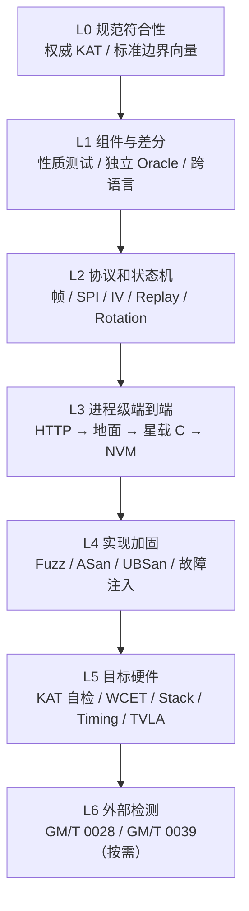

# 密码系统统一测试设计

状态：上线前强制测试合同

适用范围：地面 Go 密码系统、星载 C TC 密码模块、共享密码材料与 CCSDS TC 组合

下位专项设计：[`TC_END_TO_END_TEST_DESIGN.md`](TC_END_TO_END_TEST_DESIGN.md)

AOS 状态：任务帧格式未冻结，仅测试已实现的算法组件，不执行完整 AOS 帧发布验收

## 1. 目的和约束

本文是本项目密码测试的唯一上位合同。以后涉及密码算法、KDF、帧保护、密钥生命周期、重放、轮换、恢复、持久化或星载接口的修改，都必须按照本文选择测试集合、生成证据并通过相应门禁。专项文档可以增加测试，但不得降低本文要求。

本文使用下列含义：

- **必须**：未通过即不得提交相关代码；发布级或硬件级项目未通过即不得形成生产发布结论。
- **应当**：原则上必须执行；确因目标环境不具备条件而延期时，必须记录责任人、原因、风险和完成条件。
- **可以**：辅助诊断，不单独作为安全结论。

测试证明实现与测试依据在已覆盖条件下相符，不证明算法本身在数学上安全。覆盖率、加解密回环、随机性外观和性能测试都不能替代权威向量、独立实现差分或密码分析结论。

## 2. 当前冻结的密码合同

| 用途 | 固定合同 | 安全属性 |
| --- | --- | --- |
| 普通 TC | SM4-HCTR，16 字节 tweak，无 Tag | 保密性、宽块扩散；不声明密码学认证 |
| Recovery Root Prepare | SM4-GCM，12 字节 nonce，16 字节 Tag | 加密和认证 |
| 工作密钥派生 | SP 800-108 Counter KDF，PRF=SM4-CMAC | 从随机 SM4 Root 做确定性域隔离派生 |
| 普通 TC 工作材料 | 16 字节 SM4 key + 16 字节 HCTR hash key | 总安全强度不超过 128 位 Root |
| 星载状态保护 | live-context CRC32C/inverse、重复派生/比较、双槽 NVM | 故障检测；CRC 不提供对主动攻击者的认证 |

不允许通过测试参数临时启用旧 CTR/AES TC profile、空校验器、跳过 replay、宽松帧解析或未冻结 AOS 线格式。

## 3. 分层测试模型



- L0–L2 是密码相关代码提交的基础门禁。
- 影响真实服务、星地边界或持久化的改动必须执行 L3。
- 安全关键或大量改动必须执行 L4；短时 fuzz 用作提交门禁，长时 fuzz 用作夜间或发布门禁。
- 星载发布必须在实际目标编译器和板卡执行 L5。
- L6 只在任务或监管要求进入检测认证时执行，内部测试不得冒充认证证书。

## 4. 测试向量治理

### 4.1 向量可信度分级

每个向量必须在清单中标记来源：

1. `NORMATIVE`：正式标准或规范直接给出的已知答案；优先级最高。
2. `INDEPENDENT`：由与被测代码无共享实现的成熟密码库或参考模型产生，并经第二实现复核。
3. `INTEROP`：地面和星载共享的协议互操作向量。
4. `REGRESSION`：针对历史缺陷固定的回归向量。

`INTEROP` 或 `REGRESSION` 不得替代 `NORMATIVE`。禁止用被测实现生成期望值后再用同一实现验证。生成型向量必须记录生成工具、版本、参数、字节序和 SHA-256。

### 4.2 向量清单最小字段

```text
id, source_class, source_reference, algorithm, operation,
key, nonce_or_tweak, aad, plaintext, ciphertext, tag,
expected_status, generator, generator_version, sha256
```

飞行测试根和业务测试根只能是公开测试材料，必须明显标记 `TEST ONLY`。不得把任务真实 Root 写入仓库、测试报告或失败工件。

## 5. 算法和组件测试

### 5.1 SM4 分组密码

地面和星载必须分别执行同一组测试：

- GB/T 32907 或 GM/T 0002 的单分组加密权威 KAT；
- 对应解密 KAT；
- 标准给出时执行迭代/重复加密向量；
- 全零、全 `FF`、递增字节和 key/plaintext 单 bit 变化；
- 输入输出分离与 API 允许时的原地运算；
- `-O0`、实际发布优化选项和至少一种不同编译器构建结果一致；
- 空指针、错误长度和无效 suite 失败关闭。

不得把 `Decrypt(Encrypt(P)) == P` 作为唯一正确性证据。

### 5.2 SM4-GCM

必须纳入 RFC 8998 Appendix A.1 的 SM4-GCM 权威向量，并验证：

- ciphertext 与 16 字节 Tag 分别逐字节相等；
- authenticated decryption 恢复原文；
- 空明文、空 AAD、非空 AAD、非分组整数倍明文；
- Key、Nonce、AAD、Ciphertext、Tag 各自逐 bit 单点篡改均认证失败；
- 错误 Tag 长度和 nonce 长度拒绝；
- 认证失败输出长度为 0，输出缓冲区清零，replay/NVM 状态不推进；
- 相同 key 下 nonce 不得重复；并发、重启和计数器边界测试必须证明该约束。

应使用一个固定版本、明确支持 `SM4-GCM` 的独立库作为差分 Oracle。当前首选 OpenSSL EVP；门禁启动时必须先探测算法能力，不得静默跳过。

### 5.3 SM4-CMAC

必须验证：

- 空消息、1、15、16、17、31、32 字节及多分组消息；
- 最后分组完整时使用 K1，不完整时使用 `0x80` padding 与 K2；
- Tag 单 bit 篡改拒绝；
- 验证路径采用常量时间比较；
- 地面 Go、星载 C 和独立参考实现结果一致。

若没有正式的 SM4-CMAC 权威向量，可以使用 `INDEPENDENT` 向量，但必须由两个无共享源码的实现交叉确认并记录来源，不能标记为 `NORMATIVE`。

### 5.4 SP 800-108 Counter KDF / SM4-CMAC

固定编码为：

```text
K(i) = SM4-CMAC(
    Root,
    Counter32BE || Label || 0x00 || Context || OutputLengthBits32BE
)
```

必须验证：

- 16 字节与 32 字节输出；32 字节输出必须执行两个 counter block；
- counter 从 1 开始，长度以 bit 和大端 32 位编码；
- label/context 为空、过长或格式非法时失败关闭；
- spacecraft、direction、suite、SPI、epoch、root version 任一字段变化都改变输出；
- `TC-TRAFFIC` 与 `TC-RECOVERY-GCM` 域完全隔离；
- 地面 Go 与星载 C 逐字节一致；
- 一个独立的 SP 800-108/CMAC 参考实现给出第三方结果；
- 派生中间缓冲、CMAC Tag 和工作密钥在成功及错误路径均清零。

当前输入是均匀随机 Root，因此不增加 HKDF Extract。若以后改为 DH/SM2 协商秘密，必须重新设计并测试 Extract/Expand，不能继续把原始共享秘密直接作为 CMAC key。

### 5.5 SM4-HCTR

SM4-HCTR 是本项目定制组合，不属于 NIST ACVP 标准项目，也不能用 HCTR2、XTS 或 EME2 向量代替。测试必须固定并审查以下语义：

- 分组密码是 SM4；
- 工作材料前 16 字节为 SM4 key，后 16 字节为 universal-hash key；
- tweak 恰为 16 字节；
- 数据最小长度 16 字节；
- polynomial/hash 字节序、约简多项式、长度编码、CTR 起点和 partial-block 处理不可配置。

必须测试：

- 16、17、31、32、33、典型长度和最大 TC 数据域；
- 全零、全 `FF`、重复分组、递增字节；
- key、hash key、tweak 和 plaintext 分别单 bit 变化；
- 加解密回环、长度保持、原地/重叠缓冲区合同；
- Go 与 C 对大量确定性随机样本逐字节一致；
- 与产品源码无共享实现的简洁参考模型做差分测试；
- 所有固定向量携带规范版本和生成器哈希。

HCTR 测试只能证明实现一致，不能补足其缺少 Tag 的认证能力。普通 TC 仍必须通过正式星务明文校验，相关场景遵循下位 TC 端到端设计。

## 6. TC 协议、状态机和端到端测试

详细场景以 [`TC_END_TO_END_TEST_DESIGN.md`](TC_END_TO_END_TEST_DESIGN.md) 为准，至少覆盖：

- 完整明帧输入、完整密帧输出和真实星载 C 完整帧输入；
- 主导头长度、SPI、IV、密文、Recovery Tag 和 FECF；
- Current、Next、Recovery 独立状态；
- replay、过旧 IV、重复 IV、最大前跳和 IV 耗尽；
- `PREPARED -> SWITCHING -> ACTIVE` 地面证据链；
- Root Prepare、重启恢复 Pending Root、第一帧 Next SPI 原子提升；
- NVM 提交失败时不释放明文、不推进状态；
- 并发 IV 分配、服务重启和允许跳号但禁止重号；
- 正式明文校验器拒绝 HCTR 篡改结果；
- HTTP scope、租户隔离、未知字段和旧数据域 API 拒绝。

共享固定向量属于 L1/L2；只有真实 HTTP 服务、持久化存储、编译后的 C harness 和 NVM adapter 都实际参与，才可标记 L3 通过。

## 7. 失败关闭与故障注入

每个失败用例统一断言：

```text
status == expected_error
released_plaintext_length == 0
output_buffer contains no prior/current plaintext
replay and rotation state unchanged
NVM generation unchanged unless the intended atomic commit succeeded
logs/artifacts contain no Root, working key, token or sensitive plaintext
```

必须按受影响模块执行：

| 注入点 | 必选注入 |
| --- | --- |
| 输入帧 | 截断、超长、错误声明长度、未知 SPI、FECF bit flip |
| GCM | Key/Nonce/AAD/Ciphertext/Tag 单点篡改，重新计算 FECF 后仍失败 |
| HCTR | tweak/SPI/IV/ciphertext 篡改，正式明文规则必须关闭式拒绝 |
| Replay | 重复、过旧、窗口边界、最大前跳±1、counter 耗尽 |
| Context | 每个关键字段 bit flip，context CRC/inverse 损坏 |
| KDF | 双计算结果不一致、输入域字段损坏、输出缓冲不足 |
| NVM | magic/version/length/digest/config/CRC/inverse bit flip，半写、双槽冲突、generation 回滚 |
| 回调 | validator 拒绝、commit 失败、错误返回、另一个 context 嵌套调用 |
| 地面持久化 | 事务冲突、磁盘满、写失败、进程在分配 IV 后响应前终止 |

单粒子翻转 campaign 应使用固定 seed 可复现，并报告注入位置总数、检测数、拒绝数、未检测数及每个未检测项的影响分析。

## 8. Fuzz、Sanitizer 和静态加固

### 8.1 提交级 smoke fuzz

影响 C 帧解析、密码模式、状态或 NVM 的提交必须对以下入口执行有界 fuzz：

- `tcsec_receive`；
- `tcsec_nvm_decode`；
- `tcsec_nvm_select_latest`；
- Mission Security Profile 严格解析；
- 地面 TC HTTP JSON/Base64/完整帧解析。

语料必须包含普通 TC、Recovery、截断帧、边界长度和已知历史缺陷。提交级使用固定时长和 seed 保证可重复；发布级增加随机 seed 和更长时间。

### 8.2 C Sanitizer

主机 C harness 必须至少使用：

```text
-fsanitize=address,undefined
-fno-omit-frame-pointer
```

密码/帧解析大改动应把 sanitizer 与 coverage-guided fuzzer 组合。发现 sanitizer 报错时不得通过 suppression 隐藏项目源码问题。Sanitizer 只用于测试构建，不进入飞行二进制。

### 8.3 编译与静态规则

所有 C 构建保持：

```text
-std=c11 -Wall -Wextra -Wpedantic -Werror
```

至少验证实际飞行编译器和一种独立主机编译器。对密码代码重点检查秘密相关分支、秘密索引查表、越界、整数截断、移位、未对齐访问、未清零临时材料和被优化删除的清零。

## 9. 启动自检与目标硬件测试

### 9.1 星载密码算法自检

飞行发布前应实现模块内部 KAT，在相应算法第一次运行前完成：

```text
SM4 block KAT
  -> SM4-CMAC / KDF KAT
  -> HCTR encrypt/decrypt KAT
  -> GCM valid-tag KAT + bad-tag rejection
  -> READY
```

任一失败必须进入锁定错误态，普通 receive/reset 不得绕过。测试构建必须能受控破坏每个期望答案，证明自检失败路径真实可达。KAT 使用常量公开测试 key，运行结束后清零中间状态。

### 9.2 时间、栈和代码尺寸

目标 800 MHz CPU 使用实际编译器、优化参数和存储/NVM adapter 测量：

- 16 字节、典型帧、最大帧、最坏非法帧、Recovery 帧；
- median、p95、p99、最大值和可解释的 WCET 上界；
- 栈高水位、`.text/.rodata/.data/.bss`；
- 冷启动 KAT 时间、单次派生、解密、明文校验和 NVM commit 分项时间；
- 连续长稳运行，无堆增长、状态漂移或 counter 重用。

星务总周期为 120 ms。密码预算必须由星务任务调度正式分配；未分配前只报告数据，不得自行把平均值当成实时验收结论。

### 9.3 侧信道

当前 SM4 C 实现使用 S-box 查表。目标 CPU 若有数据缓存，必须评估秘密索引导致的 cache timing 风险；无缓存也不能据此排除功耗/电磁泄漏。

- 至少在目标 CPU 运行固定/随机输入的 timing leakage 检测，并记录样本数、环境和统计阈值；
- 测试未发现泄漏不等于证明恒定时间；
- 若任务威胁模型包含物理接触、近场探测或高价值长期 Root，必须执行功耗/电磁 TVLA，并按结果决定 bitslice、恒定时间 S-box、掩码或硬件指令实现；
- 若明确不包含物理侧信道威胁，必须形成风险接受记录，不能仅以“星上环境安全”代替分析。

## 10. 覆盖率和测试质量

- 地面 TC 相关 Go 语句覆盖率必须 `>=95%`；
- 星载密码 C 行覆盖率必须 `>=95%`；
- 新增安全分支必须有正向和负向断言，即使总体覆盖率已经超过门槛；
- 不得排除难测的错误路径、降低阈值或写无断言测试来满足数字；
- 外部库、生成代码和纯声明可不纳入分母，但排除项必须固定并说明；
- mutation/fault campaign 的存活项必须人工审查，不能只报告覆盖率。

## 11. 变更触发矩阵

| 变更类型 | 提交前最小集合 | 发布前附加集合 |
| --- | --- | --- |
| 文档、注释且不改变合同 | 链接/格式/一致性检查 | 无 |
| 非密码 UI 展示 | 相关前端测试与 build | 完整 release gate |
| SM4/CMAC/GCM/HCTR/KDF | L0、L1、相关 L2、ASan/UBSan、smoke fuzz、95% | 长时 fuzz、独立 Oracle 全量差分、L5 |
| TC 帧格式/API | L1、L2、L3、拒绝矩阵、95% | 目标链路/HIL |
| Replay/轮换/NVM/数据库 | L2、L3、故障注入、并发/重启、95% | 掉电/磁盘满/物理 NVM |
| Root/TPM/权限/审计 | 单元、集成、越权、泄漏扫描、L3 | 物理 TPM、恢复演练 |
| 大量或跨边界改动 | 完整 `make release-gate` 加对应加固测试 | 长时与目标硬件门禁 |

若表中要求的 runner 尚不存在，相关代码变更必须先实现 runner，不能以“当前项目未支持”为理由跳过。AOS 完整帧测试是唯一已批准的格式冻结前例外；算法组件测试不在例外范围内。

## 12. 执行入口和证据

统一发布入口为：

```bash
cd baseline
make release-gate
```

门禁必须失败即停，并生成机器可读证据。最终证据至少包含：

- Git commit、dirty 状态、源码清单 SHA-256；
- 编译器、Go、OpenSSL/Oracle 版本和目标架构；
- 运行的测试层级、用例数、失败数和跳过原因；
- 权威与独立向量清单 SHA-256；
- Go/C 覆盖率；
- sanitizer 和 fuzz 的运行时长、seed、语料哈希和 crash 数；
- 端到端结果、故障注入摘要；
- 目标硬件性能、栈和侧信道结果（发布时）；
- 明确的未完成项，不得用总体 `passed` 掩盖局部门禁未执行。

允许在 `.vscode/sftp.json` 配置的远程工程目录执行主机门禁。不得把源码传到未配置的 `/tmp`，不得在输出中泄露远程凭据。

## 13. 当前基线与缺口

截至本文建立时：

| 项目 | 状态 |
| --- | --- |
| Go/C 共享普通 HCTR 与 Recovery GCM 互操作向量 | 已有 |
| HTTP API 生成完整密帧并与星载向量比较 | 已有 |
| Replay、Next promotion、Recovery、NVM 双槽负向测试 | 已有 |
| Go/C 95% 覆盖率门禁、前端测试/build、发布哈希证据 | 已有 |
| GB/T/GM/T SM4 单分组权威 KAT | **待补 P0** |
| RFC 8998 SM4-GCM 权威 KAT | **待补 P0** |
| SM4-GCM 独立 OpenSSL Oracle 差分 | **待补 P0** |
| 与产品无共享实现的 HCTR 参考模型和批量差分 | **待补 P0** |
| ASan/UBSan 自动门禁和有界 fuzz runner | **待补 P0** |
| 星载启动 KAT 与失败锁定 | **待补 P0（飞行发布前）** |
| 自动 context/NVM/状态 bit-flip campaign | **待补 P1** |
| 目标板 WCET、栈高水位、编译器交叉验证 | **待补 P1（飞行发布前）** |
| 目标 CPU timing leakage/按威胁模型的 TVLA | **待补 P1/P2** |
| 真实物理 TPM、NVM 掉电与基带/射频 HIL | **待补发布验收** |
| 完整 AOS 帧测试 | 等待任务 AOS 格式冻结 |

因此当前证据可支持“星地功能互操作与已有代码覆盖率达标”，尚不能表述为“密码算法已完成权威验证”“星载实现已完成侧信道评估”或“产品已通过 GM/T 检测认证”。

## 14. 完成定义

一次密码相关代码交付只有在以下条件满足后才可提交：

- 触发矩阵要求的层级全部执行并通过；
- 新行为有独立期望值，安全失败路径有明确断言；
- 95% 门禁保持且未削弱；
- 没有 sanitizer 错误、fuzz crash 或未解释的差分；
- 密钥、明文、凭据和中间材料未进入日志或工件；
- 测试证据能够绑定当前源码和向量；
- 未执行的目标硬件/认证项目被明确标为发布阻塞项。

一次飞行候选发布还必须完成目标板 KAT 自检、实际编译器/板卡资源与时间测试、物理 NVM 故障恢复，以及威胁模型要求的侧信道测试。

### ARMv7 SM4 加速门禁

星载构建在 ARMv7 目标上默认编译 `ARMv7/NEON + software` 两个 SM4 后端。运行时在 Linux 使用 `AT_HWCAP/HWCAP_NEON`，在裸机或 RTOS 使用编译器提供的 NEON 目标能力，自动选择后端；能力不存在时必须选择 software。调用方不得选择后端，HCTR、GCM 与 KDF 共用 SM4 模块的内部调度。

每个 ARMv7 飞行候选必须增加以下目标板证据：

- 强制 software 与自动选择路径分别执行 SM4、HCTR、GCM、KDF KAT，输出逐字节一致；
- NEON 可用时断言诊断后端为 `armv7-neon`，不可用时断言为 `software`；
- 非 NEON ARMv7 板不得产生非法指令；
- 测量普通 TC 解密端到端 WCET、单分组 SM4 和长帧吞吐，报告相对 software 的提升；
- 对汇编后端单独执行寄存器清理审查、已知/随机差分测试和侧信道测试。

CI 若没有 ARMv7 交叉编译器与 QEMU，只能验证 software 回退，不能把 x86 结果作为汇编后端合格证据。ARMv7 汇编代码发生变化时，目标板证据是发布阻断项。

## 15. 规范和测试依据

- GB/T 32907-2016《信息安全技术 SM4 分组密码算法》
- GM/T 0002《SM4 分组密码算法》
- NIST SP 800-38B，CMAC
- NIST SP 800-38D，GCM/GMAC
- NIST SP 800-108 Rev.1，PRF-based KDF
- RFC 8998 Appendix A，SM4-GCM 测试向量
- RFC 5869，HKDF（仅在未来输入变为非均匀共享秘密时适用）
- FIPS 140-3 / ISO/IEC 19790 / ISO/IEC 24759 的密码模块自检思想
- GM/T 0028-2024《密码模块安全要求》
- GM/T 0039-2024《密码模块安全检测要求》
- LLVM AddressSanitizer、UndefinedBehaviorSanitizer 与 coverage-guided fuzz 文档
