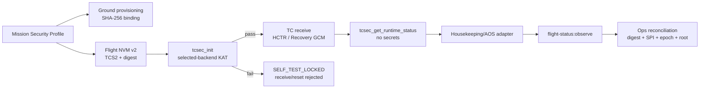

# 星载密码运行闭环

本文定义当前版本已经实现的最小运行闭环。AOS 完整帧格式仍未冻结；本文只固定状态语义和内部 API，不规定状态在 AOS 数据域中的封装位置。

## 星务需要提供

- `validate_plaintext`：按冻结的遥控包规则做严格明文判定；不得执行指令。
- `commit_state`：原子持久化 replay、epoch promotion 或 Root Prepare；成功前不得释放明文。
- `monotonic_time_us`：单调微秒时钟，仅用于处理耗时和时钟异常计数。
- NVM BSP：双槽擦写、原子写入、读回验证及可信 generation 下限。
- Housekeeping/AOS adapter：调用 `tcsec_get_runtime_status`，把语义字段放入最终冻结的遥测载荷。

## 密码模块内部完成

- 实际选中 SM4 后端的 SM4、CMAC-KDF、HCTR、GCM 启动 KAT；
- KAT 失败锁定，`receive/reset` 均不可绕过；
- Current/Next 自动一致化、Recovery GCM Root Prepare、replay 与最大前跳；
- Mission Profile 摘要运行绑定；`reset` 不允许静默切换摘要；
- receive 次数、最近/最大耗时、120 ms 整周期上限超限次数、时钟倒退次数；
- 单坏槽时生成下一 generation 的修复镜像，由 BSP 写回。

## 地面自动判断

地面持久化唯一 Mission Profile 摘要。收到星载状态后自动比较：

- Profile digest；
- self-test 与后端；
- Current SPI、Next SPI、Recovery SPI；
- security epoch、root version；
- 周期超限与时钟异常。

任何不一致进入 `MISMATCH/DEGRADED` 并在英文运维面展示。状态接口不包含 Root、working key、nonce prefix 或 replay bitmap。

## 发布门禁

`make release-gate` 强制执行：

1. 全量 Go、星载 C 和运维 CLI/API 测试；
2. 星载 C 行覆盖率不低于 95%，地面 TC Go 语句覆盖率不低于 95%；
3. ARMv7 hard-float/NEON 交叉编译；
4. QEMU 执行完整星载 TC/Recovery 测试；
5. 128 组 HCTR 加解密与 128 组 KDF 的 Go → x86 C → ARMv7 NEON 三路差分；
6. 输出 `build/release/release-evidence.json`。

真实板卡 WCET、物理 NVM 掉电、EDAC/MPU/watchdog 和侧信道测试仍属于发布验收，不由 QEMU 证据替代。
