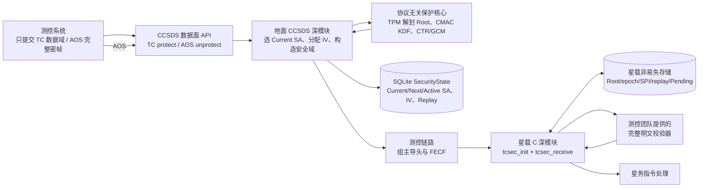
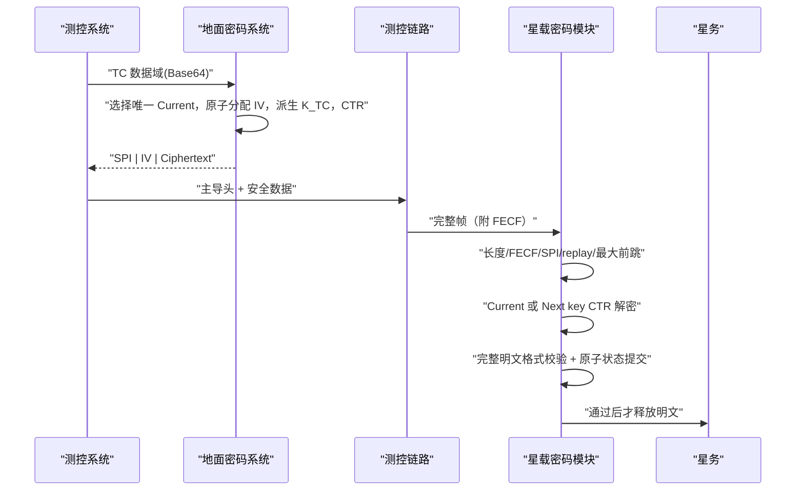

# TC 地面—星载架构与流程

## 架构



星载模块不感知租户、TPM、数据库、HTTP、审批、人员权限、AOS 或地面密钥生命周期；它只感知 TC 帧结构、Current/Next/Recovery、派生上下文、重放状态、FECF、明文校验和原子持久化结果。

## 普通 TC 加解密



## 星载最小公开接口

```c
tcsec_status_t tcsec_init(tcsec_context_t *context,
                          const tcsec_config_t *config,
                          tcsec_plaintext_validator_fn validate_plaintext,
                          tcsec_state_commit_fn commit_state,
                          void *user_context);

tcsec_status_t tcsec_receive(tcsec_context_t *context,
                             const uint8_t *frame,
                             size_t frame_length,
                             uint8_t *plaintext,
                             size_t plaintext_capacity,
                             tcsec_result_t *result);

void tcsec_clear(tcsec_context_t *context);
```

工作密钥槽是 `Current / Next / Recovery`；另有 Pending Root 状态但不增加普通可接收 SPI。不存在 Previous 或 Grace 槽。
