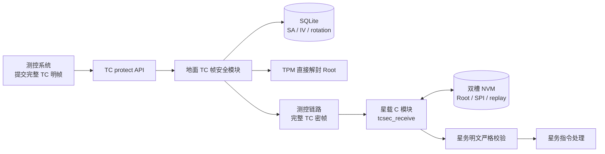
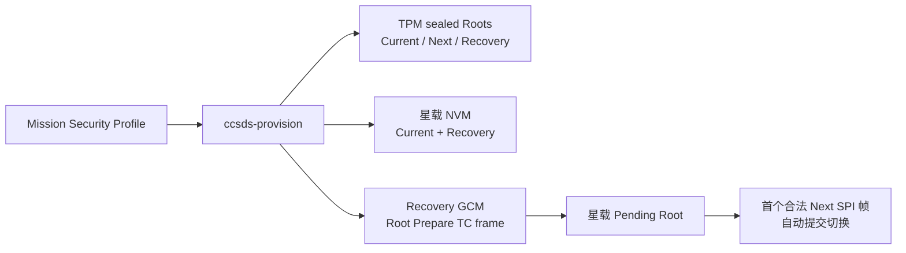
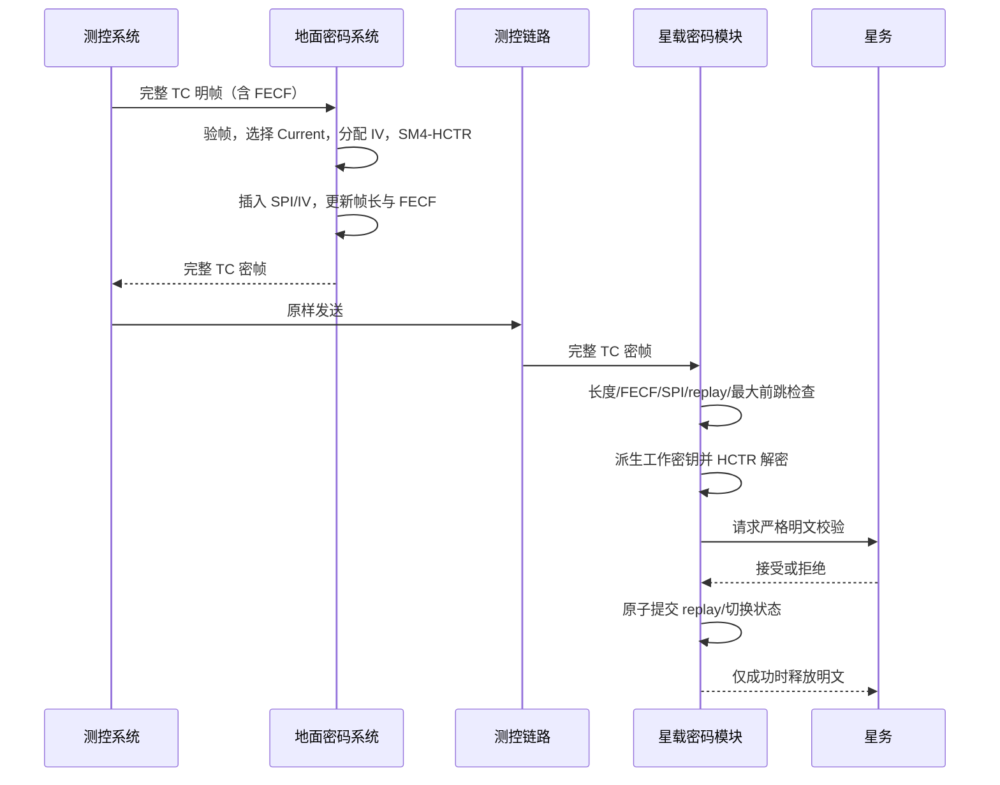

# TC 地面—星载架构与流程

## 架构



星载模块不感知租户、TPM、数据库、HTTP、审批、人员权限、下行密钥或地面密钥生命周期。它只感知 TC 帧结构、Current/Next/Recovery、派生上下文、重放状态、FECF、明文校验回调和原子持久化结果。

明文规则来自测控团队冻结的遥控包 ICD，但校验实现属于星务软件。必选规则与职责以 [TC_PLAINTEXT_VALIDATION_DESIGN.md](TC_PLAINTEXT_VALIDATION_DESIGN.md) 为准。

## 配置、装星与轮换

Mission Security Profile 是星地 TC 配置的唯一源。`ccsds-provision` 严格解析一次受控输入，直接 TPM 封装 Current/Next/Recovery Root，并生成初始星载双槽 NVM、完整 Recovery Root Prepare 帧和不含明文密钥的哈希证据。不存在中间 CRK/SWK。



地面轮换状态为 `PREPARED → SWITCHING → ACTIVE`。星上收到首个合法 Next SPI 密文后自动提交 Pending Root，不新增测控链路管理指令。普通接收槽只有 Current/Next/Recovery，不存在 Previous 或 Grace。

## 普通 TC 加解密



## 星载最小公开接口

```c
tcsec_status_t tcsec_init(tcsec_context_t *context,
                          const tcsec_config_t *config,
                          const tcsec_callbacks_t *callbacks);

tcsec_status_t tcsec_receive(tcsec_context_t *context,
                             const uint8_t *frame,
                             size_t frame_length,
                             uint8_t *plaintext,
                             size_t plaintext_capacity,
                             tcsec_result_t *result);

tcsec_status_t tcsec_reset(tcsec_context_t *context,
                           const tcsec_config_t *config);

void tcsec_deinit(tcsec_context_t *context);
```

每个独立接收状态机使用一个 `tcsec_context_t`。模块无可变全局状态，不同 context 可并发；同一 context 必须由星务串行调用，回调不得重入同一 context。`tcsec_reset` 用完整有效 NVM 快照重载状态并保留初始化时绑定的回调；失败时旧 context 继续可用，接口本身不清 replay、不写 NVM。
