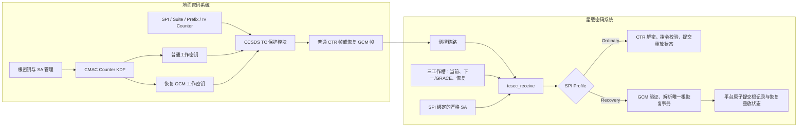
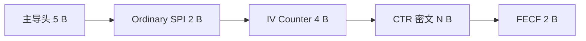
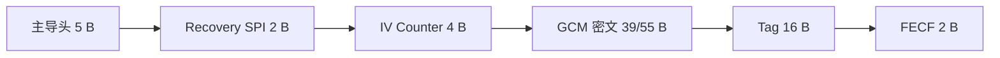
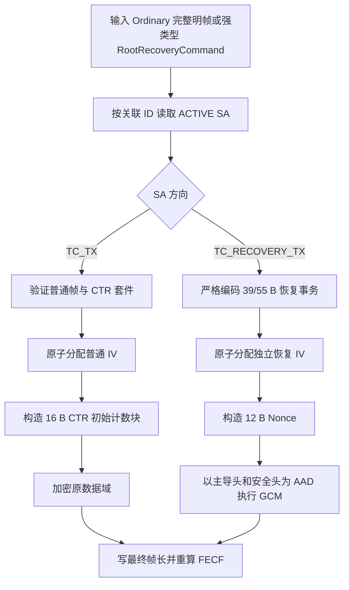
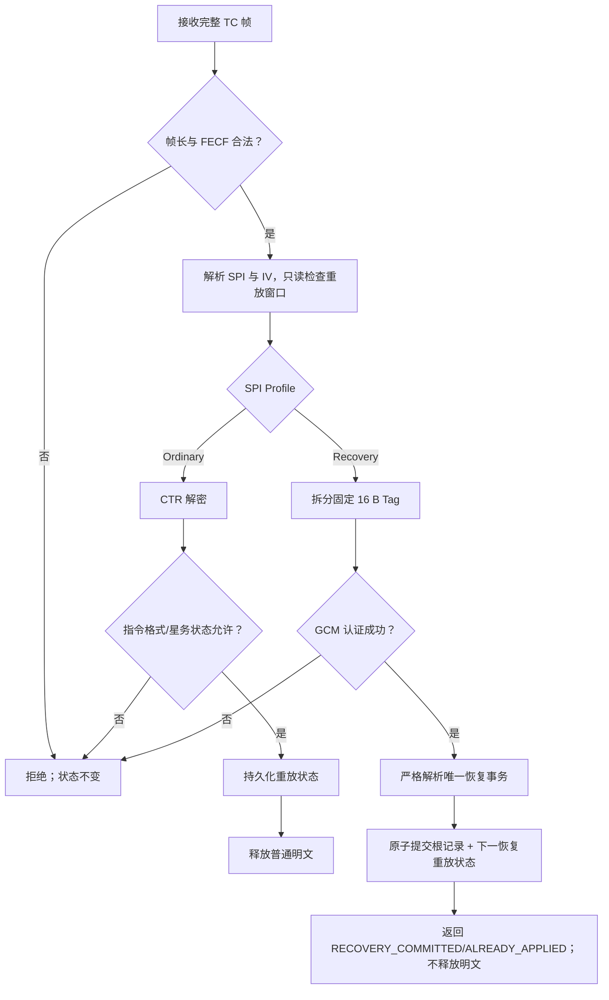

# TC 地面与星载密码系统架构及流程

## 1. 架构

星载不感知租户、数据库、管理接口、通用密钥上传下载或动态算法注册。它只感知固定 SA、三个工作槽、帧密码处理、重放状态，以及平台提供的原子根记录适配器。

## 2. 两种帧

普通 TC 无 Tag：

根恢复 TC 使用全长 Tag：

两者安全头都固定为 `SPI[2] || IV_COUNTER[4]`。SPI 在解密前唯一确定完整 Profile，不存在 `with_tag`、空 Tag 或自动探测。

## 3. 地面保护流程

## 4. 星载接收流程

普通 CTR 只提供机密性；FECF 与 IV 窗口不构成密码学认证。只有专用 Recovery SPI 的 GCM 帧具备完整性和来源认证能力，且只授权根恢复事务。
