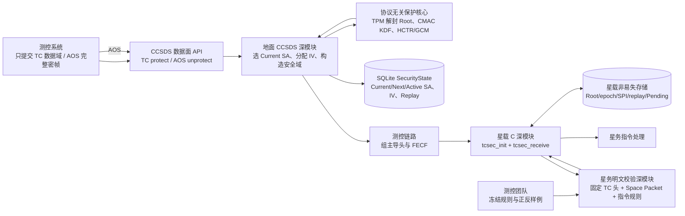
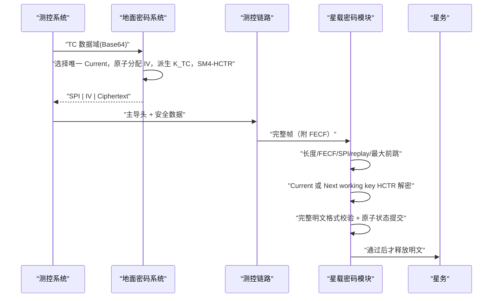

# TC 地面—星载架构与流程

## 架构



星载模块不感知租户、TPM、数据库、HTTP、审批、人员权限、AOS 或地面密钥生命周期；它只感知 TC 帧结构、Current/Next/Recovery、派生上下文、重放状态、FECF、明文校验和原子持久化结果。

明文校验规则来源于测控团队冻结的遥控包 ICD，但校验实现属于星务软件。必选字段、关闭式解析、职责和发布门禁统一以 [`TC_PLAINTEXT_VALIDATION_DESIGN.md`](TC_PLAINTEXT_VALIDATION_DESIGN.md) 为唯一开发依据。

## 普通 TC 加解密



## 星载最小公开接口

```c
typedef struct {
    tcsec_plaintext_validator_fn validate_plaintext;
    tcsec_state_commit_fn commit_state;
    void *user_context;
} tcsec_callbacks_t;

tcsec_status_t tcsec_init(tcsec_context_t *context,
                          const tcsec_config_t *config,
                          const tcsec_callbacks_t *callbacks);

tcsec_status_t tcsec_receive(tcsec_context_t *context,
                             const uint8_t *frame,
                             size_t frame_length,
                             uint8_t *plaintext,
                             size_t plaintext_capacity,
                             tcsec_result_t *result);

tcsec_status_t tcsec_reset(tcsec_context_t *context,
                           const tcsec_config_t *config);

void tcsec_deinit(tcsec_context_t *context);
```

工作密钥槽是 `Current / Next / Recovery`；另有 Pending Root 状态但不增加普通可接收 SPI。不存在 Previous 或 Grace 槽。

星务为每个独立接收状态机分配一个 `tcsec_context_t`。模块没有可变全局状态，不同 context 可并发或嵌套调用；同一 context 包含 replay/切换状态，必须由星务串行调用，回调不得重入同一 context。

`tcsec_reset` 只用于用完整 NVM 快照重新装载同一个 context，并保留 `init` 时绑定的校验和持久化 adapter。新快照验证或派生失败时旧 context 保持可用；该接口不自行清空 replay，也不写 NVM。
