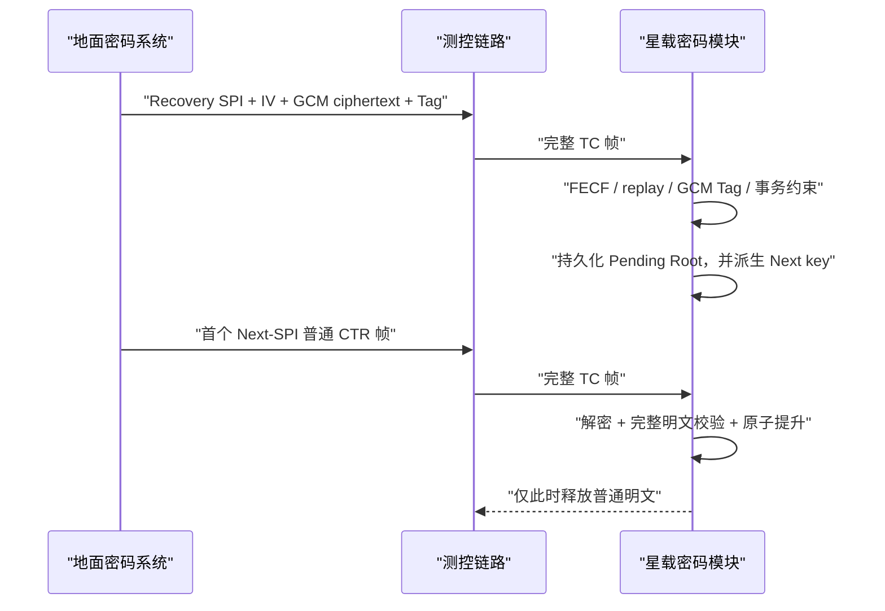

# TC Recovery GCM：Root Prepare

Recovery 是与普通 CTR TC 隔离的低频恢复通道，只接受一种强类型事务：为严格相邻的 Next SPI 准备新的 Operational Root。它不承载普通遥控指令，也不直接激活新 Root。

## Root Prepare 明文

```text
format_version                 1 byte   固定为 1
transaction_id                8 bytes  非零
expected_current_root_version 4 bytes
new_root_version              4 bytes  必须更大
next_security_epoch           4 bytes  必须等于 current epoch + 1
next_spi                      2 bytes  必须等于 (current SPI + 1) mod 65536
ordinary_suite                2 bytes  AES_256_CTR 或 SM4_CTR
new_operational_root         32/16 bytes
```

明文总长固定为 AES 57 字节或 SM4 41 字节。SPI 的合法范围是完整的
`0x0000..0xFFFF`，其中 `0xFFFF` 的相邻 Next SPI 是 `0x0000`；Security Epoch
仍必须严格加一。任何未知版本、额外尾随字节、非 CTR 套件、Root 长度不匹配、
非相邻 epoch/SPI 或当前版本不匹配均关闭式拒绝。

## 两阶段生效



Root Prepare 成功只写入 Pending。真正激活发生在第一个可正确解密且通过完整明文校验的 Next-SPI 普通帧。这样不需要确认帧或第二条激活指令。

## 掉电一致性

持久化适配器必须原子存储 Root Prepare 的完整事务、Recovery replay state 与 Pending Root。`tcsec_init` 支持恢复 Pending Root、Pending Suite、Root Version 和 Transaction ID，并重新派生 Next key。因此在 Root Prepare 与首个 Next 帧之间掉电不会遗失准备状态。

Next 提升提交必须原子完成：更新 Current SPI/Epoch/Root/Suite/replay，清除 Pending，并将原 Next key 提升为 Current。持久化失败时模块清零本次明文且不改变内存状态。

## 隔离要求

- Operational Root 和 Recovery Root 独立，Recovery Root 不派生普通流量密钥。
- Recovery 使用独立 SPI、nonce prefix、IV allocator 和 replay state。
- GCM AAD 固定为 6 字节 `SPI | IV`，Tag 固定 16 字节。
- Recovery 明文永不复制到普通输出缓冲区。
- 普通测控数据面 API 不暴露 Root Prepare。
