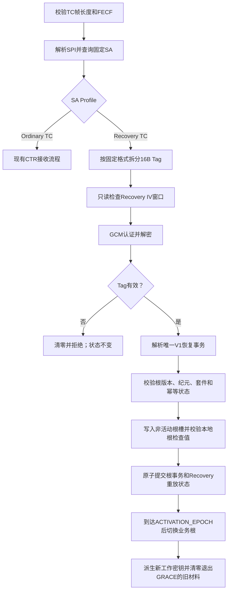

# TC 高可恢复安全 Profile 设计

状态：已实施（平台需提供原子 Flash/安全存储适配器）。

## 1. 目标与边界

系统保留两个互斥、由 SPI 唯一选择的 TC Profile：

| Profile | 允许用途 | 套件 | Tag |
|---|---|---|---:|
| Ordinary TC | 普通遥控指令 | `AES_256_CTR` 或 `SM4_CTR` | 0 B |
| Recovery TC | 唯一的根密钥恢复事务 | `AES_256_GCM` 或 `SM4_GCM` | 16 B |

Recovery TC 不为普通指令增加可选 Tag，也不建立通用密钥上传、密钥下载或远程管理通道。一个 Recovery SPI 在整个 SA 生命周期内固定绑定一个 GCM 套件、恢复密钥版本、Nonce 前缀和重放状态。任务配置可以选择 AES 或 SM4，但一个 SPI 下不存在运行时算法协商。

## 2. 帧格式

普通 TC 保持不变：

```text
TC_PRIMARY_HEADER[5]
|| ORDINARY_SPI[2]
|| IV_COUNTER[4]
|| CTR_CIPHERTEXT[N]
|| FECF[2]
```

恢复 TC 为：

```text
TC_PRIMARY_HEADER[5]
|| RECOVERY_SPI[2]
|| IV_COUNTER[4]
|| GCM_CIPHERTEXT[N]
|| GCM_TAG[16]
|| FECF[2]
```

两种 Profile 的安全头均严格固定为六字节：

```text
SPI[2] || IV_COUNTER[4]
```

Tag 是 Recovery TC 的安全尾，不属于六字节安全头。最终 TC 帧长度上限仍为 1024 B，因此 Recovery TC 的最大明文长度为：

```text
1024 - 5 - 6 - 16 - 2 = 995 B
```

FECF 在密码处理完成后计算，覆盖除 FECF 自身以外的最终帧，包括 GCM Tag。FECF 不进入 GCM AAD，也不承担认证职责。

## 3. GCM 构造

Recovery TC 使用 12 字节 Nonce：

```text
RECOVERY_NONCE_PREFIX[6] || RECOVERY_SPI[2] || IV_COUNTER[4]
```

GCM AAD 为：

```text
TC_PRIMARY_HEADER[5] || RECOVERY_SPI[2] || IV_COUNTER[4]
```

GCM 加密并认证完整的 Root Recovery Transaction。任何主导头、SPI、IV、密文或 Tag 修改都会导致认证失败。每个 Recovery SA 维护独立的 32-bit IV Counter；地面原子分配，星载在认证成功且恢复事务持久化成功后才原子提交接收状态。

不允许缩短 16 字节 Tag。恢复指令数量极少，缩短 Tag 没有有意义的带宽收益。

## 4. 根密钥与三工作槽

根密钥存储和工作槽是两个不同概念：

```text
受保护根存储：
  OP_ROOT_A        当前或待机业务根
  OP_ROOT_B        待机或当前业务根
  RECOVERY_ROOT    独立、只用于恢复且不可通过TC替换

工作密钥槽：
  SLOT_0           当前 Ordinary TC 工作密钥
  SLOT_1           下一把或 GRACE Ordinary TC 工作密钥
  SLOT_2           Recovery TC GCM 工作密钥
```

工作密钥使用 CMAC Counter KDF 确定性派生：

```text
K_ordinary = KDF-CMAC(
    OPERATIONAL_ROOT,
    label   = "TC-TRAFFIC",
    context = spacecraft_id || direction || suite_id || SPI
              || security_epoch || key_version,
    L       = suite_key_bits
)

K_recovery = KDF-CMAC(
    RECOVERY_ROOT,
    label   = "TC-RECOVERY-GCM",
    context = spacecraft_id || recovery_suite_id || RECOVERY_SPI
              || recovery_key_version,
    L       = recovery_suite_key_bits
)
```

AES 与 SM4 采用同一规范化输入编码，但使用与根类型匹配的 AES-CMAC 或 SM4-CMAC。所有整数使用大端序，所有字符串使用固定 ASCII 字节和显式长度，禁止依赖 C 结构体内存布局。

Recovery Root 必须独立于 Operational Root。业务根泄露、损坏或派生状态失步时，Recovery TC 仍必须可验证。

## 5. 唯一恢复事务格式

Recovery SPI 本身就是命令类型，因此密文中不再放置可扩展操作码。解密后只接受以下严格 V1 结构：

```text
FORMAT_VERSION[1]                 = 0x01
TRANSACTION_ID[8]
EXPECTED_CURRENT_ROOT_VERSION[4]
NEW_ROOT_VERSION[4]
ACTIVATION_EPOCH[4]
ORDINARY_SUITE_ID[2]              = AES_256_CTR 或 SM4_CTR
NEW_OPERATIONAL_ROOT[16 或 32]    = 长度由套件唯一确定
```

总明文长度必须精确等于套件对应的 39 B 或 55 B。禁止尾随扩展、空值、未知版本、未知套件和隐式默认值。

约束：

- `TRANSACTION_ID` 非零，并用于掉电或下行丢失后的幂等判定；
- `EXPECTED_CURRENT_ROOT_VERSION` 必须等于星载当前版本；
- `NEW_ROOT_VERSION` 必须严格递增；
- `ACTIVATION_EPOCH` 必须严格大于星载已提交的最高安全纪元；
- 新根只能写入非活动 Operational Root 槽；
- Recovery Root 不是事务目标，不能在线替换；
- Recovery TC 不允许承载普通指令或任意长度数据。

该事务是一条受限的单向业务根恢复路径，不是通用 key upload。星载永不返回根密钥或工作密钥。

## 6. 星载处理顺序



认证失败、结构失败、版本冲突、存储失败和派生失败均不得推进 Recovery IV、根版本或安全纪元。

## 7. 掉电一致性与幂等

平台持久化适配器必须把以下内容作为一个原子恢复记录提交：

```text
transaction_id
inactive_root_slot
new_root_version
activation_epoch
ordinary_suite_id
encrypted_or_hardware-protected_root_record
next_recovery_highest_iv
next_recovery_replay_bitmap
record_integrity_check
commit_marker
```

掉电规则：

- `commit_marker` 前掉电：启动后继续使用旧根，忽略不完整记录；
- 提交后、激活前掉电：启动后恢复为 PENDING，等待既定纪元；
- 激活后掉电：启动时从最高已提交纪元选择活动根；
- 地面用新 IV 重发相同 `TRANSACTION_ID`：星载返回已提交结果，不重复安装，但原子推进新帧的 Recovery 重放状态；
- 相同事务 ID 携带不同内容：永久拒绝并记录安全事件。

## 8. 模块接口与 seam

地面 CCSDS 模块提供两个明确入口，不提供 `with_tag` 布尔参数：

```text
ProtectTC(clear_frame, ordinary_association)
ProtectRootRecovery(primary_header, command, recovery_association)
```

`ProtectRootRecovery` 只接受 5 字节主导头和强类型 Root Recovery Transaction，不能接收任意字节作为普通业务数据；模块负责最终帧长、安全头、Tag 和 FECF。

星载 TC 接收模块继续只有一个外部接口：

```text
tcsec_receive(context, complete_frame, normal_plaintext, result)
```

SPI 在模块内部选择 Profile。Ordinary TC 成功时返回普通明文；Recovery TC 成功时调用根密钥管理模块并返回 `RECOVERY_COMMITTED` 结果，`normal_plaintext_length` 必须为零，恢复明文永不越过普通星务接口。

根密钥管理模块提供一个窄接口：

```text
commit_authenticated_recovery(typed_transaction, next_replay_state)
```

生产适配器实现原子 Flash/安全存储事务，测试适配器使用内存故障注入。GCM 验证、严格解析、授权和状态顺序保留在 TC/根密钥深模块内，不下放给调用者。

## 9. SA 与状态约束

Recovery SA：

- 使用专用且不会与 Ordinary TC 重复的 SPI；
- 套件只能是 `AES_256_GCM` 或 `SM4_GCM`；
- `transmitted_iv_length = 4`；
- `tag_length = 16`；
- `nonce_prefix_length = 6`；
- 独立维护 Recovery IV Counter 和 64-bit replay bitmap；
- 默认 `ACTIVE`，但只授权唯一恢复事务；
- 不参与 Ordinary TC 的 ACTIVE/GRACE 轮换。

Ordinary SA 继续只能使用 `AES_256_CTR` 或 `SM4_CTR`，且 `tag_length = 0`。不存在“同一个 SPI 有时带 Tag、有时不带 Tag”的状态。

## 10. 地面权限与审计

生成 Recovery TC 必须经过独立的恢复权限、双人复核和幂等事务号。审计只记录：

```text
spacecraft_id
recovery_spi
transaction_id
old_root_version
new_root_version
activation_epoch
ordinary_suite_id
frame_hash
result_status
```

日志、审计、AOS 状态和错误响应不得包含根密钥、派生工作密钥、GCM Key 或恢复明文。

## 11. AOS 恢复状态

AOS 只报告非敏感状态：

```text
transaction_id
pending_root_version
active_root_version
activation_epoch
active_ordinary_spi
recovery_status
```

AOS 不下载任何密钥。若 AOS 尚未采用认证保护，其状态只能作为操作提示，地面仍以既定激活纪元和后续可验证链路结果判断切换是否完成。

## 12. 明确排除

V1 不实现：

- 普通 TC 可选 Tag；
- 根据明文指令类型猜测 Tag 长度；
- 通用星地密钥 upload/download；
- Recovery Root 在线替换；
- 任意远程密钥读取；
- 可变或截断 GCM Tag；
- 未知字段透传、旧格式兼容或隐式默认值；
- Tag 失败后的重放状态推进；
- 通过连续失败次数永久锁死 Recovery SA。

## 13. 实现位置

- 地面严格 SA、事务编码、KDF 与帧生成：`internal/protocol/ccsds`；
- 地面持久化约束和独立 IV Counter：Postgres migration 007 与 CCSDS repository；
- 星载 AES/SM4 CTR、GCM、KDF、SPI 分派和原子恢复 seam：`embedded/tc_security`；
- 星地共享向量：`testdata/ccsds_tc_*`；
- 平台仍须实现 `tcsec_recovery_commit_fn`，将双 Operational Root 记录与传入的下一重放状态一次原子提交。模块不会提供非原子的兼容回退。
