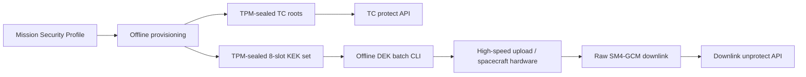

# CCSDS 链路安全当前合同

## 边界

当前系统只有两个独立运行面：

- TC uplink：地面接收完整 TC 明帧，使用 Current/Next 的 SM4-HCTR 或 Recovery 的 SM4-GCM，返回完整密帧；星载 C 模块完成对称解密。
- Raw downlink：数传硬件使用 1024 个 SM4-GCM DEK 之一加密，地面在 Tag 验证成功后返回明文。

AOS 帧格式尚未冻结。未来 AOS 只允许作为 Raw downlink 外层的解析/组帧适配器，不得引入第二套密钥、轮换、重放或数据库状态。

## 隔离关系

TC 与下行共享部署进程、审计和身份基础设施，但不共享密钥、密码状态或接口。协议 Root 和 KEKSet 均直接由 TPM 封装；不存在 CRK、SWK 或下行 KDF。

## 在线 API

| Plane | Endpoint | Scope |
|---|---|---|
| Data | `POST /api/v1/tc:protect` | `ccsds:tc:protect` |
| Data | `POST /api/v1/downlink:unprotect` | `ccsds:downlink:unprotect` |
| Data | `POST /api/v1/flight-status:observe` | `ccsds:downlink:unprotect` |
| Ops (loopback only) | `GET /ops/v1/status` | `ops:read` |

在线接口不提供 Root、KEK、DEK、nonce prefix、计数器或轮换写操作。所有密钥初装与下行批次推进均由离线命令完成。

每次普通 TC protect 调用都是新的密码操作并分配新 IV Counter。链路重传可重新提交同一完整明帧，但必须保留原 TC 帧序列号；星载 TC 接收/FARM 层负责序列号去重。密码模块不实现请求幂等、密帧缓存或业务指令重复判断。

## 固定线格式

普通 TC、Recovery TC 及星载接口以 `docs/TC_GROUND_FLIGHT_ARCHITECTURE.md` 和测试向量为准。数传上注和下行 RAW 格式以 `docs/DOWNLINK_KEY_USER_MANUAL.md` 为准。

实现不保留旧 AOS API、AOS Security Association、AOS replay store、CRK 表或旧 schema 兼容路径。数据库 schema version 3 是唯一接受版本。
