# 星务端密码模块接口手册

## 星务密码模块接入总览

星务接入的主流程是上电恢复安全状态、初始化模块、逐帧接收并按返回状态处理结果。密码模块负责 TC 安全处理，星务通过初始化时注册的回调接入自己的持久化服务，并负责业务指令执行。

| 星务接入项 | 接入约定 |
| --- | --- |
| 上电与初始化 | 调用 `tcsec_init`，注册回调并由模块加载持久化配置。收到 `TCSEC_OK` 后开放 TC 接收。 |
| 逐帧接收 | 每帧调用 `tcsec_receive`。普通帧仅在返回 `TCSEC_OK` 或 `TCSEC_EPOCH_PROMOTED` 后交付业务校验。Recovery 成功只产生管理事件。 |
| 存储与计时 | 板级集成人员提供回调。密码模块在初始化和复位时加载状态，在收帧时同步提交状态。 |
| 运行与复位 | 按需读取运行诊断。需要重载时，在帧间调用 `tcsec_reset`。模块与星务计算机保持相同运行生命周期。 |

本手册覆盖星务侧遥控（TC）接收、恢复通道换根准备、状态持久化和运行诊断。函数声明和结构定义以对应头文件为准。

### 术语

| 术语 | 含义 |
| --- | --- |
| 安全关联（SA） | 星地共同使用的一组帧保护参数和运行状态，包括算法、所用密钥、SPI 及 IV 或重放窗口。普通关联还包括安全代次。 |
| 安全参数索引（SPI） | 内部保存的 16 位逻辑关联编号，参与工作密钥和 nonce 派生。空口使用安全代次模 3 得到的 2 位选择值；完整 SPI 不在帧中发送。 |
| 当前、下一和恢复关联（Current、Next、Recovery） | Current 处理当前普通遥控，Next 处理下一安全代次的普通遥控，Recovery 处理已认证的换根准备。 |
| 恢复通道换根准备（Recovery Root Prepare） | 在恢复安全关联上认证并保存待生效的业务根密钥。它在下一安全关联切换时生效。 |
| 根密钥与工作密钥 | 根密钥由星地保管。工作密钥由根密钥与关联参数派生，用于实际的帧保护运算。 |
| 安全代次（epoch） | 普通安全关联的轮换序号。每次 Next 成为 Current 时加 1，参与普通工作密钥派生。 |
| 板级支持包（BSP）与非易失存储器（NVM） | BSP 为星务提供访问板载存储、计时器等硬件的能力。NVM 在掉电后保留数据。 |

## 模块职责

| 功能 | 密码模块职责 | 星务/BSP 职责 |
| --- | --- | --- |
| 当前安全关联遥控 | SM4-GCM 认证解密，先持久预留验证额度，再持久化重放状态，成功后交付明文 | 校验业务明文，通过后执行指令 |
| 下一安全关联遥控 | 认证解密后按编译链接的任务规则校验；通过后原子切换并交付明文 | 识别切换结果，执行业务联锁 |
| 恢复通道遥控 | SM4-GCM 认证解密，解析换根准备事务 | 原子持久化待生效根和重放状态 |
| 状态恢复 | 从已绑定的存储恢复并校验安全配置 | 板级集成负责提供实际存储操作 |
| 运行诊断 | 提供不含密钥的状态和耗时统计 | 将状态字段装入任务遥测 |

## 1. TC 初始化与生命周期

业务接口定义见 [tc_security.h](../embedded/tc_security/include/tc_security.h)。星务分配并零初始化 `tcsec_context_t`。同一实例的所有调用须串行进行，回调不得重入同一实例。不同实例可并发运行。

```c
tcsec_status_t tcsec_init(tcsec_context_t *context,
                          const tcsec_callbacks_t *callbacks);
tcsec_status_t tcsec_reset(tcsec_context_t *context);
```

| 接口 | 行为 |
| --- | --- |
| `tcsec_init` | 接收并复制回调配置。先自检，再调用 `load_state`，校验状态并派生工作密钥。成功后开放 TC 接收。 |
| `tcsec_reset` | 在两帧之间调用。沿用已注册的 `load_state`，加载并校验完整状态。成功后恢复接收，失败时保持停收。 |

`callbacks` 结构体只需在初始化调用期间有效，`user_context` 及其引用的对象须在本次计算机运行期间持续有效。持久化回调应同步完成。回调及其上下文均由星务提供，模块原样传入 `user_context`。同一实例的回调不得重入该实例。

自检锁定时，收帧和重载均返回 `TCSEC_SELF_TEST_FAILED`。星务隔离 TC 任务并按故障处置流程处理，不能通过普通复位绕过锁定。模块在计算机启动时初始化一次，运行中通过 `tcsec_reset` 重载，回调绑定在本次运行期间保持固定。临时关闭 TC 由星务停止分发并等待在途调用结束，恢复分发时继续使用原对象。

### 上下文与公开数据对象

`tcsec_context_t` 是星务分配的 512 字节不透明存储对象，不申请堆内存。头文件仅保留对象的存储容量，根密钥、派生密钥、回调绑定和内部状态成员全部隐藏。星务可声明 `static tcsec_context_t context = {0};` 并向四个入口传递其地址。星务不得访问对象存储、复制运行实例、强制类型转换、落盘对象内存或自行清零一个运行中的对象。计算机重启后由启动代码重新提供零初始化的对象。

| 对象 | 可见范围和原因 |
| --- | --- |
| `tcsec_context_t` | 仅提供不透明存储，具体成员和布局留在密码模块内部。 |
| `tcsec_callbacks_t` | 注册参数，由星务填写函数指针和服务句柄，字段必须公开。 |
| `tcsec_config_t` 及普通、恢复配置和重放窗口 | 状态加载的数据合同，由星务恢复字段并写入，结构须公开。应显式编码到持久化格式，禁止直接保存 C 结构体内存。 |
| `tcsec_commit_t` 和 `tcsec_root_prepare_t` | 提交回调的只读输入，星务依据字段完成一个原子事务。所有指针仅在本次回调期间有效。 |
| `tcsec_result_t` 和 `tcsec_runtime_status_t` | 业务结果与无密钥诊断输出，字段须公开。 |
| `user_context` | 星务自有对象的句柄，模块按 `void *` 传递，不解析其成员。 |

四个公开入口为 `tcsec_init`、`tcsec_reset`、`tcsec_receive`、`tcsec_get_runtime_status`。星务集成只依赖公开头文件和静态库。

普通通道固定使用 SM4-GCM 和 4 字节认证标签，恢复通道固定使用 SM4-GCM 和 16 字节认证标签。两种用途的工作密钥均为 16 字节，使用不同 KDF 标签隔离。根密钥固定为 16 字节数组。星务无需填写算法选择和根密钥长度。帧中的协议套件字段仍由模块严格检查，非法值被拒绝。对外头文件完整内容见附录 C。


### 1.1 星务回调约定

星务在 `tcsec_init` 中注册下表中的回调，可以直接对接星务现有的持久化服务。只需包含 `tc_security.h` 并链接密码核心库。统一注册与收帧示例见第 1.5 节。`tcsec_callbacks_t` 是星务填写的注册对象，保存三个回调函数指针及共享的 `user_context`。运行时，星务通过 `load_state` 写出完整快照，通过 `commit_state` 读取一次状态变化。

| 回调 | 是否必需 | 调用约定 |
| --- | --- | --- |
| `load_state` | 必需 | 初始化和复位时加载已验证的完整配置。成功返回 `TCSEC_OK`。根据具体失败返回存储不可用、无可信多数副本、回退、未装星或完整性错误。具体错误码见第 4 节。 |
| `commit_state` | 必需 | 收帧时同步提交本次安全状态变化。只有确认更新已原子持久化后，才能报告成功。保存内容与返回值见第 1.3 节。 |
| `monotonic_time_us` | 可选 | 读取单调微秒时间。填 `NULL` 时跳过计时。 |

`load_state` 和 `commit_state` 必须在返回前清理各自拥有的临时根密钥、解封装缓冲和候选快照，成功、拒绝、写入失败及提交结果不确定的出口均须覆盖。星务存储服务内部使用的临时缓存由该服务同步清理，不能依赖密码模块后续调用。`load_state` 交给模块的输出配置保留有效内容，由模块在使用后清零。`commit_state` 的只读输入及其根准备对象由模块清理，星务不得改写或提前清除。

自有持久化服务须能在掉电或提交结果不确定后恢复可信状态。密码模块提供逻辑状态和变化记录，星务决定存储格式、介质和读写方式。

完整持久格式须绑定接口版本 5，加载时拒绝缺失预算字段的记录。首次装星由星务的受控工序灌装并验证初始安全状态。星务保存可信的首装完成记录，再开放 TC 接收。运行期发现状态缺失、损坏或回退时保持停收，交由授权恢复流程处理。首装职责和判定流程见附录 A。

### 1.2 加载状态回调 load_state

```c
typedef tcsec_status_t (*tcsec_state_load_fn)(
    void *user_context, tcsec_config_t *config);
```

| 参数 | 方向与约定 |
| --- | --- |
| `user_context` | 入参。注册时由星务传入的服务句柄，用于定位设备的持久化状态。模块原样传递。 |
| `config` | 出参。模块提供的临时缓冲区，调用前已清零。回调先核对首装记录，再将通过完整性和防回退检查的完整快照写入 `*config`。回调返回后不得继续引用该指针。模块使用后清零。 |

`tcsec_init` 和 `tcsec_reset` 在密码自检成功后调用此回调。复位时模块还会核对任务配置摘要与当前实例一致。

#### 加载回调示例

示例中的两个底层函数由星务实现，其内部临时数据也在返回前自行清理。回调先核对首装记录，再将可信状态读入自己的临时对象。两步均成功时复制到输出，最后清除临时对象。清理使用逐字节 volatile 写入，避免普通清零被优化掉。

```c
#include "tc_security.h"
#include <stdbool.h>

tcsec_status_t flight_check_commissioning(void *service);
tcsec_status_t flight_read_verified_snapshot(
    void *service, tcsec_config_t *out);

/* 星务示例内部使用的内存清理函数，不注册为模块回调。 */
static void flight_wipe(void *memory, size_t length)
{
    volatile unsigned char *cursor = memory;
    while (length-- != 0u) *cursor++ = 0u;
}

static tcsec_status_t flight_load_state(void *service, tcsec_config_t *out)
{
    tcsec_config_t temporary = {0};
    /* 未完成首装时也经过下方统一清理出口。 */
    tcsec_status_t status = flight_check_commissioning(service);
    if (status == TCSEC_OK) {
        status = flight_read_verified_snapshot(service, &temporary);
    }
    /* 只发布完整可信状态，保留输出供密码模块使用。 */
    if (status == TCSEC_OK) *out = temporary;
    flight_wipe(&temporary, sizeof(temporary));
    return status;
}
```

#### 配置快照对象 tcsec_config_t

这是 `load_state` 的出参。星务恢复该对象的逻辑字段，持久化编码由星务定义。字段类型和声明以 [tc_security.h](../embedded/tc_security/include/tc_security.h) 为准。

根密钥随安全状态由星务保管。首装灌入当前业务根和独立的恢复通道根，受控交付流程见附录 A。运行期加载时，模块从快照中取得根密钥及版本，在内存中派生工作密钥。掉电恢复时若快照含待生效根，模块用它重新派生 Next 工作密钥。派生规则见第 2.1 节。

| 字段 | 填写内容 |
| --- | --- |
| `profile_digest` | 32 字节任务配置摘要，与地面制备使用的摘要一致。 |
| `ordinary` | 类型为 `tcsec_ordinary_config_t`，保存普通通道及待生效根。 |
| `recovery` | 类型为 `tcsec_recovery_config_t`，保存恢复通道及其重放窗口。 |

#### 普通通道对象 tcsec_ordinary_config_t

| 字段 | 填写内容 |
| --- | --- |
| `spacecraft_id` | 任务配置中的航天器编号，范围为 0 至 1023。 |
| `operational_root` | 固定 16 字节的当前业务根密钥。 |
| `root_version`、`current_epoch` | 当前业务根版本和安全代次，均为非零。安全代次须小于 `UINT32_MAX`，递增和上限规则见第 2.2 节。 |
| `current_spi`、`nonce_prefix` | 当前安全关联 SPI 及 6 字节 Nonce 前缀。 |
| `replay` | 当前普通关联的完整重放窗口，最高计数不超过 16383。 |
| `current_auth_used`、`next_auth_used` | 当前和下一工作密钥已经持久预留的 GCM 验证次数，分别为 0～2048 的偶数。首装为 0；重启或复位恢复原值，禁止清零。每次普通帧认证前增加 2。 |
| `pending_root_present` | 有已持久化的待生效根时填 1，否则填 0。 |
| `pending_operational_root` | 固定 16 字节的待生效业务根。 |
| `pending_root_version`、`pending_transaction_id` | 待生效根版本和对应换根事务号。根版本须大于当前业务根版本，事务号须非零。 |

`pending_root_present = 0` 时，其他待生效字段全部填零。模块据此判断是否需要使用待生效根来派生 Next 工作密钥。

#### 恢复通道对象与重放窗口

| 字段 | 填写内容 |
| --- | --- |
| `recovery.spi` | 恢复通道内部逻辑 SPI；空口使用独立的选择值 3。数值可与普通 SPI 相同，不构成歧义。 |
| `recovery.recovery_root` | 固定 16 字节的恢复通道根密钥。 |
| `recovery.root_version`、`recovery.nonce_prefix` | 非零的恢复根版本及 6 字节恢复通道 Nonce 前缀。 |
| `recovery.replay` | 恢复通道独立的重放窗口。 |

`ordinary.replay`、`recovery.replay` 和 `commit->replay` 均为 `tcsec_replay_state_t`。前两者由星务在加载时填写，后者由模块在提交时提供。星务保存三项字段的完整快照。

| 重放窗口字段 | 含义 |
| --- | --- |
| `seen` | 0 表示从未接收，1 表示已接收。 |
| `highest_iv` | 最高已接收计数。字段使用 uint32_t；普通帧计数范围 0～16383，Recovery 为 0～0xFFFFFFFF。 |
| `bitmap` | 64 位接收位图。第 0 位表示最高 IV，第 `n` 位为 1 表示比最高 IV 小 `n` 的帧已接收。 |

`seen = 0` 时，`highest_iv` 和 `bitmap` 都填零。`seen = 1` 时，位图第 0 位须为 1。

| 返回值 | 含义 |
| --- | --- |
| `TCSEC_OK` | 完整快照已验证并写入 `*config`。 |
| `TCSEC_PERSISTENCE_FAILED` | 存储服务不可用或读取失败。 |
| `TCSEC_STATE_INTEGRITY_FAILED` | 首装记录或快照完整性不可信。 |
| `TCSEC_STORAGE_UNAVAILABLE` | 介质、提交锚或副本修复不可用。 |
| `TCSEC_STORAGE_NO_QUORUM` | 提交锚所指版本没有两个一致的可信副本。 |
| `TCSEC_STORAGE_ROLLBACK_DETECTED` | 快照版本早于受保护的提交版本。 |
| `TCSEC_STORAGE_NOT_COMMISSIONED` | 设备尚未完成受控首装。 |
| `TCSEC_INVALID_CONFIGURATION` | 快照可以读取，但配置字段非法或组合不符合约定。 |

回调返回其他未约定状态时，模块返回 `TCSEC_CALLBACK_RESULT_INVALID`，保持入口关闭。

### 1.3 提交状态回调 commit_state

```c
typedef tcsec_commit_result_t (*tcsec_state_commit_fn)(
    void *user_context, const tcsec_commit_t *commit);
```

`user_context` 是注册时传入的服务句柄。`commit` 指向模块提供的只读变化记录。回调通过返回值报告提交结果，无独立输出缓冲区。`commit` 及其引用的 `root_prepare` 只在本次调用期间有效，回调须在返回前完成状态提交及结果确认。

#### 变化记录对象 tcsec_commit_t

| 字段 | 内容 |
| --- | --- |
| `kind` | 提交类型，决定应更新哪一组状态。 |
| `spi` | 本次帧所属的安全关联。发生切换时，对应将成为 Current 的关联。 |
| `replay` | 普通重放、提升或 Recovery 准备提交中的新完整窗口。预算预留提交中全零且不使用，不能据此清空窗口。 |
| `current_epoch`、`root_version` | 业务安全代次和业务根版本。切换时是生效后的值。恢复通道请求中仍是当前业务值，Recovery 根版本保存在持久化快照中。 |
| `auth_used` | 普通提交中所选工作密钥的验证额度总消耗值。预算预留提交时是持久旧值加 2；重放或提升提交时应等于已持久的所选密钥预算。Recovery 提交为 0。 |
| `root_prepare` | 指向 `tcsec_root_prepare_t`。仅换根准备时非空。 |

#### 换根准备对象 tcsec_root_prepare_t

该对象由模块认证并解析换根准备帧后提供。星务将 `pending_root_present` 置 1，并把待生效根和事务信息与新的 Recovery 重放窗口一起持久化。回调返回后指针失效，根密钥和含密钥的快照不得写入日志。

| 字段 | 星务处理 |
| --- | --- |
| `transaction_id` | 换根事务号，保存到 `pending_transaction_id`。 |
| `expected_current_root_version` | 请求预期的当前业务根版本，用于核对已保存的 Current 状态。 |
| `new_root_version` | 待生效根版本，保存到 `pending_root_version`。 |
| `next_security_epoch`、`next_spi` | 本次事务所指的下一安全代次和 SPI。用于核对切换目标，准备阶段保持当前关联。 |
| `new_operational_root` | 固定 16 字节的新业务根，保存到 `pending_operational_root`。 |

| 提交类型 | 原子写入内容 |
| --- | --- |
| `TCSEC_COMMIT_AUTH_BUDGET` | 认证前持久预留两次验证。按 SPI、代次和根版本选中 Current 或 Next，核对 auth_used 为旧值加 2 且不超过 2048，仅更新该预算。重放、根和切换状态保持原值。 |
| `TCSEC_COMMIT_ORDINARY_REPLAY` | 核对已预留预算一致，保存当前普通关联新的完整重放窗口；保留已预留额度。 |
| `TCSEC_COMMIT_EPOCH_PROMOTION` | 保存新 Current SPI、代次、根版本和重放窗口，同时将 next_auth_used 移为 current_auth_used，再将未来下一密钥的 next_auth_used 置 0。存在待生效根时，在同一事务中启用该根并清除待生效记录。 |
| `TCSEC_COMMIT_ROOT_PREPARE` | 将待生效根及事务信息和新的 Recovery 重放窗口一起保存。首次安装该新根时，下一工作密钥改变，next_auth_used 置 0；同一事务使用新 Recovery 计数重试时必须保留预算。当前业务根及其预算继续生效。 |

**待生效根的切换时点。** 换根准备只写入待生效记录。首个 Next SPI 普通帧通过重放检查和任务规则检查，并确认切换状态已持久化后，模块才将 Next 提升为 Current。没有待生效根时，Next 工作密钥使用当前业务根和下一关联的 SPI、代次派生。

#### 提交返回值

| 提交返回值 | 适用条件与模块处理 |
| --- | --- |
| `TCSEC_COMMIT_NEW` | 本次更新已原子持久化并确认。四类提交均可返回。 |
| `TCSEC_COMMIT_ALREADY_APPLIED` | 仅用于安全关联切换或换根准备。须核实此前持久化的状态已包含本次请求的全部变化，包括重放窗口。预算预留和普通重放提交成功须返回 `TCSEC_COMMIT_NEW`。 |
| `TCSEC_COMMIT_REJECTED` | 请求与当前持久状态不相符。返回 `TCSEC_STATE_COMMIT_REJECTED` 并停收，重载可信状态后才能继续。 |
| `TCSEC_COMMIT_PERSISTENCE_FAILED` | 写入未能完成。返回 `TCSEC_PERSISTENCE_FAILED`，停收且不释放明文。 |
| `TCSEC_COMMIT_UNCERTAIN` | 无法确认提交锚是否已推进，例如写入完成但确认丢失。返回 `TCSEC_STORAGE_COMMIT_UNCERTAIN`，停收并通过重载判定最终状态。 |

#### 提交回调示例

本例收到普通帧计数 9 后，先以 AUTH_BUDGET 提交将对应预算从 0 持久增加到 2，成功后才执行最多两次 GCM 验证。认证成功后，模块在 `commit->replay` 中给出包含该 IV 的完整窗口。星务保存窗口，并在确认写入后返回 `TCSEC_COMMIT_NEW`。模块才交付明文。下次开机恢复该窗口，同一帧会被拒绝。

下列存储函数由星务实现。每个函数在返回前完成对应的原子写入和结果确认，并在所有出口清除自身的临时根密钥、候选快照及封装缓冲，再返回上表中的枚举值。回调自身只做分发，不保留敏感缓存。具体事务算法见附录 B。

```c
/* 持久增加所选工作密钥的验证额度；不能只修改 RAM。 */
tcsec_commit_result_t flight_save_auth_budget(
    void *service, const tcsec_commit_t *change);

tcsec_commit_result_t flight_save_replay(
    void *service, const tcsec_commit_t *change);
tcsec_commit_result_t flight_save_promotion(
    void *service, const tcsec_commit_t *change);
tcsec_commit_result_t flight_save_root_prepare(
    void *service, const tcsec_commit_t *change);

static tcsec_commit_result_t flight_commit_state(
    void *service, const tcsec_commit_t *change)
{
    switch (change->kind) {
    case TCSEC_COMMIT_AUTH_BUDGET:
        return flight_save_auth_budget(service, change);
    case TCSEC_COMMIT_ORDINARY_REPLAY:
        return flight_save_replay(service, change);
    case TCSEC_COMMIT_EPOCH_PROMOTION:
        return flight_save_promotion(service, change);
    case TCSEC_COMMIT_ROOT_PREPARE:
        return flight_save_root_prepare(service, change);
    default:
        return TCSEC_COMMIT_REJECTED;
    }
}
```

### 1.4 单调计时回调 monotonic_time_us

```c
typedef uint64_t (*tcsec_monotonic_time_us_fn)(void *user_context);
```

唯一入参是注册时传入的星务服务句柄。无指针出参。返回同一单调时钟基准下的微秒读数，起点由星务决定。模块用收帧前后的读数差统计耗时。结束读数小于开始读数时，模块记录时钟异常，本次耗时计为零。填 `NULL` 时跳过计时。

示例转发星务的单调计时读数。板级时钟的单位由星务在此处统一为微秒。

```c
uint64_t flight_board_monotonic_us(void *service);

static uint64_t flight_time_us(void *service)
{
    return flight_board_monotonic_us(service);
}
```

### 1.5 回调注册与星务调用示例

#### 注册与启动

前面三段回调实现与本节示例可放在同一 C 源文件中。星务提供的 `service` 须在本次计算机运行期间持续有效。启动示例用于已完成首装验收并获准运行的设备。首装验收期间，星务在维护模式下调用初始化和状态查询，TC 入口保持关闭。

```c
/* 控制星务侧 TC 入口。调用方负责串行化。 */
void flight_set_tc_ingress(bool enabled);

static tcsec_context_t tc_context;

static tcsec_status_t start_tc(void *service)
{
    const tcsec_callbacks_t callbacks = {
        .load_state = flight_load_state,
        .commit_state = flight_commit_state,
        /* 无需采集耗时时可填 NULL。 */
        .monotonic_time_us = flight_time_us,
        .user_context = service,
    };

    /* 仅在启动时调用，关闭入口直至初始化成功。 */
    flight_set_tc_ingress(false);
    const tcsec_status_t status = tcsec_init(&tc_context, &callbacks);
    if (status == TCSEC_OK) flight_set_tc_ingress(true);
    return status;
}
```

#### 串行收帧

以下函数由同一星务任务串行调用。普通明文仅在收到普通帧成功或安全关联切换成功时交给星务业务校验，明文指针仅在同步调用期间有效。恢复通道成功只上报管理事件。

```c
/* 同步读取明文，执行业务校验后再决定是否派发。 */
void flight_check_command(const uint8_t *data, size_t length);
void flight_report_root_event(tcsec_status_t status);

static tcsec_status_t on_tc_frame(const uint8_t *frame, size_t length)
{
    /* 示例为串行收帧，使用静态缓冲区避免占用任务栈。 */
    static uint8_t plaintext[TCSEC_MAX_FRAME_LENGTH];
    tcsec_result_t result;
    const tcsec_status_t status = tcsec_receive(
        &tc_context, frame, length, plaintext, sizeof(plaintext), &result);

    if (status == TCSEC_OK || status == TCSEC_EPOCH_PROMOTED) {
        flight_check_command(plaintext, result.plaintext_length);
    } else if (status == TCSEC_ROOT_PREPARED ||
               status == TCSEC_ROOT_ALREADY_PREPARED) {
        flight_report_root_event(status);
    } else if (status == TCSEC_PERSISTENCE_FAILED ||
               status == TCSEC_STORAGE_COMMIT_UNCERTAIN ||
               status == TCSEC_RECEPTION_PAUSED ||
               status == TCSEC_STATE_COMMIT_REJECTED ||
               status == TCSEC_CALLBACK_RESULT_INVALID ||
               status == TCSEC_STATE_INTEGRITY_FAILED ||
               status == TCSEC_SELF_TEST_FAILED) {
        flight_set_tc_ingress(false);
    }
    /* 业务处理已同步返回，及时清除含明文的星务缓冲区。 */
    volatile uint8_t *wipe = plaintext;
    for (size_t i = 0; i < sizeof(plaintext); ++i) wipe[i] = 0;
    return status;
}
```

#### 故障复位

持久化故障发生后，确认存储服务恢复可用，再由星务调度复位。复位沿用已注册的回调。自检锁定和上下文完整性故障按星务故障处置流程处理。运行中的对象由模块维护，星务不直接修改。

```c
static tcsec_status_t reload_tc(void)
{
    flight_set_tc_ingress(false);
    const tcsec_status_t status = tcsec_reset(&tc_context);
    if (status == TCSEC_OK) flight_set_tc_ingress(true);
    return status;
}

```

## 2. TC 接收

```c
tcsec_status_t tcsec_receive(tcsec_context_t *context,
                            const uint8_t *frame,
                            size_t frame_length,
                            uint8_t *plaintext,
                            size_t plaintext_capacity,
                            tcsec_result_t *result);
```

| 参数 | 约定 |
| --- | --- |
| `context` | 已初始化的密码模块上下文 |
| `frame`、`frame_length` | 完整 TC 密帧及实际长度，最大 1024 字节；包含主导头、安全域和 FECF |
| `plaintext`、`plaintext_capacity` | 普通 TC 明文数据域缓冲区及容量；最大数据域 1011 字节 |
| `result` | 输出 SPI、IV 计数器、处理后的安全 epoch、profile 和明文长度 |

主导头为 5 字节，安全域保持从偏移 5 开始的连续 6 字节，密文从偏移 11 开始，末尾 FECF 为 2 字节。普通 TC 使用 SM4-GCM，标签 4 字节；Recovery 使用独立的 SM4-GCM 工作密钥，标签 16 字节。完整字节合同见 [TC GCM 帧格式](TC_GCM_PROFILE.md)。

| 帧类型 | 完整帧布局 |
| --- | --- |
| 普通 Current 或 Next | 主导头 5 ＋ 控制字 2 ＋ Tag 4 ＋ 密文 N ＋ FECF 2。N 为 16～1011。 |
| Recovery 换根准备 | 主导头 5 ＋ 固定控制字 0xC000 2 ＋ Recovery 计数 4 ＋ 密文 41 ＋ Tag 16 ＋ FECF 2，共 70 字节。 |

普通控制字高 2 位为选择值、低 14 位为计数。选择值等于安全代次 mod 3：当前值选 Current，下一代次的值选 Next，其余普通值拒绝。选择值 3 专属 Recovery，其低 14 位必须为零。内部 SPI 仍按 16 位维护，Next SPI 为 Current SPI 加 1 后回绕；模块通过持久代次推导选择值，不能仅凭空口选择值重置关联。

普通帧 AAD 为最终主导头 5 字节和控制字 2 字节，共 7 字节。Recovery AAD 为最终主导头和整个 6 字节安全域，共 11 字节。两类 nonce 都是相应前缀 6 字节、内部完整 SPI 2 字节和补足为 uint32 大端编码的计数 4 字节，共 12 字节。Tag 均为完整 GCM 标签的左侧固定字节。

普通帧先通过帧格式和重放检查，再持久预留两次验证预算；预留成功后执行重复 GCM 认证解密。认证失败不更新重放窗口，但保留已消耗预算。首个 Next 帧还须通过内部切换规则，飞行构建须链接正式任务规则，见 [Next 明文校验设计](TC_PLAINTEXT_VALIDATION_DESIGN.md)。之后持久提交重放或提升，成功才交付明文。Recovery 认证后在模块内部处理，不消耗普通工作密钥预算。

| 接收结果 | 含义 | 星务处理 |
| --- | --- | --- |
| `TCSEC_OK` | Current 普通 TC 接收成功 | 按 `result.plaintext_length` 交付明文数据域 |
| `TCSEC_EPOCH_PROMOTED` | Next 普通 TC 接收成功并提升为 Current | 交付明文，记录切换事件 |
| `TCSEC_ROOT_PREPARED` | 新根准备事务已完成认证和持久化 | 记录管理事件；明文输出长度为 0 |
| `TCSEC_ROOT_ALREADY_PREPARED` | 同一根准备事务已持久化 | 记录幂等结果；明文输出长度为 0 |
| 其他返回码 | 处理失败 | 丢弃本次输出，不执行指令 |

**按上述返回码分支处理。** 三个带名称的成功事件均为非零返回值。星务只能在 `TCSEC_OK` 或 `TCSEC_EPOCH_PROMOTED` 后消费普通明文；当输出指针及容量有效时，错误返回将清零明文缓冲区，非空 `result` 的明文长度归零。仍须先检查返回码，再消费输出。调用期间，输出缓冲区不得被其他任务或 DMA 作为有效业务数据消费。输入帧、输出缓冲区、结果和上下文须相互独立，指针和容量须对应真实可访问的内存。

Current 帧的 IV 在成功返回前已持久化。星务随后拒绝该指令时，不执行指令，也不回退该 IV。Next 校验拒绝不推进该帧的重放状态，也不触发切换；已经持久预留的验证额度继续保留。

### 2.1 TC 根密钥与工作密钥

根密钥是星地受控保管的 16 字节密钥材料。工作密钥是密码模块用根密钥和安全关联参数计算出的结果，直接用于帧加解密。星务保存根密钥和安全状态，密码模块在内存中派生工作密钥。

#### 三个安全关联的密钥对应关系

| 安全关联 | 星上派生所用的根 | 工作密钥及用途 |
| --- | --- | --- |
| Current 当前关联 | 当前业务根。 | 16 字节，用于当前普通遥控的 SM4-GCM 和 4 字节 Tag。 |
| Next 下一关联 | 有已持久化的待生效业务根时使用该根，否则使用当前业务根。两种情况下都使用 Next SPI 和下一安全代次。 | 16 字节，用于下一普通关联的 SM4-GCM 和 4 字节 Tag。 |
| Recovery 恢复关联 | 独立的恢复通道根。 | 16 字节，用于换根准备帧的 SM4-GCM 认证解密。 |

Current、Next、Recovery 各有一把 16 字节 SM4 工作密钥。GCM 内部的 GHASH 子密钥由 SM4 工作密钥计算，不由星务另行灌装或持久化。

#### 派生和选用工作密钥的时点

| 时点 | 模块取得的信息 | 模块怎么处理 |
| --- | --- | --- |
| 初始化或复位 | `load_state` 返回根密钥、根版本、SPI、安全代次及待生效根状态。 | 在开放收帧前派生 Current、Next 和 Recovery 工作密钥。没有待生效根时，用当前业务根和 Next 的 SPI、安全代次派生 Next 工作密钥。 |
| 收到 Recovery 换根准备帧 | 先用已有 Recovery 工作密钥认证解密，得到新业务根、新根版本、下一 SPI、下一安全代次及事务信息。 | 用新根和下一关联参数计算候选 Next 工作密钥。待生效状态持久化成功后，才用候选密钥更新内存中的 Next 工作密钥。 |
| 收到普通 Next 帧 | 帧安全域给出下一代次选择值和本帧计数器。 | 选择值结合持久代次选中已派生的 Next 工作密钥，帧 IV 用于本帧解密及重放检查。帧通过校验且切换状态持久化成功后，Next 成为 Current。 |

例如当前业务根为 `R1`，Current SPI 为 `0x0020`、安全代次为 7。没有待生效根时，星上启动会用 `R1` 派生两把普通工作密钥，分别对应 `0x0020／7` 和 `0x0021／8`。如果随后通过 Recovery 收到并保存新业务根 `R2`，模块用 `R2` 重新派生 `0x0021／8` 的工作密钥。下一帧带代次 8 对应的选择值 2 到达时，模块直接选用这把工作密钥。

#### 星地派生输入

地面制备工具将任务配置中的根密钥交给 TPM 封装。地面组帧按密钥版本解封对应的根并派生工作密钥，完成后清理本次使用的根密钥和派生缓冲区。星载模块在重载替换或进入停收状态时清除相应的运行密钥，临时派生材料在使用后清除。

Go 和 C 均使用 SM4-CMAC 计数器模式 KDF。两端使用相同的根密钥、标签和上下文。上下文各字段按表中顺序编码，多字节整数用大端字节序。

| 通道和标签 | 派生上下文 |
| --- | --- |
| 普通遥控 `TC-GCM32-V1` | 航天器编号（2 字节）、TC 方向码 `1`（1 字节）、套件（2 字节）、SPI（2 字节）、安全代次（4 字节）、业务根版本（4 字节）。 |
| 恢复通道 `TC-GCM128-RECOVERY-V1` | 航天器编号（2 字节）、套件（2 字节）、Recovery SPI（2 字节）、恢复根版本（4 字节）。 |

#### 帧 IV 计数器的用途

普通帧计数为 14 位，Recovery 计数为 32 位。计数参与 12 字节 GCM nonce，并用于重放检查。普通工作密钥的 KDF 套件标识固定为 0x0003，Recovery 固定为 0x0002，两个标签的派生输出均为 16 字节。帧计数不触发逐帧派生工作密钥。

同一个安全关联的不同帧使用该关联的工作密钥。切换成功后，模块将已用的 Next 工作密钥提升为 Current，并为再下一安全代次准备工作密钥。

### 2.2 安全代次和计数规则

初始安全代次由任务配置给出，使用非零的 32 位值。模块根据当前代次预先计算 `Next epoch = Current epoch + 1`。

| 事件 | Current 安全代次 |
| --- | --- |
| 正常接收 Current 帧 | 保持当前代次，保存本次更新的重放窗口。 |
| 收到有效的 Recovery 换根准备帧 | 保持当前代次。帧内的 `next_security_epoch` 必须等于当前代次加 1，新根保存为待生效。 |
| 首个 Next 帧通过校验且切换已持久化 | 当前代次加 1。有无新业务根都按此规则切换。 |
| 切换提交失败 | 保留当前内存代次。复位时从星务验证过的持久化状态恢复。 |
| 断电重启或复位 | 恢复持久化的已生效代次。 |

| 字段 | 变化规则 |
| --- | --- |
| 安全代次 `current_epoch` | 每次成功切换加 1。当前实现允许 `0xFFFFFFFE` 作为已生效代次，达到该值后拒绝再次切换。 |
| 安全参数索引 `SPI` | 普通关联按 `(Current SPI + 1) mod 65536` 计算 Next SPI。例如 SPI `0xFFFF`、代次 7 的下一关联是 SPI `0x0000`、代次 8。空口选择值由代次 mod 3 推导，Recovery 使用独立值 3。 |
| 业务根版本 `root_version` | 新根版本须大于当前业务根版本，允许跳号。使用同一业务根完成关联切换时，根版本保持原值。 |
| 帧 IV 计数器 `iv_counter` | 普通计数空口容量为 14 位；地面当前安全策略最多分配 1024 帧，每关联从 0 到 1023，达到上限停止，切换工作密钥后才能继续。Recovery 独立分配 32 位计数，耗尽后停止。帧 IV 用于本帧处理和重放判断。 |

#### 短标签验证预算

普通帧的密文与 AAD 总长不超过 1024 字节，按 NIST SP 800-38D 附录 C 表 1 的 32 位标签限制，单工作密钥最多执行 2048 次认证解密。本模块每帧最多执行两次独立验证，因此每次预留 2 次，失败、故障及认证后的中断均不返还。地面每工作密钥最多生成 1024 帧，90% 时告警；链路异常或恶意输入可能使星上预算先耗尽，须同时关注星载预算遥测。

额度不足返回 TCSEC_AUTH_BUDGET_EXHAUSTED，本帧不解密、不交付明文，也不全局暂停 Recovery。不能清零预算或回退代次继续用同一密钥。应在地面确认星上状态后切换到仍有额度的 Next；若 Next 也不可用，通过独立 Recovery 准备新业务根后再切换。普通帧不会因标签失败或预算耗尽而自动切换。短标签仍只有 32 位认证强度，预算限制不将它提升为 128 位认证。

预算预留是独立的持久化事务。普通帧通常有两次同步 commit_state：一次预留预算、一次提交重放或切换。星务应据此评估写入时延和寿命。若平台要求批量预留，必须另行冻结确保掉电不回退的合同，不能在本版本自行改为 RAM 累计。

#### 重放窗口和前跳上限

Current、Next 和 Recovery 分别使用 64 帧重放窗口。窗口内已接收的 IV 或距最高 IV 至少 64 的旧帧会被拒绝。普通 TC 首帧的 IV 上限为 4096。窗口建立后，普通帧的 IV 最多可比已接收的最高值大 4096。Recovery 使用自己的计数器及窗口，允许向前跳到更大的有效 IV。

## 3. 掉电复位与状态恢复

模块先完成安全状态持久化，再发布内存状态和普通明文。星务存储服务必须使掉电恢复得到一个完整可信的旧状态或新状态，不能拼接不同版本的根密钥、版本、SPI、代次和重放窗口。持久化恢复以独立保护的提交锚为准，三副本投票只在该锚所指定的完整记录之间进行。

### 3.1 模块状态与恢复入口

| 状态 | 允许的操作和处理 |
| --- | --- |
| 尚未初始化 | 收帧、复位和状态查询返回 `TCSEC_NOT_INITIALIZED`。初始化的加载失败时可修复存储后再次初始化，星务保留原始失败码。 |
| 就绪 | 串行处理收帧、诊断或复位。同一对象的回调不能重入该对象。 |
| 停收 | 持久化失败、结果不确定、提交拒绝、非法回调结果或处理中的完整性故障触发停收。清除运行密钥材料，保留诊断和已绑定回调。后续收帧返回 `TCSEC_RECEPTION_PAUSED`。 |
| 复位失败 | 保持停收并清除运行密钥。修复星务存储后可再次复位。复位不增加安全代次，不清空重放历史，也不触发首装。 |
| 自检锁定 | 只允许读取锁定诊断，普通收帧和复位均失败。星务按故障流程隔离，不能循环调用初始化绕过。 |
| 上下文不可信 | 返回 `TCSEC_STATE_INTEGRITY_FAILED`。星务关闭 TC 入口并按计算机故障流程处置，不从损坏的回调指针恢复，也不直接清零后重开入口。 |

### 3.2 任意阶段中断的恢复结果

| 掉电或复位位置 | 重启后可确认的状态 | 星务与地面处理 |
| --- | --- | --- |
| 自检、加载或密钥派生期间 | 运行内存失效，持久状态未变。 | 计算机启动时重新初始化。初始化成功前关闭 TC 入口。 |
| 复位候选状态构建期间 | 沿提交锚重读完整状态。 | 不恢复半构建的内存对象，不增加代次。 |
| 帧格式或重放检查期间 | 尚未调用密码验证，预算和业务状态不变。 | 未交付明文；保留原计数。 |
| 预算预留提交前或候选写入中 | 以提交锚判定预算是否已增加，尚未调用 GCM。 | 只在确认预算预留成功后认证。 |
| 预算已提交，认证期间或业务状态提交前 | 已扣预算保留，根、代次与重放状态尚未推进。 | 可按重试流程再预留新额度；禁止返还已扣额度。 |
| 第一个副本或第二个副本尚未写完 | 提交锚未变，旧状态有效。 | 忽略无完整标记的候选，恢复旧状态后修复副本。 |
| 三份候选已核验，提交锚尚未推进 | 提交锚仍指向旧状态。 | 新记录保持未提交，不能只因三份一致就启用。 |
| 提交锚原子更新期间 | 平台必须只返回完整旧锚或新锚。 | 锚不可确认则停收。不能从副本数量猜测事务结果。 |
| 锚已推进，回调尚未返回或确认丢失 | 新状态已提交。 | 预算提交只消费验证额度；重放或提升提交才消费本帧 IV。重载时区分提交种类。相同密帧重传被重放检查拒绝。 |
| 回调返回后，运行内存尚未发布 | 新状态已提交。 | 初始化从新状态重新派生密钥，无需恢复旧运行内存。 |
| 明文已返回，业务校验或派发尚未完成 | 安全状态已提交，业务可能尚未执行。 | 星务通过业务事务号和执行记录核对结果。密码模块不能重放已消费帧。 |
| 业务执行中或业务应答丢失 | 安全状态已提交，外部动作结果可能不确定。 | 星务执行业务恢复和幂等检查，地面先查询结果再决定补发。 |
| 换根准备提交之前 | Current 根仍有效，无可信新准备记录。 | 地面保持待确认，用新 Recovery IV 重发同一事务。 |
| 换根准备提交之后 | 旧 Current 根与完整 Pending 根、事务信息及 Recovery 窗口一起恢复。 | 重启重新派生 Next，地面确认准备结果后发送首个 Next 帧。 |
| Next 提升提交之前 | 原 Current 和 Pending 状态有效。 | 不切换地面有效业务状态，不宣布完成。 |
| Next 提升提交之后 | 新 Current 根、SPI、代次、重放窗口和清除 Pending 的结果一起恢复。 | 地面依据可信状态回执确认生效，不能因应答丢失回退密钥或 IV。 |
| 副本修复或旧记录回收期间 | 提交锚所指记录继续有效。 | 保留该版本至少两份已验证副本，不原位覆盖唯一可信记录。 |

### 3.3 三取二存储合同

三取二用于完整安全快照，包含 Current 根、Recovery 根、Pending 根、版本、SPI、代次、Nonce 前缀、任务摘要、两个持久重放窗口及 Current/Next 验证预算。不能分别投票各个字段。存储服务由星务实现，密码模块通过已有的 `load_state` 和 `commit_state` 使用它。

星务在三个可独立擦写的存储区域保存记录。每个区域支持追加候选记录，并保留当前已提交记录。记录含设备身份、格式版本、严格递增的存储代数、长度、快照和完整性保护。存储代数按每次安全状态提交增长，与安全 epoch 和根版本分开。根密钥等敏感内容应由星务受保护存储加密封装，完整性保护和防回退能力由平台提供。CRC 只用于偶发损坏检测。

每次提交先读出提交锚指定的可信快照，核对变化记录的前置条件，在 RAM 中构建完整候选。依次追加三份候选，逐份写入、刷写、读回验证和完成标记，三份均验证成功后，原子推进独立保护的提交锚。锚包含存储代数与记录摘要，只有锚更新确认后才返回成功。回调确认不确定时返回 `TCSEC_COMMIT_UNCERTAIN`。

加载先核对首装记录和可信提交锚，再选择至少两份与锚的代数、摘要和完整内容一致的已验证记录。检测到单副本故障时，先用多数副本修复并读回确认，再开放新提交。无法形成可信多数、修复失败、锚不可用或发现回退时保持停收。不能改用较旧的多数版本。

三份副本在一个擦除块中，或与提交锚一起被整体回退，不能满足上述合同。板级集成须明确独立故障域、写入原子性、刷写语义、容量、擦写寿命和可信锚的实现。如果平台暂不具备这些能力，本节方案仍需完成 BSP 实现与板上验证，不能据主机测试宣称已实现物理掉电保护。

### 3.4 星地确认与业务执行

地面发送换根准备后保持待确认，确认星上 Pending 事务与计划一致后再发送首个 Next 帧。Next 已发出而回执丢失时，先读取可信状态回执中的配置摘要、Current SPI、代次、根版本和 Pending 标志，核对星上的实际生效阶段。地面现有 `PREPARED`、`SWITCHING`、`ACTIVE` 表示发送侧编排阶段，`ACTIVE` 不能证明星上已经接收。星上实际生效阶段和业务结果须另行确认。地面在确认前保留事务证据与所需密钥材料，禁止因结果未知而回退。遥测承载与可信确认方式由任务规定。

地面发送计数器持久分配，进程重启、应答丢失和重试均不能回退或重用。Recovery 采用 GCM，重试同一换根事务时分配新 IV。已提交的原密帧会被拒绝为重放，不能将该错误直接解释为业务执行失败。普通 IV 前跳超过 4096 或超出重放窗口时按任务恢复流程处理，禁止通过清空窗口追赶。

密码模块保证持久重放保护。业务动作是否执行以及外部动作能否重试，由星务维护业务事务号、执行记录和幂等处理。同一次安全提交与业务执行之间存在掉电窗口，不能宣称任意业务动作恰好执行一次。对不可重复的动作，星务须使用持久执行意图和设备状态核验完成业务闭环，并规定“已接受”“已执行”“结果不确定”三种回执。

## 4. 运行状态与诊断

```c
tcsec_status_t tcsec_get_runtime_status(const tcsec_context_t *context,
                                        tcsec_runtime_status_t *status);
```

运行状态包含最近一次进入处理尾部的收帧或复位结果 `last_status`、自检状态、密码后端、配置摘要、Current/Next/Recovery SPI、安全 epoch、根版本、Pending 根标志、Current/Next 验证额度消耗、停收标志 `reception_paused`，以及接收次数、最近/最大耗时、超过 120 ms 统计阈值的次数和时钟异常次数。状态不含根密钥或工作密钥；自检锁定时仍会填充诊断状态，但返回 `TCSEC_SELF_TEST_FAILED`。停收期间拒绝的帧不计入接收次数。星务负责遥测字段封装。

自检在加载配置之前失败时，诊断中的 SPI、代次、根版本和摘要可能为零，不能将其当作有效关联状态。初始化或加载失败的原始状态码由星务调用任务保存。

板级集成未启用时钟时，最近耗时、最大耗时、超限次数和时钟异常次数均为零。星务按板级配置将这些字段解释为未测量。120 ms 用于诊断计数，密码处理的目标执行时间预算由星务调度另行分配。

| TC 错误码 | 直白含义与定位 | 星务处理 |
| --- | --- | --- |
| `TCSEC_INVALID_ARGUMENT` | 指针或调用参数无效。 | 修复调用参数，不重发业务。 |
| `TCSEC_NOT_INITIALIZED` | 对象尚未成功初始化。 | 关闭入口，先完成初始化。 |
| `TCSEC_ALREADY_INITIALIZED` | 对已初始化的可信实例再次初始化。 | 运行中使用 reset。 |
| `TCSEC_MISSING_CALLBACK` | 未注册 load_state 或 commit_state。 | 补齐必需回调。 |
| `TCSEC_INVALID_CONFIGURATION` | 航天器编号、代次、根版本、重放窗口、Pending 状态或 SPI 组合非法。 | 核对加载快照和第 1.2 节字段规则。 |
| `TCSEC_PROFILE_MISMATCH` | 复位加载的任务摘要与本实例绑定值不一致。 | 停收并核对任务配置，禁止静默换任务。 |
| `TCSEC_FRAME_LENGTH_INVALID` | 实际帧长、主导头声明长度或受保护数据长度非法。 | 丢弃帧，检查地面组帧与链路截断。 |
| `TCSEC_FECF_INVALID` | 帧校验序列不匹配。 | 丢弃帧，定位链路误码或帧拼接。 |
| `TCSEC_ASSOCIATION_NOT_FOUND` | 选择值不是当前或下一普通代次，且不是 Recovery 专用值。 | 核对星地关联状态。 |
| `TCSEC_REPLAY_REJECTED` | IV 已接收，或比最高 IV 落后至少 64。 | 不执行，不回退计数器，核对发送记录。 |
| `TCSEC_IV_FORWARD_JUMP_REJECTED` | 普通 IV 首值或前跳大于 4096。 | 核对星地计数器和恢复流程。 |
| `TCSEC_AUTH_BUDGET_EXHAUSTED` | 当前选定普通工作密钥剩余验证次数不足 2。 | 不能靠复位恢复额度。确认星上状态后换工作密钥；必要时使用 Recovery。 |
| `TCSEC_AUTHENTICATION_FAILED` | 普通或 Recovery 的 GCM 标签认证失败，可能是帧被修改，或密钥、nonce、AAD 不一致。 | 不交付明文，不推进重放或根状态；普通帧已预留的预算保留。核对星地配置与链路。 |
| `TCSEC_OUTPUT_TOO_SMALL` | 普通明文缓冲区容量小于数据域长度。 | 扩容后按任务发送策略处理。 |
| `TCSEC_PLAINTEXT_REJECTED` | 首个 Next 明文未通过固定任务规则。 | 不切换，核对业务包格式和任务规则。 |
| `TCSEC_ROOT_PREPARE_REJECTED` | 事务格式、根版本、目标关联或现有 Pending 事务不相符。 | 核对换根事务，不能覆盖不同的 Pending 根。 |
| `TCSEC_EPOCH_EXHAUSTED` | 当前代次已到可切换边界，无法生成后续关联。 | 保留当前接收能力，进入授权维护。 |
| `TCSEC_KEY_DERIVATION_FAILED` | 工作密钥初始化或候选派生失败，或重复计算结果不一致。 | 保持关闭入口，检查配置与运行故障。 |
| `TCSEC_PERSISTENCE_FAILED` | 状态写入未能完成。 | 停收，修复存储后 reset。 |
| `TCSEC_STORAGE_COMMIT_UNCERTAIN` | 提交锚是否推进无法确认。 | 停收，重载判定旧状态或新状态。 |
| `TCSEC_STATE_COMMIT_REJECTED` | 星务存储拒绝了与持久状态不一致的变化。 | 停收并重载，定位并发写入或状态漂移。 |
| `TCSEC_CALLBACK_RESULT_INVALID` | 加载回调返回非约定状态，或提交回调返回未定义值及不允许的成功类型。 | 停收，修复回调实现后重载。 |
| `TCSEC_RECEPTION_PAUSED` | 本实例因之前故障已停收，本次没有尝试解密。 | 读取 last_status 和原始故障日志，修复后 reset。 |
| `TCSEC_STORAGE_UNAVAILABLE` | load_state 报告介质、可信锚或副本修复不可用。 | 保持停收，检查星务存储诊断。 |
| `TCSEC_STORAGE_NO_QUORUM` | load_state 无法得到锚所指的两个一致有效副本。 | 保持停收，执行授权存储恢复。 |
| `TCSEC_STORAGE_ROLLBACK_DETECTED` | load_state 发现快照早于受保护提交版本。 | 保持停收，禁止加载旧根和旧窗口。 |
| `TCSEC_STORAGE_NOT_COMMISSIONED` | load_state 确认设备未完成受控首装。 | 保持关闭入口，按附录 A 首装。 |
| `TCSEC_STATE_INTEGRITY_FAILED` | 运行上下文、处理中数据或加载快照完整性不可信。 | 关闭入口。区分存储校验失败与运行内存故障，按故障流程恢复。 |
| `TCSEC_SELF_TEST_FAILED` | 密码自检失败，实例锁定。 | 隔离模块并报告故障，禁止普通复位绕过。 |

成功事件 `TCSEC_OK`、`TCSEC_EPOCH_PROMOTED`、`TCSEC_ROOT_PREPARED`、`TCSEC_ROOT_ALREADY_PREPARED` 的处理见第 2 节。状态码按头文件定义存为数字，诊断工具可转换名称。星务日志记录接口名、状态码、阶段、SPI、IV 和事务标识，不记录根密钥、工作密钥或敏感明文。

## 5. 推荐接入顺序

1. 星务使用零初始化的上下文和板级集成提供的回调调用 `tcsec_init`，返回 `TCSEC_OK` 后开放接收。
2. 每帧调用 `tcsec_receive`。按第 2 节处理返回状态。持久化失败时按第 3 节恢复。
3. 按需调用 `tcsec_get_runtime_status` 读取诊断状态。重载配置时在帧间调用 `tcsec_reset`。
4. 遇到停收错误时关闭入口，修复存储并重载。计算机重启后重新初始化，保持持久状态连续。

## 6. 星务调用时序

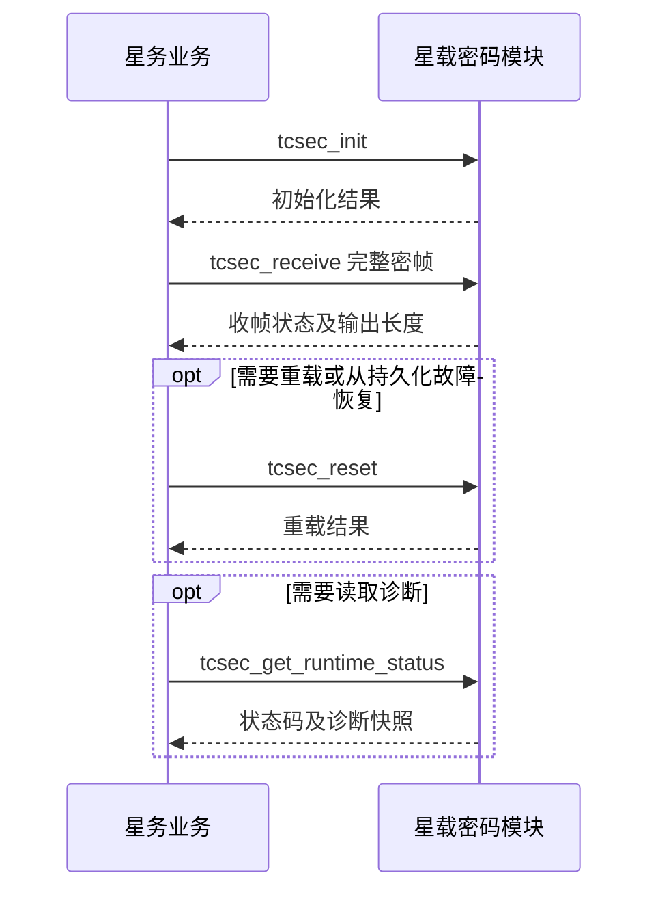

### 6.1 初始化与重载

#### `tcsec_init` 初始化

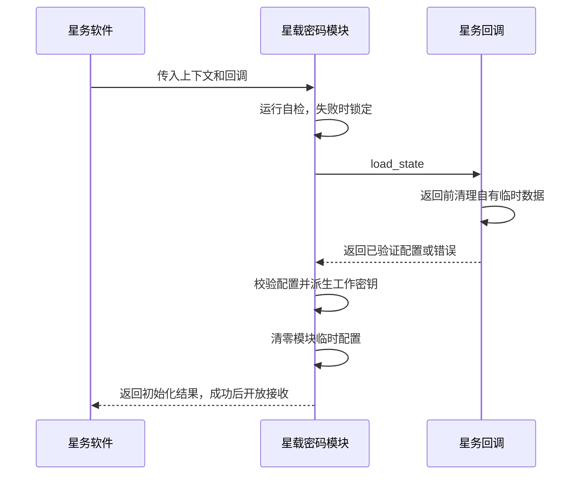

#### `tcsec_reset` 重载配置

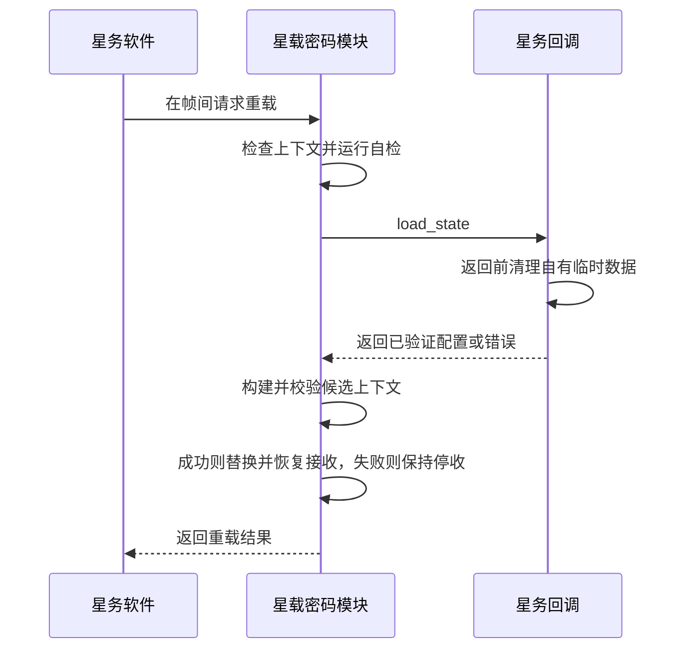

### 6.2 遥控帧接收

#### `tcsec_receive` 收帧

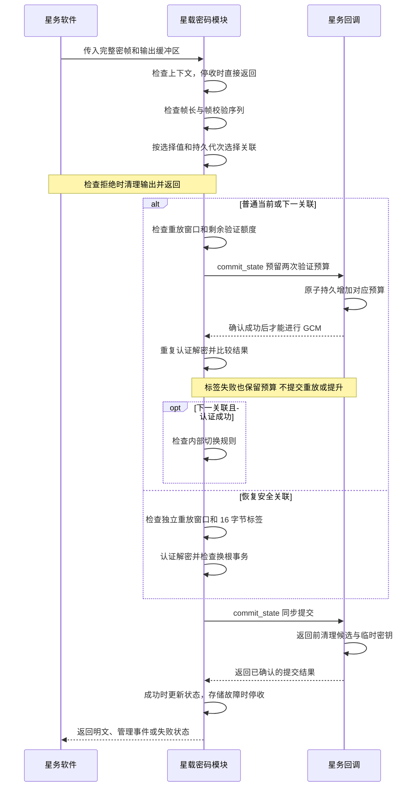

恢复通道成功时输出长度为零。以下为接收路径上的可选计时。

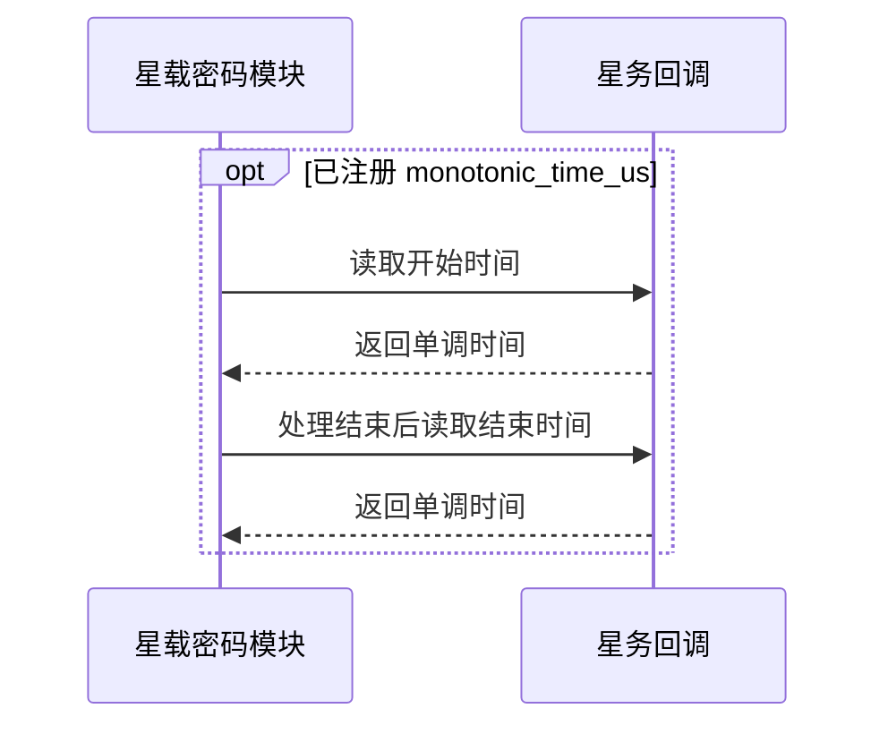

### 6.3 运行诊断

#### `tcsec_get_runtime_status` 读取诊断

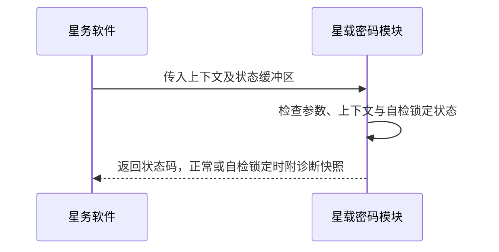


### 6.4 持久化中断与重新上电

图中的存储操作由星务实现，密码模块只调用已注册回调。提交锚更新是唯一的状态生效点。

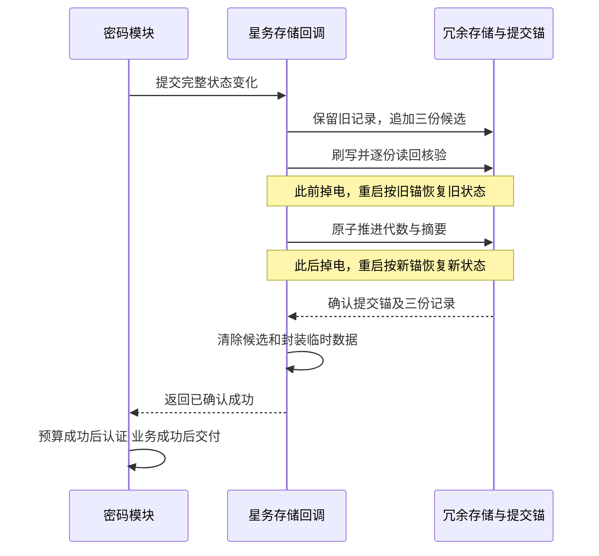

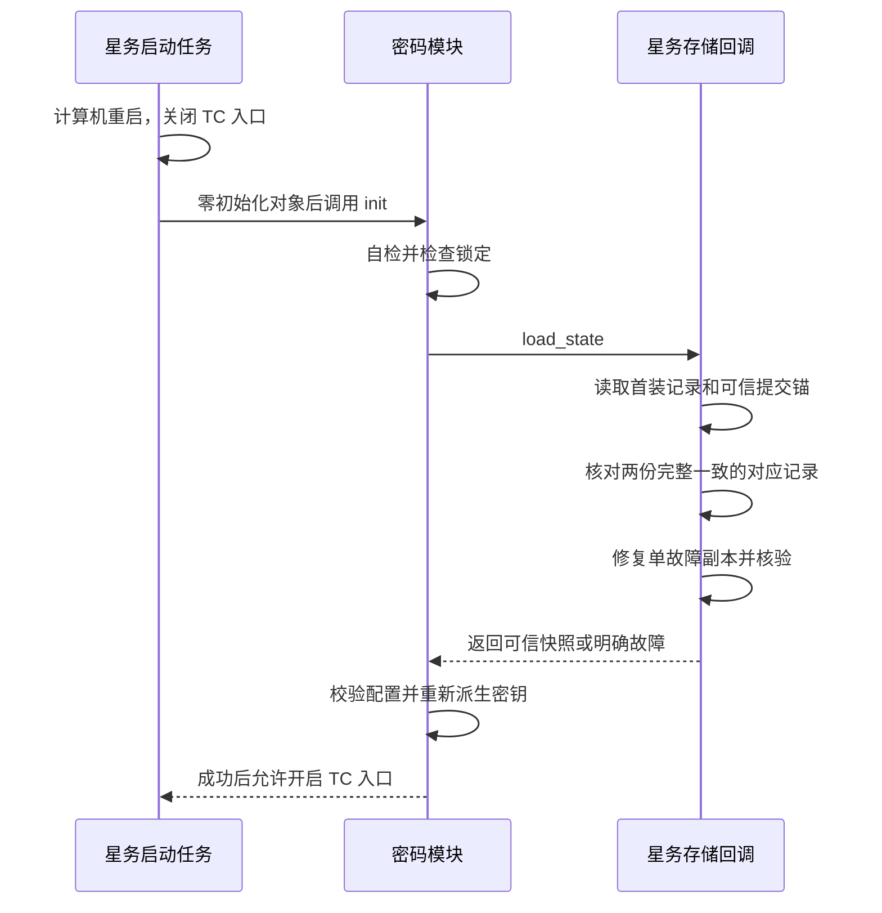

### 6.5 换根与回执丢失

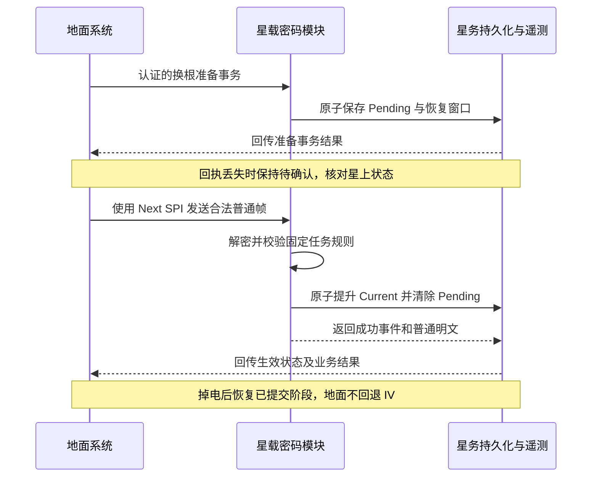

### 6.6 安全接收与业务执行窗口

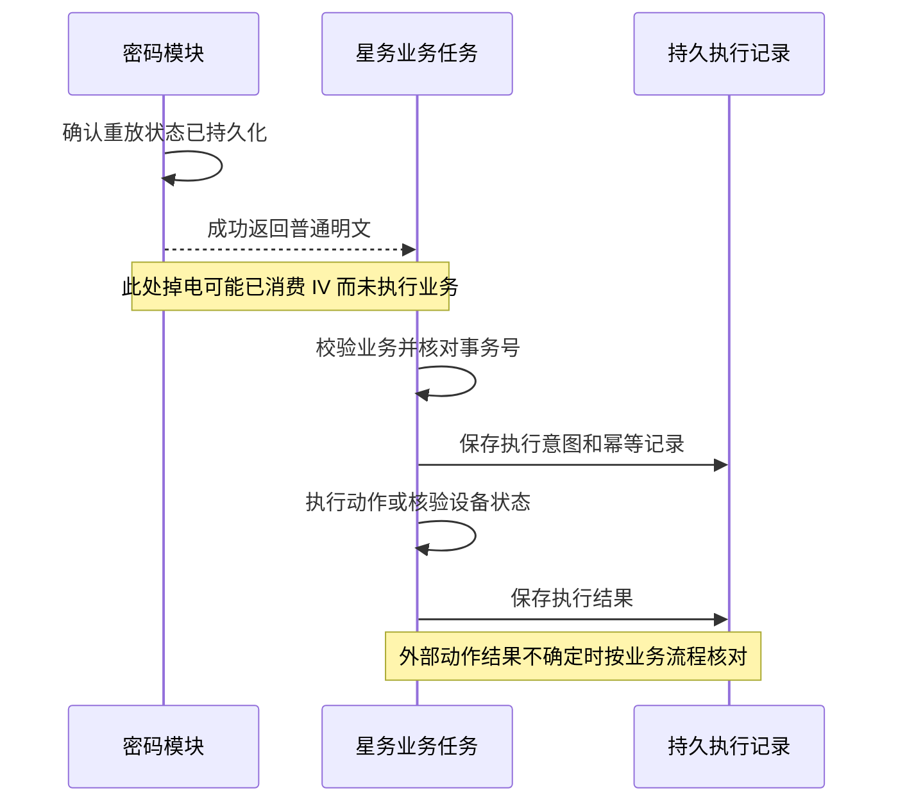

## 附录 A 首装与运行恢复

本附录是星务与地面接口评审方案。首装由地面工装和星务维护流程共同完成，运行期由星务通过已注册的回调提供可信状态。

### A.1 地面制备与密钥交付

1. 登记任务标识、目标设备的唯一硬件身份及 TC 航天器编号 `spacecraft_id`。工装用硬件身份核对所连接的目标板，地面组帧使用协议编号。
2. 在受控环境制备同一份任务配置。地面将 Current、Recovery 和 Next 根密钥导入 TPM，工装仅向星务灌装 Current 和 Recovery 根。Next 根在运行后通过已认证的换根准备帧交付。
3. 工装通过有线维护口建立双向认证、加密的会话。星务验证工装权限及一次性授权，授权绑定目标设备、任务、事务号和配置摘要。
4. 工装经受保护的会话交付初始配置。配置包括两个根密钥及其版本、初始安全代次、SPI、Nonce 前缀、任务配置摘要和空重放窗口。待生效根相关字段置零。日志和交付回执只记录设备标识、事务号、配置摘要及结果。

### A.2 星务灌装与开机确认

1. 星务在受控维护模式关闭 TC 接收，验证授权和本机身份。先保存受保护的 `装星中` 记录，包括事务号和配置摘要。
2. 星务将完整配置原子写入自己的安全存储，并在受保护环境中读回核验。确认安全状态可持久恢复后，将首装记录推进到 `已装星`，清理临时密钥缓冲区。
3. 工装执行一次断电重启。星务调用 `tcsec_init`，模块自检后通过 `load_state` 加载已验证状态。工装核对状态摘要、SPI、安全代次和根版本，验收成功后放行 TC。

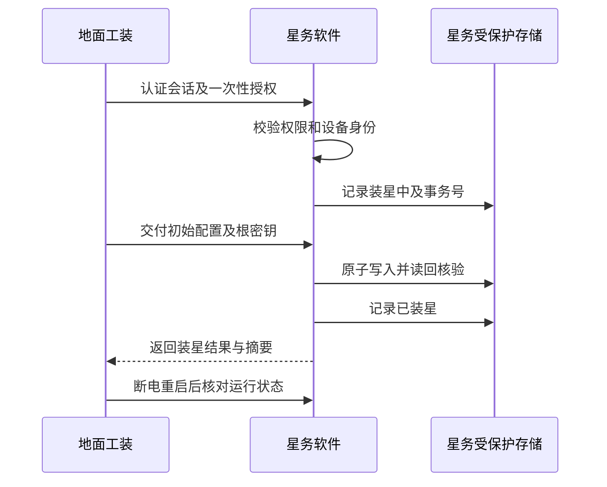

### A.3 首装判定和中断续办

首装记录应与运行状态独立保护。擦除、替换或回滚运行状态时，首装记录仍须可验证。首装记录证明设备是否完成过灌装，运行状态的防回退机制确认当前快照足够新。

| 首装记录 | 启动处理 |
| --- | --- |
| `未装星`，且维护授权有效 | 允许工装开始首装。 |
| `装星中` | 保持停收。授权工装按事务号和摘要续办同一事务。配置已完整写入时，可读回验证后完成确认。 |
| `已装星`，运行状态完整且通过防回退检查 | 通过 `load_state` 恢复状态，初始化成功后开放接收。 |
| `已装星`，运行状态缺失、损坏或回退 | 保持停收并进入授权恢复。 |
| 首装记录不可读、损坏或与配置冲突 | 保持停收，由工装核对设备履历。 |

若板卡只有一块可整体擦除的存储，整片擦除后由授权工装核对出厂台账，再决定是否进入首装。运行启动遇到空状态时保持停收。

## 评审待确认事项

| 事项 | 评审要确定的内容 | 会后交付物 |
| --- | --- | --- |
| 首装授权与信任锚 | 工装认证、目标设备身份、维护模式入口和根密钥交付方式。 | 星地工装接口和装星授权流程。 |
| 首装记录与运行防回退 | 独立保存的首装记录、运行状态可信版本锚及写入顺序。 | BSP 能力清单和首装中断、运行状态丢失的验收用例。 |
| 三副本存储与提交锚 | 三个独立擦写区域、原子且防回退的提交锚、加密封装、回读、寿命与修复条件。 | BSP 存储实现及物理断电验证证据。 |
| 首个 Next 帧规则 | 允许的 VCID、APID 和指令码，指令体长度及字段约束。 | 冻结的遥控包规则及合法、非法样例，用于飞行构建和星地联试。 |

## 附录 B 星务代码开发指导

本附录面向星务集成人员。以下步骤描述可实现的存储算法和调用约定，板级读写、刷写、加密封装和提交锚原语须由星务平台实现。手册中的 `flight_*` 名称都是星务示例函数，不属于密码模块静态库，也不假定已有 BSP 提供同名函数。回调注册的完整 C 示例位于第 1.2 至 1.5 节。

### B.1 交付文件与编译集成

业务集成包包含 `tc_security.h` 和 `libtc_security.a`，接口版本由附录 C 中的 `TCSEC_INTERFACE_VERSION` 定义。随包记录版本、文件 SHA-256、目标架构、编译器、编译选项、字节序、调用约定、枚举及 size_t 宽度、浮点 ABI、任务规则版本和门禁证据。头文件与静态库必须成对使用，升级时重编译调用方。内部头文件、算法接口、测试策略和根密钥不进入业务集成包。

模块开发侧在干净构建目录中运行下列命令。`MISSION_POLICY` 指向已评审的正式任务规则源码，由模块侧编译进静态库。星务业务代码不需要调用或实现该内部函数。仓库测试策略不能用于飞行交付。

```text
make -C embedded/tc_security clean
make -C embedded/tc_security flight-package CC=<目标编译器> AR=<目标归档器> MISSION_POLICY=<正式规则源码路径>
```

集成时仅添加公开头文件目录并链接静态库。平台提供 C11 所需的基础内存操作，检查目标链接结果中未解析符号、栈用量和禁止的运行依赖。通过 `static tcsec_context_t context = {0};` 分配实例。运行上下文无需对齐转换，模块内部通过复制读取私有对象。运行实例常驻，不能将其字节作为星务存储格式。

目标板卡型号、编译器 ABI、正式任务规则和板级存储能力须冻结后，才能生成对应的飞行交付包。主机库不能替代目标板静态库。

### B.2 定义星务持久记录

先定义独立于 C 结构体布局的版本化编码。逐字段规定长度、字节序和合法范围，再编码 `tcsec_config_t` 的逻辑字段。禁止写入指针、填充字节、size_t 原生布局、运行上下文和派生工作密钥。持久层的所有写入在同一互斥事务中串行处理。

每份完整记录至少包括设备身份、任务摘要、格式版本、存储代数、负载长度、编码快照、完整性保护和完成标记。密钥密文封装由星务安全存储负责。加密封装的密钥独立保管，不能与三个快照副本一起明文保存。若使用 AEAD，Nonce 必须遵守其不重复要求。可先封装一次，再复制同一份已封装记录到三个区域，不分别用同一 Nonce 执行多次加密。

若封装使用存储代数构造 Nonce，必须先持久预留一个从未使用过的代数，再执行封装。掉电、写入失败或提交锚未推进都不能重用该值。受保护分配器允许跳号，提交锚仅发布已完成事务，不能代替唯一 Nonce 分配器。

完成标记在记录主体刷写并读回核验后发布。每个区域在新事务完成前保留旧锚所指的记录。提交锚记录存储代数和整条记录摘要，并具备掉电原子更新及防回退能力。首装记录独立保护，不能因运行记录损坏而自动变成未装星。

### B.3 实现加载回调

```text
load_state(service, out)
    清零 out 和本次临时缓冲
    锁定星务持久状态事务
    验证首装记录
    未完成首装则返回 STORAGE_NOT_COMMISSIONED
    读取可信提交锚并验证其完整性和新鲜度
    读取三个区域，逐条校验编码长度和完整性
    仅保留代数与摘要精确匹配提交锚的完整记录
    找到至少两个完整内容相同的副本
    无多数则返回 STORAGE_NO_QUORUM
    发现回退则返回 STORAGE_ROLLBACK_DETECTED
    使用可信多数修复故障副本并读回验证
    修复无法完成则返回 STORAGE_UNAVAILABLE
    解封装并严格解码成 tcsec_config_t
    将完整逻辑快照写入 out
    清除临时密钥和解封装缓冲，解锁
    返回 OK
```

所有错误出口均清除临时明文密钥、释放锁，并保持 TC 入口关闭。发现未提交候选时，先按旧锚恢复，再清理候选。发现较新记录不能单独作为推进提交锚的理由。加载成功后模块还会校验配置并重复派生工作密钥。

### B.4 构建四类提交的完整候选

`commit_state` 的入参由模块临时提供，回调不能保存指针供异步线程继续使用。先在同一事务内读取当前可信快照，检查提交 SPI、代次、根版本及重放窗口与当前状态相符，再复制为候选。必须核对变化的前置条件，不能直接信任一份长期 RAM 缓存。

| kind | 候选快照的具体更新 |
| --- | --- |
| `TCSEC_COMMIT_AUTH_BUDGET` | 按 SPI、代次、根版本准确绑定 Current 或 Next。读取已持久总额，核对请求恰为旧值加 2 且不超过 2048。仅替换对应 auth_used 字段，原子提交完整候选；重放窗口保持原值。 |
| `TCSEC_COMMIT_ORDINARY_REPLAY` | 核对 `spi == ordinary.current_spi`，根版本和代次与 Current 一致。核对 auth_used 与持久 Current 预算相等，再将 ordinary.replay 替换为请求中的完整窗口。 |
| `TCSEC_COMMIT_ROOT_PREPARE` | 核对 Recovery SPI 及事务预期的 Current 版本。保存新 Pending 根、版本和事务号，同时替换 `recovery.replay`。首次安装新 Pending 根时清空 Next 预算；同一事务重试保留 Next 预算。Current 根、代次及预算保持原值。 |
| `TCSEC_COMMIT_EPOCH_PROMOTION` | 核对目标 SPI 为 Current 加 1、代次为当前加 1。存在 Pending 时将其根及版本移为 Current。更新普通 SPI、代次、根版本和重放窗口，然后将所有 Pending 字段及根字节清零。没有 Pending 时沿用 Current 根。把 Next 已耗预算转给 Current，未来 Next 预算置 0。 |

同一 Root Prepare 事务可用新的 Recovery IV 重试，仍须提交新的完整 Recovery 窗口。返回 `ALREADY_APPLIED` 之前必须确认请求的全部效果已落盘，包含本次窗口。预算预留和普通重放提交只允许 NEW。请求与持久状态不相符时返回 `REJECTED`，不能静默改写请求。

### B.5 发布提交与清理敏感内存

```text
commit_state(service, change)
    锁定星务持久状态事务
    加载提交锚指定的可信完整快照
    核对变化前置条件并构建完整候选
    分配未用过的新存储代数，禁止回绕
    对候选编码并加密封装
    依次在三个独立区域追加候选
        写记录主体并刷写
        读回核验，发布完成标记并再次确认
    三份均完整后原子推进提交锚
    读回确认提交锚和对应记录
    确认完成则返回 NEW
    锚更新是否成功无法确认则返回 UNCERTAIN
    写入失败则返回 PERSISTENCE_FAILED
    每个出口都清除候选明文、临时根和封装缓冲并解锁
```

只有在三个候选副本均验证成功后才推进锚，从而允许随后一个副本故障时仍可恢复。单副本故障时先修复，修复前不开始新安全提交。不要把未刷写的驱动缓存、已发出的写命令或某一份副本写成功当成事务成功。确认丢失时停止后续收帧，重载提交锚确定最终版本。

记录回收必须在提交已确认且对应副本已完整后进行。不能擦除另外两个区域仍依赖的唯一旧版本。每个被接受的普通帧都提交重放窗口，评估最坏 TC 速率下的擦写寿命、写放大、刷写时延和任务调度预算，采用追加日志与磨损均衡，不能通过延后提交窗口节省擦写。

### B.6 星务调度与错误处理

使用一个星务任务串行处理同一实例。任务接收完整 TC 帧，调用 receive，再依据状态码分发普通明文或管理事件。业务校验同步完成后清零星务明文缓冲。回调不能执行或排队业务指令，不能重入同一实例，也不能在尚未确认落盘时提前返回成功。

对于持久化失败、提交结果不确定、提交拒绝和回调返回非法，关闭帧分发，保存原始状态码和无密钥诊断，修复存储后调用 reset。对于自检锁定或运行上下文损坏，进入星务计算机故障处置。对于帧长、FECF、重放、认证或任务规则拒绝，只丢弃对应帧，不清空安全状态。普通预算耗尽时协调工作密钥轮换或 Recovery，代次耗尽进入计划维护。

### B.7 必须完成的验证

新增必测项包括预算预留在每个写入字节的掉电、预留成功后尚未认证时掉电、标签失败后复位、预算耗尽后的 Recovery 可用性、提升时预算迁移，以及同一换根准备事务重试不能重置 Next 预算。首装的 Current 和 Next 预算均为 0；读取已有记录时不能采用这一默认值。


| 验证范围 | 通过条件 |
| --- | --- |
| 上下文与接口 | 仅使用公开头文件能够声明对象并链接四个入口，无法访问根或派生密钥成员。缺少回调、未初始化及重复初始化均有明确错误。 |
| 每一字节写入中断 | 普通重放、换根准备和 Next 提升逐写入步骤断电，重启恢复完整旧状态或完整新状态，无混合根、窗口或代次。 |
| 单副本故障 | 三个区域分别不可读、半写、位翻转或旧版本，能从锚所指的可信多数恢复并修复。 |
| 无多数与回退 | 两份损坏、三份不同、旧多数、新锚配旧记录及锚损坏均保持停收。 |
| 确认丢失 | 新状态已提交而回调报告不确定，模块不释放明文，reset 后重复帧被拒绝。 |
| 换根与重启 | Pending 根及恢复窗口一起恢复，Next 提升后新 Current 与清除 Pending 同时恢复。 |
| 业务掉电窗口 | 分别在安全提交、明文交付、业务执行意图、外部动作和结果记录之后断电，地面能够区分接收与执行结果。 |
| 回调清理 | 加载成功和失败、提交成功、拒绝、写入失败和结果不确定的各出口均清除自有临时数据。加载成功的输出快照仍完整，持久状态保持正确。 |
| 资源和机密 | 实测 WCET、栈、存储寿命和刷写时延，日志和工件无真实根密钥、工作密钥或敏感明文。 |

仓库的主机三副本模型覆盖普通重放、换根准备和提升的逐字节中断，以及单副本损坏和旧记录不能覆盖提交锚的场景。模型假定平台提供可信原子提交锚，未模拟真实擦除、电源波形和控制器缓存。物理断电、共因故障和锚原语须在最终板卡上完成验收。


### B.8 字段与参数的接入边界

| 信息 | 接入约定和保留原因 |
| --- | --- |
| 固定算法和根密钥尺寸 | 由模块确定，星务只提供固定 16 字节根数组。内部算法实现不进入对外头文件；公开头保留快照字段和星务校验所需的固定预算上限。 |
| frame_length、plaintext_capacity、plaintext_length | 分别表示实际输入长度、可写容量和有效输出长度，用于边界检查和安全消费，不能相互替代。 |
| SPI、代次、根版本、IV、事务号、配置摘要 | 分别标识关联、派生域、根材料版本、防重放状态、换根事务和任务绑定，须独立保存和核对。 |
| Pending 标志及重放窗口 | 显式状态和一致性校验用于发现半写、损坏和重放，按完整逻辑快照恢复。 |
| user_context 和运行诊断输出 | 服务句柄支持独立实例。诊断中已计算的 Next SPI 等信息由模块提供，星务无需重复计算。 |

## 附录 C 对外头文件

本附录逐字引用 `embedded/tc_security/include/tc_security.h`，与静态库按同一接口版本发布。

<!-- flight-public-header:begin -->
```c
#ifndef TC_SECURITY_H
#define TC_SECURITY_H

#include <stddef.h>
#include <stdint.h>

#ifdef __cplusplus
extern "C" {
#endif

#define TCSEC_INTERFACE_VERSION 5u
#define TCSEC_MAX_FRAME_LENGTH 1024u
#define TCSEC_ROOT_KEY_LENGTH 16u
#define TCSEC_NONCE_PREFIX_LENGTH 6u
#define TCSEC_PROFILE_DIGEST_LENGTH 32u
#define TCSEC_ORDINARY_AUTH_LIMIT 2048u

typedef enum {
    TCSEC_OK = 0,
    TCSEC_INVALID_ARGUMENT,
    TCSEC_INVALID_CONFIGURATION,
    TCSEC_FRAME_LENGTH_INVALID,
    TCSEC_FECF_INVALID,
    TCSEC_ASSOCIATION_NOT_FOUND,
    TCSEC_REPLAY_REJECTED,
    TCSEC_IV_FORWARD_JUMP_REJECTED,
    TCSEC_AUTHENTICATION_FAILED,
    TCSEC_OUTPUT_TOO_SMALL,
    TCSEC_PLAINTEXT_REJECTED,
    TCSEC_ROOT_PREPARE_REJECTED,
    TCSEC_PERSISTENCE_FAILED,
    TCSEC_STATE_INTEGRITY_FAILED,
    TCSEC_EPOCH_PROMOTED,
    TCSEC_ROOT_PREPARED,
    TCSEC_ROOT_ALREADY_PREPARED,
    TCSEC_SELF_TEST_FAILED,
    TCSEC_NOT_INITIALIZED,
    TCSEC_ALREADY_INITIALIZED,
    TCSEC_MISSING_CALLBACK,
    TCSEC_RECEPTION_PAUSED,
    TCSEC_STORAGE_UNAVAILABLE,
    TCSEC_STORAGE_NO_QUORUM,
    TCSEC_STORAGE_ROLLBACK_DETECTED,
    TCSEC_STORAGE_NOT_COMMISSIONED,
    TCSEC_STORAGE_COMMIT_UNCERTAIN,
    TCSEC_STATE_COMMIT_REJECTED,
    TCSEC_CALLBACK_RESULT_INVALID,
    TCSEC_EPOCH_EXHAUSTED,
    TCSEC_KEY_DERIVATION_FAILED,
    TCSEC_PROFILE_MISMATCH,
    TCSEC_AUTH_BUDGET_EXHAUSTED
} tcsec_status_t;

typedef enum {
    TCSEC_PROFILE_ORDINARY_CURRENT = 1,
    TCSEC_PROFILE_ORDINARY_NEXT = 2,
    TCSEC_PROFILE_ROOT_PREPARE = 3
} tcsec_profile_t;

typedef struct {
    uint32_t highest_iv;
    uint64_t bitmap;
    uint8_t seen;
} tcsec_replay_state_t;

typedef struct {
    uint16_t spacecraft_id;
    uint8_t operational_root[TCSEC_ROOT_KEY_LENGTH];
    uint32_t root_version;
    uint32_t current_epoch;
    uint16_t current_spi;
    uint8_t nonce_prefix[TCSEC_NONCE_PREFIX_LENGTH];
    tcsec_replay_state_t replay;
    /* Durable reservation totals per working key, even values in 0..2048.
     * Reserve two before ordinary GCM; failures and resets never refund them. */
    uint32_t current_auth_used;
    uint32_t next_auth_used;
    /* A zero pending_root_present requires every other pending_* field zero. */
    uint8_t pending_root_present;
    uint8_t pending_operational_root[TCSEC_ROOT_KEY_LENGTH];
    uint32_t pending_root_version;
    uint64_t pending_transaction_id;
} tcsec_ordinary_config_t;

typedef struct {
    uint8_t recovery_root[TCSEC_ROOT_KEY_LENGTH];
    uint32_t root_version;
    uint16_t spi;
    uint8_t nonce_prefix[TCSEC_NONCE_PREFIX_LENGTH];
    tcsec_replay_state_t replay;
} tcsec_recovery_config_t;

typedef struct {
    uint8_t profile_digest[TCSEC_PROFILE_DIGEST_LENGTH];
    tcsec_ordinary_config_t ordinary;
    tcsec_recovery_config_t recovery;
} tcsec_config_t;

typedef struct {
    uint64_t transaction_id;
    uint32_t expected_current_root_version;
    uint32_t new_root_version;
    uint32_t next_security_epoch;
    uint16_t next_spi;
    uint8_t new_operational_root[TCSEC_ROOT_KEY_LENGTH];
} tcsec_root_prepare_t;

typedef enum {
    TCSEC_COMMIT_ORDINARY_REPLAY = 1,
    TCSEC_COMMIT_EPOCH_PROMOTION = 2,
    TCSEC_COMMIT_ROOT_PREPARE = 3,
    TCSEC_COMMIT_AUTH_BUDGET = 4
} tcsec_commit_kind_t;

typedef struct {
    tcsec_commit_kind_t kind;
    uint16_t spi;
    tcsec_replay_state_t replay;
    uint32_t current_epoch;
    uint32_t root_version;
    /* AUTH_BUDGET: persisted old total + 2; ordinary replay/promotion:
     * already reserved total for the selected key; ROOT_PREPARE: zero. */
    uint32_t auth_used;
    const tcsec_root_prepare_t *root_prepare;
} tcsec_commit_t;

typedef enum {
    TCSEC_COMMIT_REJECTED = 0,
    TCSEC_COMMIT_NEW = 1,
    TCSEC_COMMIT_ALREADY_APPLIED = 2,
    TCSEC_COMMIT_PERSISTENCE_FAILED = 3,
    TCSEC_COMMIT_UNCERTAIN = 4
} tcsec_commit_result_t;

/* Flight software atomically persists one logical state change and returns
 * only after verifying it. The core has no storage dependency. The callback
 * must not execute or enqueue ordinary plaintext. root_prepare is non-NULL
 * only for ROOT_PREPARE. The callback must clear its own temporary secrets
 * before returning on every success and failure path. AUTH_BUDGET updates only
 * the selected key's durable quota, never replay/root state. Promotion moves
 * next_auth_used to current_auth_used and clears future NEXT quota. A new
 * Pending root resets NEXT quota; a retry of that same root never resets it. */
typedef tcsec_commit_result_t (*tcsec_state_commit_fn)(void *user_context,
                                                       const tcsec_commit_t *commit);

/* Load one complete, verified durable snapshot into a temporary output.
 * Return TCSEC_OK only after verifying it. The module clears the output
 * after use. Return a storage-specific status for unavailable media, missing
 * quorum, rollback, or an uncommissioned device. Integrity and configuration
 * errors must be reported explicitly. Unexpected return codes are rejected.
 * The callback clears its own temporary secrets before returning on every
 * path, but leaves the output intact. The module clears the output after use. */
typedef tcsec_status_t (*tcsec_state_load_fn)(void *user_context,
                                               tcsec_config_t *config);

typedef uint64_t (*tcsec_monotonic_time_us_fn)(void *user_context);

/* Runtime dependencies supplied by flight software. tcsec_init copies this
 * value; the struct itself need not outlive the call, while user_context and
 * everything it references must remain valid for the running instance. */
typedef struct {
    tcsec_state_load_fn load_state;               /* Required. */
    tcsec_state_commit_fn commit_state;           /* Required. */
    tcsec_monotonic_time_us_fn monotonic_time_us;  /* NULL disables timing. */
    void *user_context;
} tcsec_callbacks_t;

typedef enum {
    TCSEC_SELF_TEST_NOT_RUN = 0,
    TCSEC_SELF_TEST_PASSED = 1,
    TCSEC_SELF_TEST_LOCKED = 2
} tcsec_self_test_state_t;

typedef enum {
    TCSEC_CRYPTO_BACKEND_SOFTWARE = 0,
    TCSEC_CRYPTO_BACKEND_ARMV7_NEON = 1
} tcsec_crypto_backend_t;

typedef struct {
    tcsec_self_test_state_t self_test;
    tcsec_crypto_backend_t crypto_backend;
    uint8_t profile_digest[TCSEC_PROFILE_DIGEST_LENGTH];
    uint16_t current_spi;
    uint16_t next_spi;
    uint16_t recovery_spi;
    uint32_t security_epoch;
    uint32_t root_version;
    uint8_t pending_root_present;
    uint32_t current_auth_used;
    uint32_t next_auth_used;
    uint8_t reception_paused;
    tcsec_status_t last_status;
    uint64_t receive_count;
    /* The four timing fields are zero when no clock is configured. */
    uint64_t last_receive_us;
    uint64_t max_receive_us;
    uint64_t cycle_limit_exceeded_count;
    uint64_t clock_anomaly_count;
} tcsec_runtime_status_t;

typedef struct {
    uint16_t spi;
    uint32_t iv_counter;
    uint32_t security_epoch;
    tcsec_profile_t profile;
    size_t plaintext_length;
} tcsec_result_t;

/* Caller-owned opaque object. Zero-initialize once at computer startup.
 * Do not inspect, copy, serialize or change its storage. No heap is used. */
#define TCSEC_CONTEXT_STORAGE_SIZE 512u
typedef struct {
    unsigned char _opaque[TCSEC_CONTEXT_STORAGE_SIZE];
} tcsec_context_t;

/* Start with a zero-initialized context. Registers callbacks and loads the
 * initial snapshot. Callback bindings remain fixed until computer restart. */
tcsec_status_t tcsec_init(tcsec_context_t *context,
                          const tcsec_callbacks_t *callbacks);

/* Reloads the complete durable snapshot through the registered callback.
 * A failed reload leaves reception paused. A successful reset resumes it.
 * Serialize reset with receive and every other call on the same context. */
tcsec_status_t tcsec_reset(tcsec_context_t *context);

/* Receives one complete TC transfer frame. Current plaintext is released after
 * durable replay commit; the caller must validate it before execution. Next
 * plaintext additionally passes the built-in mission checks before promotion
 * commits. Root-prepare plaintext is consumed internally.
 *
 * Reentrancy contract: the implementation has no mutable global state, so calls
 * using distinct tcsec_context_t objects may execute concurrently or from nested
 * callbacks. A single context owns one replay/rotation state machine and must be
 * serialized by its caller; callbacks must not re-enter that same context. */
tcsec_status_t tcsec_receive(tcsec_context_t *context,
                             const uint8_t *frame,
                             size_t frame_length,
                             uint8_t *plaintext,
                             size_t plaintext_capacity,
                             tcsec_result_t *result);

/* Returns a semantic, carrier-independent snapshot for housekeeping/AOS
 * publication. It never exposes roots or derived keys. */
tcsec_status_t tcsec_get_runtime_status(const tcsec_context_t *context,
                                        tcsec_runtime_status_t *status);


#ifdef __cplusplus
}
#endif

#endif
```
<!-- flight-public-header:end -->
