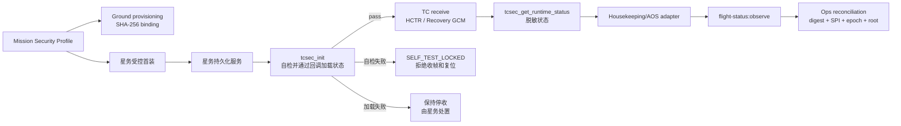

# 星载密码运行闭环

本文定义当前版本已经实现的最小运行闭环。AOS 完整帧格式仍未冻结；本文只固定状态语义和内部 API，不规定状态在 AOS 数据域中的封装位置。

## 星务需要提供

- 星务业务通过 `tc_security.h` 使用四个接口。板级集成提供持久化服务及可选的单调微秒时钟。
- 星务在初始化时注册状态加载、提交、适配缓存清理和可选计时回调。密码模块调用回调并检查结果，持久化失败时暂停收帧，调用 `tcsec_reset` 恢复。
- Housekeeping/AOS adapter：调用 `tcsec_get_runtime_status`，把语义字段放入最终冻结的遥测载荷。

收到普通遥控明文后，星务按任务规则校验并决定是否执行。星务在构建时提供首个 Next 帧的任务规则。

## 密码模块内部完成

- 首个 Next 帧解密后的帧头、包头和任务规则判定，成功后才原子提交切换；
- 实际选中 SM4 后端的 SM4、CMAC-KDF、HCTR、GCM 启动 KAT；
- KAT 失败锁定，`receive/reset` 均不可绕过；
- Current/Next 自动一致化、Recovery GCM Root Prepare、replay 与最大前跳；
- Mission Profile 摘要运行绑定；`reset` 不允许静默切换摘要；
- receive 次数、最近/最大耗时、120 ms 整周期上限超限次数和时钟倒退次数。

## 地面自动判断

地面持久化唯一 Mission Profile 摘要。收到星载状态后自动比较：

- Profile digest；
- self-test 与后端；
- Current SPI、Next SPI、Recovery SPI；
- security epoch、root version；
- 周期超限与时钟异常。

任何不一致进入 `MISMATCH/DEGRADED` 并在英文运维面展示。状态接口不包含 Root、working key、nonce prefix 或 replay bitmap。

## 发布门禁

`make release-gate` 强制执行：

1. 全量 Go、星载 C 和运维 CLI/API 测试；
2. 星载 C 行覆盖率不低于 95%，地面 TC Go 语句覆盖率不低于 95%；
3. ARMv7 hard-float/NEON 交叉编译；
4. QEMU 执行完整星载 TC/Recovery 测试；
5. 128 组 HCTR 加解密与 128 组 KDF 的 Go → x86 C → ARMv7 NEON 三路差分；
6. 输出 `build/release/release-evidence.json`。

真实板卡 WCET、物理 NVM 掉电、EDAC/MPU/watchdog 和侧信道测试仍属于发布验收，不由 QEMU 证据替代。

## 2026 年 11 月 5 日接口可靠性回归

已通过远程完整 make release-gate，并核对门禁源码与本地源码 SHA-256 一致。
C 行覆盖率 97.53%，地面 TC Go 95.00%，权限 Go 96.20%，AES 下行 C 与 Go 均为 100%。
包括 Go race 与漏洞检查、ASan/UBSan、4096 次 C smoke fuzz、三副本逐字节中断模型、
链接故障注入、实际 HTTP/SQLite 到独立 C 进程的持久化恢复、ARMv7/QEMU
及仅公开头文件加静态库的链接检查。

正式 Next 任务规则及样例、最终板卡 ABI、可信提交锚与真实三副本 BSP、
物理掉电及寿命验收仍是飞行交付条件。主机测试使用公开测试根与测试策略，
不能作为这些任务验收项目已经完成的证据。
