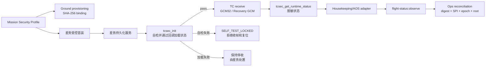

# 星载密码运行闭环

普通 TC、Recovery、KDF、短标签预算及当前版本以 [TC GCM 帧格式](TC_GCM_PROFILE.md) 为准。
本文定义当前版本已经实现的最小运行闭环。AOS 完整帧格式仍未冻结；本文只固定状态语义和内部 API，不规定状态在 AOS 数据域中的封装位置。

## 星务需要提供

- 星务业务通过 `tc_security.h` 使用四个接口。板级集成提供持久化服务及可选的单调微秒时钟。
- 星务在初始化时注册状态加载、提交和可选计时回调。存储回调及其内部服务在所有返回路径清理自有临时数据，加载输出由密码模块使用后清零。密码模块调用回调并检查结果，持久化失败时暂停收帧，调用 `tcsec_reset` 恢复。
- Housekeeping/AOS adapter：调用 `tcsec_get_runtime_status`，把语义字段放入最终冻结的遥测载荷。

收到普通遥控明文后，星务按任务规则校验并决定是否执行。星务在构建时提供首个 Next 帧的任务规则。

## 密码模块内部完成

- 首个 Next 帧解密后的帧头、包头和任务规则判定，成功后才原子提交切换；
- 实际选中 SM4 后端的 SM4、CMAC-KDF、GCM32、GCM 启动 KAT；
- KAT 失败锁定，`receive/reset` 均不可绕过；
- Current/Next 自动一致化、Recovery GCM Root Prepare、replay 与最大前跳；
- Mission Profile 摘要运行绑定；`reset` 不允许静默切换摘要；
- receive 次数、最近/最大耗时、120 ms 整周期上限超限次数和时钟倒退次数。

## 地面自动判断

地面持久化唯一 Mission Profile 摘要。收到星载状态后自动比较：

- Profile digest；
- self-test 与后端；
- Current SPI、Next SPI、Recovery SPI；
- security epoch、root version；
- Current/Next 已耗验证额度、停收状态、周期超限与时钟异常。

任何不一致进入 `MISMATCH/DEGRADED` 并在英文运维面展示。状态接口不包含 Root、working key、nonce prefix 或 replay bitmap。

## 发布门禁

`make release-gate` 强制执行：

1. 全量 Go、星载 C 和运维 CLI/API 测试；
2. 星载 C 行覆盖率不低于 95%，地面 TC Go 语句覆盖率不低于 95%；
3. ARMv7 hard-float/NEON 交叉编译；
4. QEMU 执行完整星载 TC/Recovery 测试；
5. 128 组 GCM32 认证解密与 128 组 KDF 的 Go → x86 C → ARMv7 NEON 三路差分；
6. 输出 `build/release/release-evidence.json`。

真实板卡 WCET、物理 NVM 掉电、EDAC/MPU/watchdog 和侧信道测试仍属于发布验收，不由 QEMU 证据替代。

## 当前版本验证记录

远程完整 make release-gate 已通过。星载 C 行覆盖率 96.30%，地面 TC Go 语句覆盖率 95.20%，权限 Go 96.20%，下行 C 与 Go 均为 100%。59 个登记 TC 进程场景在优化和 ASan/UBSan 构建中共执行 118 次，无失败和跳过；ARMv7/QEMU 通过 256 条 Go/C 差分记录。完整证据位于 build/release/release-evidence.json。

覆盖预算持久预留、失败后复位、预留与业务提交的中断恢复、同一换根准备重试保留预算、普通预算耗尽后的 Recovery，以及连续同根工作密钥轮换。源码、公开头及两份接口手册的哈希与发布证据绑定。

正式任务规则及样例、目标板 ABI、可信提交锚和三副本 BSP、物理掉电、写入寿命与 WCET 仍需对应环境验收。
