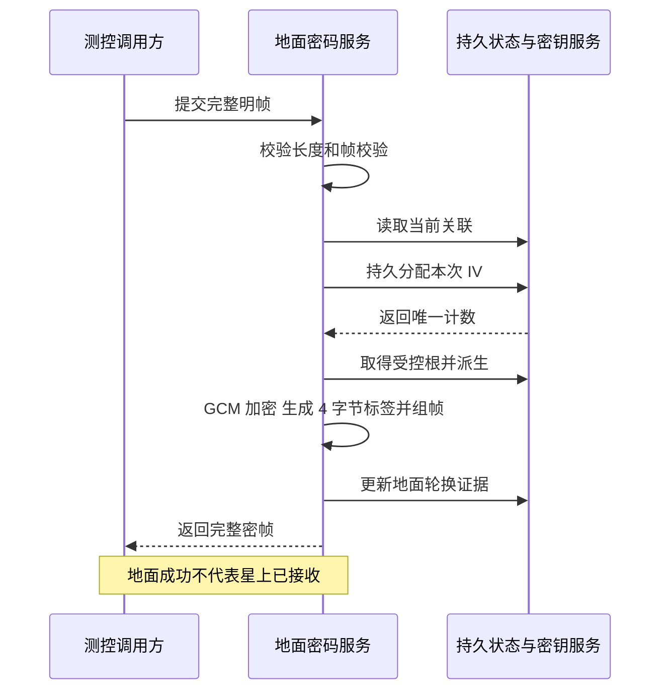
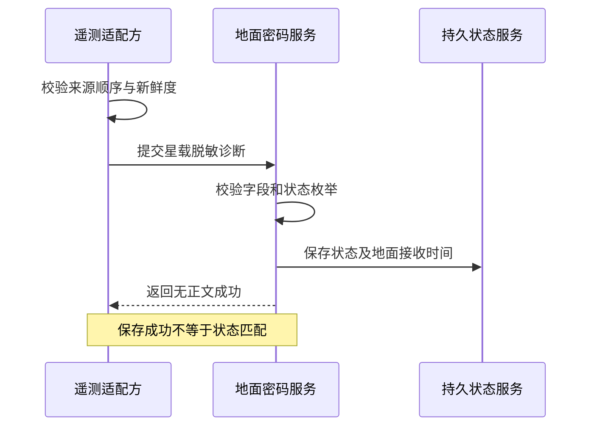
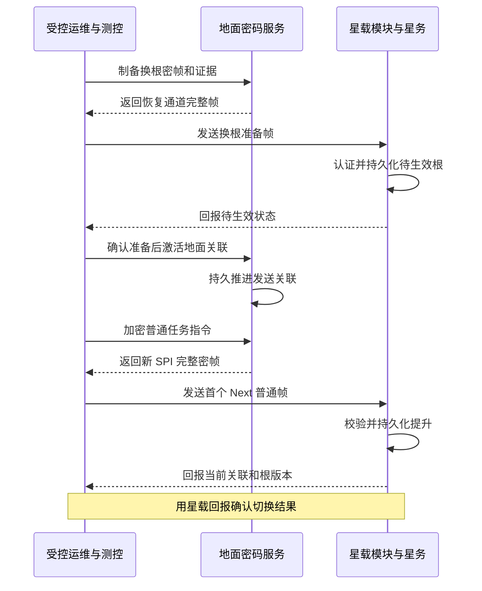
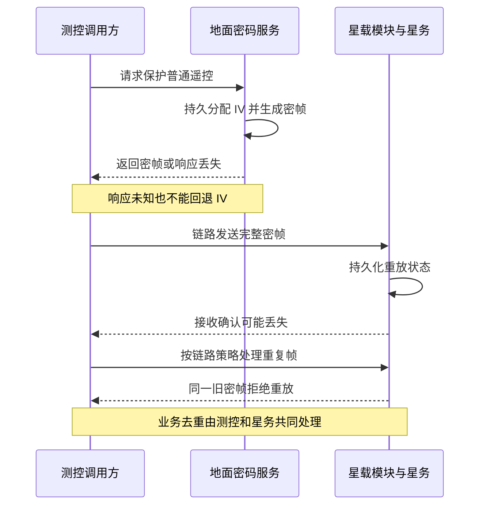

# 地面遥控密码模块接口手册

## 地面遥控接入总览

本手册面向测控软件、遥测适配软件和地面集成人员，说明普通遥控加密、星载密码状态上报、只读诊断及受控换根的实际接入方式。地面密码服务接收完整 TC 明帧，返回可直接交给测控链路发送的完整密帧。测控调用方不选择密钥、SPI、IV 或安全代次。

本手册与星务端接口手册使用同一遥控合同。普通遥控采用 SM4-GCM 和 4 字节标签；恢复通道换根准备采用独立工作密钥的 SM4-GCM 和 16 字节标签。AES 下行不在本手册范围内。地面状态格式为 schema 4，任务配置与星载状态上报格式均为版本 2；星载公开接口版本为 5。

| 接入项 | 实际入口与责任 |
| --- | --- |
| 普通遥控加密 | POST /api/v1/tc:protect，输入和输出均为完整帧的 Base64。 |
| 星载状态回传 | POST /api/v1/flight-status:observe，遥测适配方提交脱敏状态。 |
| 只读运行诊断 | GET /ops/v1/status，运维方读取状态，不分配 IV、不执行切换。 |
| 首装和换根制备 | ccsds-provision，受控读取任务配置、封装地面根并生成换根准备密帧。 |
| 地面发送关联切换 | ccsds-activate，在地面推进已准备事务，不产生空口管理指令。 |

### 术语

| 术语 | 中文含义与关系 |
| --- | --- |
| TC | 遥控。本文的完整帧包含 5 字节主导头和末尾 2 字节帧校验序列。 |
| 安全关联 SA | 密钥版本、SPI、算法、Nonce 前缀和计数状态等共同构成的一组帧保护配置。 |
| 安全参数索引 SPI | 内部持久保存的 16 位逻辑关联编号，参与 KDF 和 nonce；空口使用代次模 3 的 2 位选择值，值 3 专属 Recovery。 |
| Current 与 Next | 当前和下一普通关联。Next SPI 为 Current SPI 加 1，按 16 位回绕；Next 安全代次为当前加 1。 |
| Recovery Root Prepare | 恢复通道换根准备。认证并在星上保存待生效业务根，等待首个合法 Next 帧启用。 |
| 根密钥与工作密钥 | 根是受控保管的 16 字节材料；工作密钥由根及关联参数派生，用于实际加解密。 |
| 安全代次 epoch | 普通关联的派生输入，随切换递增；与根版本、SPI、IV 分别承担不同责任。 |
| IV 计数器 | 普通帧在 2 字节控制字中携带 14 位计数，地面每工作密钥最多分配 1024 帧；Recovery 为独立 32 位计数。允许跳号，禁止回退和重复。 |
| TPM 与 SQLite | TPM 用于封装根材料；SQLite 持久化封装对象、关联、发送计数和运行证据。 |

## 1 接入边界与生命周期

地面交付为 Go 服务和受控命令行工具，对外采用 HTTP/JSON；星载交付为头文件与静态库。地面调用方无需使用星载 init、reset 或上下文对象，也不注册星载持久化回调。

| 层次 | 负责内容 |
| --- | --- |
| 测控调用方 | 产生合法完整 TC 明帧、保留帧序列号、提交加密请求、发送返回密帧、管理链路重传。 |
| 地面密码服务 | 选择 Current，分配并持久化 IV，读取受控根、派生工作材料、加密、插入安全域并重算 FECF。 |
| 遥测适配方 | 解读任务遥测，将星载诊断字段映射为状态上报对象，维护来源与采样新鲜度。 |
| 受控运维方 | 首装、配置核对、换根准备、地面切换、数据库恢复和异常处置。 |
| 星载密码模块与星务 | 解密、持久化重放或切换状态；星务继续校验普通业务明文并决定执行。 |

### 服务启停与并发

服务启动由部署配置完成数据库、TPM、策略和关联加载；测控软件通过 HTTP 接入，不直接操纵内部对象。停止服务前应停止新请求并处理在途请求；重启后继续使用原持久化安全状态。禁止以清空数据库、重新首装或回退计数代替故障恢复。

多个普通加密请求可并发进入，发送计数通过持久化存储分配。响应到达顺序不保证与 IV 顺序相同。切换、配置制备和数据库维护须由受控流程与发送调度协调，避免在途旧帧跨越关联退役窗口。同一逻辑指令是否已经执行，由测控与星务的业务去重流程判定。

### 凭据与传输

HTTP 请求使用 `Authorization: Bearer <token>`；POST 使用 `Content-Type: application/json`。地址、端口、证书和超时来自部署配置，不属于遥控帧协议。不要把本手册中的示例地址作为任务部署要求。

| 凭据 | 已配置的能力与约束 |
| --- | --- |
| 数据面 data.token | ccsds:tc:protect 与 ccsds:flight-status:observe；当前实现这两项使用同一数据面身份。 |
| 运维面 ops.token | ops:read 与 audit:read；不能加密遥控或替代数据面上报状态。 |
| 租户绑定 | 当前身份绑定一个租户。普通请求省略 tenant_id 即使用绑定值，显式传不同值会被拒绝。 |

数据面和运维面使用各自监听地址。数据面还校验实际连接来源 IP，须匹配部署配置中的测控主机，Forwarded 等转发头不能替代来源检查；中转代理及遥测适配部署应一并核对这一限制。TLS 启用时服务最低版本为 TLS 1.3，客户端须校验证书。

JSON 使用代码约定的字段名，未知字段会被严格解析器拒绝。字段“必须提供”表示集成合同要求；部分 Go 零值字段在省略时会变成 0 或 false，不应据此省略其业务含义。客户端应设置连接和整体请求超时，不对遥控加密作无条件自动重试。

## 2 普通遥控加密接口

### 请求与响应

`POST /api/v1/tc:protect`。权限为 `ccsds:tc:protect`。服务选择唯一 Current 普通关联，不接受调用方提供 suite、key、SPI、IV 或安全代次。

| 请求字段 | 类型与填写方式 |
| --- | --- |
| frame | 必填 string。标准 Base64，解码后为完整 TC 明帧，不是裸指令数据域。 |
| tenant_id | 可选 string。通常省略；若提供须等于身份绑定租户，空值按绑定租户处理。 |

明帧为 `Primary Header 5字节 + Plaintext N字节 + FECF 2字节`。N 为 16～1011，明帧总长为 23～1018；受部署上限约束时还可能更小。主导头长度字段须等于实际明帧长度减 1，输入 FECF 必须正确。服务不承担普通指令的任务语义校验。

| 响应 | 类型与含义 |
| --- | --- |
| HTTP 200 | 生成一份完整密帧；只证明地面保护完成，不证明星上接收或指令执行。 |
| protected_frame | string。标准 Base64，解码后为完整密帧。没有单独的 SPI、IV、Tag 或元数据响应字段。 |

密帧为 Primary Header 5 字节 ＋ 控制字 2 字节 ＋ Tag 4 字节 ＋ Ciphertext N 字节 ＋ FECF 2 字节，总长比明帧增加 6 字节，最大 1024。控制字高 2 位为 security_epoch mod 3，低 14 位为计数。安全域仍为偏移 5 起的连续 6 字节，密文仍从偏移 11 开始。主导头中帧长和末尾 FECF 由服务更新，调用方将返回字节原样交给链路，不再插入安全域或重算正常返回帧。

普通帧 AAD 为最终主导头与控制字，共 7 字节。两类帧的 nonce 均为相应前缀 6 字节、内部完整 SPI 2 字节与 uint32 大端计数 4 字节。Recovery 的安全域为 0xC000 加 4 字节计数，AAD 为主导头与完整安全域 11 字节；41 字节管理密文后追加 16 字节标签，完整帧 70 字节。字节编码及派生输入以 [TC GCM 帧格式](TC_GCM_PROFILE.md) 为准。

### 加密处理与发送顺序

服务先检查明帧长度、声明长度、FECF 和最小数据域，再读取 Current，持久分配 IV，派生工作密钥并加密，最后组装完整密帧和记录地面轮换证据。输入帧校验失败发生在 IV 分配之前。IV 分配后的任何错误都可能留下跳号，不能假设“接口失败则计数不变”。



### 接入示例

下面是可独立使用的 Python 标准库客户端。输入文件为测控方已经生成的完整二进制明帧；输出文件为完整密帧。示例不制造任务指令，不自动重试，不输出凭据、明文或密帧内容。环境变量 TC_BASE_URL 和 TC_DATA_TOKEN 由部署环境提供。输出文件应交给测控链路，不应自动解释为已发送。

```python
import base64
import json
import os
import pathlib
import urllib.error
import urllib.request


def protect_frame(clear_frame):
    # 由部署配置提供地址及凭据，不将令牌写入源代码。
    origin = os.environ["TC_BASE_URL"].rstrip("/")
    token = os.environ["TC_DATA_TOKEN"].strip()
    body = json.dumps({
        "frame": base64.b64encode(clear_frame).decode("ascii")
    }).encode("utf-8")
    request = urllib.request.Request(
        origin + "/api/v1/tc:protect", data=body,
        headers={"Authorization": "Bearer " + token,
                 "Content-Type": "application/json"},
        method="POST")
    try:
        # 超时表示结果未知，不在此处自动重发逻辑指令。
        with urllib.request.urlopen(request, timeout=10) as response:
            if response.status != 200:
                raise RuntimeError("unexpected HTTP status")
            result = json.load(response)
    except urllib.error.HTTPError as error:
        # 记录 HTTP 状态即可；错误正文需按脱敏规则处理。
        raise RuntimeError("TC protect HTTP " + str(error.code)) from None
    # 标准 Base64 严格解码；检查保护后的长度合同。
    protected = base64.b64decode(result["protected_frame"], validate=True)
    if len(protected) != len(clear_frame) + 6 or len(protected) > 1024:
        raise RuntimeError("invalid protected frame length")
    return protected


if __name__ == "__main__":
    # 两个文件名仅为本地调用示例，路径由接入方选择。
    clear = pathlib.Path("command.clear.tc").read_bytes()
    protected = protect_frame(clear)
    # 独占创建，防止覆盖尚未发送的密帧。
    with open("command.protected.tc", "xb") as output:
        output.write(protected)
```

### 重试与重放边界

重复调用本接口会分配新的 IV，即使明帧完全相同也不是同一次请求的幂等查询。当前没有 Idempotency-Key 合同，也没有“按请求号找回上一密帧”的接口。

| 情况 | 处置 |
| --- | --- |
| 请求前已知校验失败 | 修复明帧再提交；不要自行补安全域。 |
| HTTP 超时或响应丢失 | 可能已经分配 IV 或生成密帧。先按任务流程核对；再次保护将使用新 IV。 |
| 密帧已发送但回执未知 | 区分链路接收确认与业务执行确认，按测控流程重传，不以密码服务成功代替确认。 |
| 再保护同一逻辑帧 | 保持原 TC 帧序列号，由 FARM/COP-1 或等价机制阻止业务重复交付。IV 重放检查不能替代业务去重。 |
| 延迟旧关联密帧 | Next 提升后旧 SPI 退役，旧帧可能被拒绝，发送调度须管理在途帧。 |

## 3 星载密码状态上报接口

### 状态对象与字段

`POST /api/v1/flight-status:observe`。权限为 `ccsds:flight-status:observe`，使用数据面令牌。遥测适配方从 `tcsec_get_runtime_status` 的结果映射字段，任务遥测封装不由本 HTTP 接口定义。成功返回 HTTP 204，无响应正文。

| 请求字段 | 类型与含义 |
| --- | --- |
| format_version | uint16，当前固定为 2。 |
| profile_digest | string，64 个十六进制字符表示 32 字节任务配置摘要，必须与地面绑定值一致才能核对为匹配。 |
| self_test | string，仅 PASSED 或 LOCKED。由星载自检状态映射。 |
| crypto_backend | string，仅 SOFTWARE 或 ARMV7_NEON。由星载密码后端映射。 |
| current_spi、next_spi、recovery_spi | uint16，当前、下一、恢复关联。next_spi 必须等于 current_spi 加 1 后按 16 位回绕。 |
| security_epoch、root_version | uint32，非零；分别是星载普通安全代次与业务根版本。 |
| pending_root_present | bool，是否保存了待生效业务根。 |
| current_auth_used、next_auth_used | uint32，分别为当前和下一工作密钥已经持久预留的验证次数，均为 0～2048 的偶数。星载复位不清零。 |
| reception_paused | bool，星载是否因存储或完整性故障停收。 |
| receive_count | uint64，本次星载运行中的接收计数，重启后可重新计数。 |
| last_receive_us、max_receive_us | uint64，最近及最大收帧耗时，微秒。未注册计时回调时为零。 |
| cycle_limit_exceeded_count | uint64，超过 120 ms 诊断阈值的次数。 |
| clock_anomaly_count | uint64，计时异常次数。 |

所有上述字段均应由适配方明确提供，数值字段在 JSON 中使用十进制整数。JavaScript 等客户端处理 uint64 时须避免超过安全整数范围后的精度丢失；不得将数字字段擅自改成字符串。接口不接收根、工作密钥、Nonce 前缀、重放位图或 last_status。

C 枚举须转换为表中字符串，不能直接发送枚举整数。星载的 self-test 未运行或诊断调用失败时，不能伪造 PASSED 来满足上报校验，应进入遥测适配异常处理。

### 上报示例与处理结果

下列 JSON 是公开测试配置的示意，不能替代实际星载采样。POST 时附上数据面 Bearer 令牌及 JSON 内容类型。

```json
{
  "format_version": 2,
  "profile_digest": "5a5a5a5a5a5a5a5a5a5a5a5a5a5a5a5a5a5a5a5a5a5a5a5a5a5a5a5a5a5a5a5a",
  "self_test": "PASSED",
  "crypto_backend": "SOFTWARE",
  "current_spi": 8193,
  "next_spi": 8194,
  "recovery_spi": 28674,
  "security_epoch": 8,
  "root_version": 7,
  "pending_root_present": false,
  "current_auth_used": 24,
  "next_auth_used": 0,
  "reception_paused": false,
  "receive_count": 12,
  "last_receive_us": 0,
  "max_receive_us": 0,
  "cycle_limit_exceeded_count": 0,
  "clock_anomaly_count": 0
}
```

HTTP 204 表示状态被接收并保存，不保证内容与地面匹配。运维快照另行比较任务摘要、自检、Current SPI、安全代次、根版本和 Recovery SPI。上报不会自动改地面 Current、回退 IV 或触发换根；不匹配记录为诊断告警，而不是自动修复。

当前上报对象没有星上采样时间或遥测序列号，observed_at 是地面接收保存时间；不能据此判断原始遥测一定新鲜。迟到或重放的遥测可能覆盖最近记录，适配方须在提交前完成来源、顺序和新鲜度检查。停收状态已通过 reception_paused 传给运维视图并生成告警；仍不能仅凭 MATCHED 推断业务健康。



## 4 运行诊断与错误定位

### 只读运行状态

`GET /ops/v1/status`。权限为 `ops:read`，使用运维面令牌，无请求正文，无租户查询参数。成功为 HTTP 200；状态降级通常仍返回 200，客户端须读取 ready、status、checks 和 warnings，不能只判断 HTTP 状态码。

| 响应字段 | 类型与用途 |
| --- | --- |
| observed_at、uptime_seconds | 时间字符串与整数；本次快照生成时间和地面服务运行秒数。 |
| status、ready | string 与 bool；整体状态和是否满足就绪判据。 |
| checks | 对象；检查项映射到 status、summary，描述数据库、TPM、策略、TC 等条件。 |
| database | 对象；connected、integrity_ok、schema、expected_schema、database_bytes、wal_bytes、security_associations、audit_events。分别反映连接、完整性、版本、大小和记录数。 |
| tc | 对象；current、next、recovery 各为关联对象或 null，关联字段见下表。 |
| tc_rotation | 可省略对象；phase、transaction_id、current_spi、next_spi、current_root_version、next_root_version、evidence。事务号是十进制字符串。 |
| profile_digest | string；绑定的任务摘要十六进制值。 |
| flight | 可省略对象；已观测星载诊断、observed_at 及上报章节所述自检、后端、SPI、代次、根版本、Pending 和五项计数耗时。 |
| flight_reconciliation | string；NOT_OBSERVED、MATCHED 或 MISMATCH。 |
| access_rejections | 对象；鉴权、权限或来源拒绝的计数投影，字段以附录 B 实际声明为准。 |
| warnings | string 数组；无需靠解析英文 summary 判断告警类型。 |

### 关联诊断对象

以下是 tc.current、tc.next 和 tc.recovery 对象的字段。null 表示当前快照没有对应关联；可省略字段须区分“未提供”和数值零。

| 关联对象字段 | 含义 |
| --- | --- |
| id、direction、state、suite_id | 关联标识、方向、状态和固定算法名称，不含原始根或工作密钥。 |
| spi、security_epoch、key_version、policy_version | SPI、普通安全代次、根版本、策略版本。Recovery 不使用普通安全代次。 |
| sequence_number_length、transmitted_iv_length、tag_length、replay_window | 管理参数。普通发送为 2 字节控制字、4 字节 Tag；恢复通道为 4 字节计数、16 字节 Tag。两类发送的 sequence_number_length 与 replay_window 均为 0。 |
| next_iv_counter | 可省略 uint64。普通关联的下一发送计数最多到耗尽标记 1024；Recovery 可到耗尽标记 2 的 32 次方，不能存进 uint32。 |
| replay_highest、replay_seen | 可省略最高计数及有效标志；按方向适用性解释，不代替星载重放窗口。 |

### 诊断结论与运维示例

| 结论或告警 | 定位与处理 |
| --- | --- |
| NOT_OBSERVED | 尚未上报星载诊断，不能推断星地一致。 |
| MATCHED | 已存诊断的关联参数与地面匹配；不证明遥测新鲜或业务指令已执行。 |
| MISMATCH | 任务摘要、自检或关联参数不匹配，核对上报来源、切换进度和持久状态。 |
| TC_IV_NEAR_EXHAUSTION | 当前计数达到容量的 90%，提前安排受控切换。 |
| TC_NEXT_MISSING 或 TC_RECOVERY_MISSING | 对应关联缺失，按受控配置流程处置。 |
| TC_ROTATION_STATE_MISMATCH | 轮换记录与 Current、Next 的绑定不一致。 |
| FLIGHT_CYCLE_LIMIT_EXCEEDED 或 FLIGHT_CLOCK_ANOMALY | 星载计时诊断异常，结合真实板卡调度和时钟定位。 |

地面 ACTIVE 只表示首个新 SPI 密帧已经生成，不能当作星载已经提升的回执。生成和发送之间、发送和星载持久化之间都可能中断。MATCHED 也只比较已实现的关联字段，不能替代星务业务回执。

本地运维可用以下命令读取状态。token-file 是部署提供的运维令牌文件；CLI 限制访问回环地址，HTTPS 时通过 ca-file 指定固定服务端证书。status 或 doctor 为只读操作。

```text
kvltctl --addr http://127.0.0.1:8080 --token-file OPS_TOKEN_FILE status --json
kvltctl --addr http://127.0.0.1:8080 --token-file OPS_TOKEN_FILE doctor --json
```

CLI 退出码：0 就绪，1 降级，2 连接或请求不可达，3 审计完整性失败，4 配置或调用参数错误。审计退出码主要用于 audit 子命令，不能要求 status 复现所有审计流程。

### 错误响应与恢复方式

错误正文通常为 `{"error":{"code":"错误代码","message":"定位说明"}}`。鉴权中间件或部署层可更早拒绝请求；不要把所有错误都解释为遥控帧校验错误。message 面向定位，业务分支优先依据 HTTP 状态和 code。中间件错误还可能包含 request_id 和 retryable；retryable 不代表业务指令可以不经核对直接重发。X-Request-Id 用于请求追踪，不是幂等键。

| HTTP 与 code | 直白含义及处理 |
| --- | --- |
| 400 BAD_REQUEST | JSON、Base64 或状态摘要编码不符合约定，检查字段和内容类型。 |
| 400 FRAME_INVALID | 明帧边界、FECF 或关联绑定结果不符合合同，不能直接重试原输入。 |
| 401 AUTH_FAILED | 凭据缺失或不可信，核对令牌和服务配置。 |
| 403 PERMISSION_DENIED | 使用了错误平面令牌、缺少能力或租户不匹配，修复身份绑定。 |
| 404 ASSOCIATION_NOT_FOUND | 找不到当前需要的关联，核对任务配置和初始化状态。 |
| 409 CCSDS_STATE_REJECTED | 关联状态不允许操作或计数耗尽，进入受控运维处置。 |
| 400 POLICY_DENIED | 密钥用途或策略不允许本次操作，核对受控配置，不能通过修改调用字段绕过。 |
| 429 RATE_LIMITED | 容量或限流拒绝，按部署调度恢复；仍须区分请求是否进入实际保护阶段。 |
| 503 TPM_UNAVAILABLE 或 AUDIT_UNAVAILABLE | 根解封依赖或审计服务不可用，转运维定位。 |
| 409 DB_CONFLICT | 数据库写入冲突，核对事务结果，不自行回退安全状态。 |
| 500 INTERNAL | 可能涉及数据库、根解封、派生或写入失败；可能已消耗 IV，不能自行回退计数。 |
| 400 TENANT_REQUIRED | 运维身份未绑定租户。 |
| 503 OPS_UNAVAILABLE | 无法取得运行快照；与 HTTP 200 中 ready=false 的降级区别处理。 |

星载错误码不是本接口的响应代码。星上拒绝重放、Next 校验失败或持久化失败，应经星务诊断及测控回执处置，不能期待加密请求返回这些星载结果。状态语义验证失败的具体 HTTP 映射可能进入 INTERNAL，不应假定所有非法上报都统一返回 400。

## 5 根密钥与安全关联管理

### 根与工作材料

地面受控配置分别给出当前业务根、下一业务根和独立恢复根。星上运行时保存当前业务根、可选 Pending 业务根及独立恢复根；没有 Pending 时，下一普通工作密钥可由当前业务根和下一关联参数派生。Current、Next 是关联角色，不是固定三份根槽的命名。

| 项目 | 派生与存储关系 |
| --- | --- |
| 普通工作材料 | SM4-CMAC Counter KDF，标签 TC-GCM32-V1，输入航天器号、遥控方向、套件 0x0003、内部完整 SPI、安全代次和根版本，输出 16 字节 SM4 工作密钥。 |
| 恢复工作密钥 | 相同 KDF，标签 TC-GCM128-RECOVERY-V1，输入航天器号、恢复套件 0x0002、内部完整 SPI 和恢复根版本，输出 16 字节。 |
| 帧级输入 | 两类 GCM nonce 均为 6 字节前缀、2 字节内部 SPI、4 字节大端计数；普通计数由 14 位补零。 |
| 地面保存 | 根以 TPM 封装形式保存，工作材料按需派生并清理。应用请求不携带根。 |

根版本只在根材料更新时按任务规划前进；安全代次每次普通关联提升加 1；SPI 可从 0xFFFF 回绕至 0；IV 在新的关联中独立分配。SPI 回绕不允许安全代次或根版本跟着回退。临近代次上限时，按星地共同合同拒绝无法安全继续的切换。

### 短标签预算与工作密钥轮换

普通帧密文与 AAD 总长最多 1018 字节。按 NIST SP 800-38D 附录 C 表 1 的 32 位标签限制，星上单工作密钥最多进行 2048 次认证解密；每帧最多验证两次，认证前先持久预留 2 次。因此地面每工作密钥最多分配 1024 帧，即计数 0～1023，达到 90% 时产生 TC_IV_NEAR_EXHAUSTION，达到上限拒绝加密。14 位计数空间不代表可以发送满 16384 帧。

星上无效标签和验证后的掉电也消耗预算，复位不能返还。遥测适配必须上报 current_auth_used 与 next_auth_used；FLIGHT_AUTH_BUDGET_LOW 和 FLIGHT_NEXT_AUTH_BUDGET_LOW 表示达到 90%，FLIGHT_RECEPTION_PAUSED 表示需要先恢复存储状态。预算告警可早于地面帧数告警。32 位标签保障仍受短标签长度限制。

常规切换流程是先协调发送调度、核对最新可信星载状态，再运行 ccsds-activate，随后用新的工作密钥保护普通任务指令。星上首个合法 Next 帧原子提升并回报；确认之前不得继续推进再下一代次。地面已经生成的密帧消耗计数，即使网络响应丢失也不能回退。单密钥限制按关联身份和持久分配状态执行，不能重新建库或换关联 ID 来重复使用同一密钥。

### 首装配置与制备命令

地面首装使用受控任务配置，不将真实根放入源码、命令行参数、示例、日志或版本库。完整任务配置包含密钥材料，文件整体须按敏感材料管理。摘要是整个配置规范化 JSON 的 SHA-256；由制备工具生成，不手工拼接或只对非敏感字段计算。

| 配置字段 | 含义和约束 |
| --- | --- |
| format_version、mission_id、tenant_id、spacecraft_id | 版本固定 2，任务和租户非空，航天器号为 0～1023。 |
| tc.current_spi、tc.security_epoch | 初始当前 SPI 和非零安全代次，代次不能为 UINT32_MAX。 |
| tc.current_root_version、tc.current_operational_root_hex | 当前业务根版本非零，根为 16 字节的 32 个十六进制字符。 |
| tc.next_root_version、tc.next_operational_root_hex | 下一业务根版本大于当前，根为 16 字节。 |
| tc.nonce_prefix_hex | 普通关联 6 字节前缀，Current 与 Next 保持相同任务绑定。 |
| tc.recovery_spi、tc.recovery_root_version | 恢复通道内部逻辑 SPI；恢复根版本非零。 |
| tc.recovery_root_hex、tc.recovery_nonce_prefix_hex | 独立恢复根 16 字节，恢复前缀 6 字节。 |
| tc.recovery_transaction_id、tc.recovery_primary_header_hex | 非零换根事务号，5 字节恢复帧主导头模板。 |

```text
ccsds-provision --config GROUND_CONFIG \
  --mission-profile MISSION_PROFILE \
  --artifacts-dir PRIVATE_ARTIFACTS
```

三个参数分别指定地面 YAML 配置、受控任务配置和私有工件目录。后两项必填；config 使用部署配置加载规则，正式操作应明确指定。工具严格校验配置和已存材料，一致记录可核验复用；出现冲突会失败，不允许用重跑覆盖未知状态。

输出 `root-prepare.tc` 是完整恢复密帧，`release-evidence.json` 是任务与密帧哈希等证据。证据最后发布，部分工件写入中断时应核对哈希。输出不包含星载 NVM 镜像。星务通过自己的受控导入途径灌入首装根、参数和独立首装标记，运行时由加载回调交给模块。

制备包含多步持久化和工件发布，不是跨 TPM、数据库与文件系统的一次原子事务；失败时检查已完成步骤和计数，再决定续办。保护恢复帧时会持久写入匹配的 PREPARED 记录。该记录表示地面准备阶段，不证明星上已经保存 Pending；必须核对星上可信回报后再激活。

### 换根准备与地面切换

```text
ccsds-activate --config GROUND_CONFIG --tenant TENANT --reason REASON --ticket-id TICKET
```

| 参数或结果 | 含义 |
| --- | --- |
| tenant | 必填目标租户，须存在唯一合法 Next。换根须有匹配的 PREPARED；同根工作密钥切换须有与当前 SPI、代次、根版本一致且自检通过、任务摘要匹配、未停收、无 Pending 且 Next 尚有预算的星载状态回报。 |
| reason、ticket-id | 必填变更原因和批准单据标识，用于审计记录。 |
| config | 地面部署配置路径，建议显式填写。 |
| 成功 | 本地 Current 退役、Next 提升，事务进入 SWITCHING，并按同一根准备再下一代次关联及独立计数；下一次加密使用新关联。 |
| 失败 | 不应盲目重跑。特别是“状态已推进但成功审计失败”，应先读取实际状态。 |

换根准备方法将精确匹配的 Current、Next、根版本与事务号记为 PREPARED。普通测控 HTTP 不提供任意替换 Next 根或在线写关联的入口；后续新业务根的导入须通过受控管理流程，不得直接修改 SQL。常规工作密钥轮换复用已生效业务根，通过新代次派生新工作密钥，无需发送换根准备指令。

星上先成功认证并持久化 Pending，再由受控流程确认，随后执行地面切换并发送首个符合正式任务规则的 Next 普通帧。地面制备根、新版关联和星上待生效根必须一致；首个 Next 帧不需要新增空口管理指令。



## 6 中断恢复与星地一致性

| 中断位置 | 已知事实与恢复要求 |
| --- | --- |
| 地面输入校验前或失败 | 尚未分配该请求的 IV；修复输入。 |
| IV 已分配后加密或响应失败 | IV 可能已消耗，允许跳号；重启后使用数据库下一值，禁止恢复旧计数。 |
| 响应已返回但尚未发送 | 地面成功不证明星上处理；发送队列决定续发，避免另一次请求造成业务重复。 |
| 星载提交前失败 | 星载不交付明文；恢复加载后按真实持久状态判断能否重新接收。 |
| 星载预算预留后中断 | 已扣预算保留，重放和业务状态尚未推进；重载可信状态后重新预留额度再认证。 |
| 星载业务状态已提交但确认丢失 | 重启后重放窗口已推进，同一密帧应被拒绝；不能回退状态以强行再次解密。 |
| Pending 写入后重启 | 通过星务加载回调恢复 Pending，确认版本和事务后继续切换。 |
| 地面切换后尚未生成新帧 | 可能停留 SWITCHING，重启核对状态后继续新关联；不直接改回旧关联。 |
| 已生成首个新帧但链路丢失 | 地面可能 ACTIVE，星上仍旧 Current；用后续合法 Next 帧和状态回报完成核对。 |
| 数据库损坏或旧备份回滚 | 可能复用 IV，停止发送并进入受控恢复；不能只修复文件完整性就宣称安全状态恢复。 |
| 星载运行状态丢失 | 不自动视为首次装星，核对独立首装记录和可信存储；不能重新灌入初始重放状态继续使用旧根。 |

下图说明地面计数分配与星上接收的确认窗口。数据库分配成功与星务执行业务是不同事件，密码模块不能保证业务指令恰好执行一次。



普通帧使用 4 字节 GCM 标签验证主导头、控制字和密文，篡改或错误密钥验证失败时不交付明文。FECF 只用于误码检查。星务仍须完成业务语义和联锁校验。Next 依赖模块链接的正式任务规则，测试策略不能替代飞行规则。

## 附录 A 接入开发指导

### 开发步骤与验证点

| 步骤 | 接入实现与验收要求 |
| --- | --- |
| 配置依赖 | 分别取得数据面和运维面地址与令牌，确认租户、证书和超时；凭据不进入代码。 |
| 明帧输入 | 使用测控已有组帧与 FECF 逻辑，校验 23～1018 字节及声明长度。第 2 节客户端可作为接入起点。 |
| HTTP 客户端 | 保持严格响应解析；为 200、204 和错误分别处理，不将所有 2xx 当作同一种响应。 |
| 发送调度 | 记录业务标识与帧序列号，区分已生成、已发送、已接收和已执行；管理并发与在途帧。 |
| 状态适配 | 将 C 自检和后端枚举映射为字符串，完整填写数值，校验遥测来源、顺序和新鲜度后上报。 |
| 状态核对 | 使用只读运维接口，检查 ready、warnings、flight_reconciliation 以及切换目标；不只看 HTTP 200。 |
| 故障处置 | 超时不自动重新执行指令，不回退 IV；依实际持久状态和业务回执决定续办。 |
| 受控运维 | 首装和换根由独立授权流程执行，核实 PREPARED 与星上 Pending，保留审计和工件哈希。 |

### 交付组成与责任

地面集成包应包含服务及相关 CLI、部署配置说明、接口手册、版本和文件哈希、门禁证据。编译器、平台和物理 TPM 适配以目标部署为准；本手册不将测试密钥来源或软件模拟器写成正式任务硬件。

调用方不需要内部 Go 结构成员、数据库表布局或密钥派生函数。地面接口采用 HTTP 对象，不能照搬星载的 .h/.a 交付方式。也不需要复制星载回调；地面 TPM 与数据库由服务部署层接入。

验收时至少执行普通遥控加密与星上解密、畸形帧、重放、乱序、地面重启、连续存储失败、Recovery 认证失败、Pending 重启和首个 Next 提升。已有 59 个登记主机进程场景，包括预算持久化、中断和连续轮换；优化与 ASan/UBSan 构建共执行 118 次，不能当作所有异常空间的覆盖百分比。

## 附录 B 对外数据合同原文

地面没有对外 C 头文件。本附录引用当前 HTTP 请求对象与对外运维 JSON 投影的实际字段声明，便于对照参数；仅作数据合同参考，不要求接入方调用 Go 函数或依赖 Go 类型名称。权限、必填含义和调用顺序仍以正文为准。内部算法、存储与依赖接口不在本附录。

<!-- ground-contract:begin -->
### protectTCRequest 字段原文

```go
type protectTCRequest struct {
	TenantID string `json:"tenant_id,omitempty"`
	Frame    string `json:"frame"`
}
```

### observeFlightStatusRequest 字段原文

```go
type observeFlightStatusRequest struct {
	FormatVersion           uint16                       `json:"format_version"`
	ProfileDigest           string                       `json:"profile_digest"`
	SelfTest                protocol.FlightSelfTestState `json:"self_test"`
	CryptoBackend           protocol.FlightCryptoBackend `json:"crypto_backend"`
	CurrentSPI              uint16                       `json:"current_spi"`
	NextSPI                 uint16                       `json:"next_spi"`
	RecoverySPI             uint16                       `json:"recovery_spi"`
	SecurityEpoch           uint32                       `json:"security_epoch"`
	RootVersion             uint32                       `json:"root_version"`
	PendingRootPresent      bool                         `json:"pending_root_present"`
	ReceiveCount            uint64                       `json:"receive_count"`
	LastReceiveUS           uint64                       `json:"last_receive_us"`
	MaxReceiveUS            uint64                       `json:"max_receive_us"`
	CycleLimitExceededCount uint64                       `json:"cycle_limit_exceeded_count"`
	ClockAnomalyCount       uint64                       `json:"clock_anomaly_count"`
	CurrentAuthUsed         uint32                       `json:"current_auth_used"`
	NextAuthUsed            uint32                       `json:"next_auth_used"`
	ReceptionPaused         bool                         `json:"reception_paused"`
}
```

### Check 字段原文

```go
type Check struct {
	Status  string `json:"status"`
	Summary string `json:"summary"`
}
```

### Database 字段原文

```go
type Database struct {
	Connected      bool  `json:"connected"`
	IntegrityOK    bool  `json:"integrity_ok"`
	Schema         int   `json:"schema"`
	ExpectedSchema int   `json:"expected_schema"`
	DatabaseBytes  int64 `json:"database_bytes"`
	WALBytes       int64 `json:"wal_bytes"`
	Associations   int64 `json:"security_associations"`
	AuditEvents    int64 `json:"audit_events"`
}
```

### Association 字段原文

```go
type Association struct {
	ID                   string                    `json:"id"`
	SPI                  uint16                    `json:"spi"`
	Direction            protocol.Direction        `json:"direction"`
	State                protocol.AssociationState `json:"state"`
	SuiteID              string                    `json:"suite_id"`
	SecurityEpoch        uint32                    `json:"security_epoch"`
	KeyVersion           uint32                    `json:"key_version"`
	PolicyVersion        uint32                    `json:"policy_version"`
	SequenceNumberLength int                       `json:"sequence_number_length"`
	TransmittedIVLength  int                       `json:"transmitted_iv_length"`
	TagLength            int                       `json:"tag_length"`
	ReplayWindow         uint8                     `json:"replay_window"`
	NextIVCounter        *uint64                   `json:"next_iv_counter,omitempty"`
	ReplayHighest        *uint64                   `json:"replay_highest,omitempty"`
	ReplaySeen           bool                      `json:"replay_seen"`
}
```

### TCRotation 字段原文

```go
type TCRotation struct {
	Phase              protocol.TCRotationPhase `json:"phase"`
	TransactionID      string                   `json:"transaction_id"`
	CurrentSPI         uint16                   `json:"current_spi"`
	NextSPI            uint16                   `json:"next_spi"`
	CurrentRootVersion uint32                   `json:"current_root_version"`
	NextRootVersion    uint32                   `json:"next_root_version"`
	Evidence           string                   `json:"evidence"`
}
```

### Flight 字段原文

```go
type Flight struct {
	ObservedAt              time.Time                    `json:"observed_at"`
	SelfTest                protocol.FlightSelfTestState `json:"self_test"`
	CryptoBackend           protocol.FlightCryptoBackend `json:"crypto_backend"`
	CurrentSPI              uint16                       `json:"current_spi"`
	NextSPI                 uint16                       `json:"next_spi"`
	RecoverySPI             uint16                       `json:"recovery_spi"`
	SecurityEpoch           uint32                       `json:"security_epoch"`
	RootVersion             uint32                       `json:"root_version"`
	PendingRootPresent      bool                         `json:"pending_root_present"`
	ReceiveCount            uint64                       `json:"receive_count"`
	LastReceiveUS           uint64                       `json:"last_receive_us"`
	MaxReceiveUS            uint64                       `json:"max_receive_us"`
	CycleLimitExceededCount uint64                       `json:"cycle_limit_exceeded_count"`
	ClockAnomalyCount       uint64                       `json:"clock_anomaly_count"`
	CurrentAuthUsed         uint32                       `json:"current_auth_used"`
	NextAuthUsed            uint32                       `json:"next_auth_used"`
	ReceptionPaused         bool                         `json:"reception_paused"`
}
```

### Snapshot 字段原文

```go
type Snapshot struct {
	ObservedAt    time.Time        `json:"observed_at"`
	Status        string           `json:"status"`
	Ready         bool             `json:"ready"`
	UptimeSeconds int64            `json:"uptime_seconds"`
	Checks        map[string]Check `json:"checks"`
	Database      Database         `json:"database"`
	TC            struct {
		Current  *Association `json:"current"`
		Next     *Association `json:"next"`
		Recovery *Association `json:"recovery"`
	} `json:"tc"`
	TCRotation           *TCRotation            `json:"tc_rotation,omitempty"`
	ProfileDigest        string                 `json:"profile_digest"`
	Flight               *Flight                `json:"flight,omitempty"`
	FlightReconciliation string                 `json:"flight_reconciliation"`
	AccessRejections     access.CounterSnapshot `json:"access_rejections"`
	Warnings             []string               `json:"warnings"`
}
```

### CounterSnapshot 字段原文

```go
type CounterSnapshot struct {
	SourceIPRejected uint64 `json:"source_ip_rejected"`
	TokenRejected    uint64 `json:"token_rejected"`
	PlaneRejected    uint64 `json:"plane_rejected"`
	RateLimited      uint64 `json:"rate_limited"`
}
```

<!-- ground-contract:end -->

## 附录 C 版本核对与待集成事项

本手册对应星载接口版本 5、地面状态 schema 4 与版本 2 的 GCM 帧合同。普通遥控与状态 HTTP 路由、运维快照、受控制备及激活 CLI 均按当前代码核对。后续接口变化需同步正文、字段原文及 Word，不得保留已失效的接入示例。

| 项目 | 当前边界 |
| --- | --- |
| 软件证据 | 本版本须通过完整 release gate，C 和地面 TC Go 覆盖率均不低于 95%；实际结果见当前发布证据。 |
| 主机闭环 | 真实 HTTP/SQLite/C 进程，使用公开测试根、测试 Next 规则和文件持久化回调。 |
| 目标验收 | 物理 TPM、真实 NVM 掉电、正式任务规则、链路与星务业务去重仍需目标环境验证。 |
| 运维写链路 | 新业务根的受控导入仍需管理接入；已生效根的未来 Next 由提升事务建立。普通 HTTP 不提供根写入。 |
| 遥测新鲜度 | 当前上报接口不含采样时间或序列号，调用方补足来源与时序校验。 |
| 自动放行 | 诊断匹配与 ready 是观测结果，不是测控发送或业务执行的唯一授权条件。 |

核对来源为 `internal/api/ccsds/ccsds.go`、`internal/operations/service.go`、`internal/protocol/ccsds` 及 `cmd/ccsds-provision`、`cmd/ccsds-activate`、`cmd/kvltctl`。这些路径用于开发人员追溯，测控接入以本手册中的外部合同为准。

## 附录 D 联试关测与生产根导入集成要求

地面主机的物理 TPM 提供根密钥生成所需随机材料，并封存本机使用的根。受控制备进程验证授权，绑定在线设备身份与任务，再为指定设备生成签名的密钥封装包。测试凭据、根和状态分别受控。制备签名钥与设备导入钥分开管理，限制 TPM 设备访问、生产进程调试、转储和程序替换。

| 阶段 | 地面工装或运维的交互 |
| --- | --- |
| 实星联试 | 申请测试授权，转交设备绑定的测试封装包，通过测试链路验证遥控。人员查看测试项与结果。 |
| 关测 | 发起关测并撤销本端测试授权。核对星上复核回执后再申请正式首装授权。 |
| 正式首装 | 交付物为非秘密任务清单、设备绑定密钥封装件和认证回执。收齐重启确认及星上放行回执后才允许地面正式组帧。 |
| 在轨运行 | 业务通过授权接口使用密码服务，人员可见版本、状态和审计结果。更新按 Recovery 流程执行。 |

主机参考实现支持 TPM 随机源、HPKE 封装、ECDSA 验签及阶段门控。此处列出工装接线和部署约束。现行 `ccsds-provision` 的输入见第 5 节。正式切换须完成 TPM 对象注册、导入权限、受保护事务状态及星务回执联试。[根密钥首装设计](TC_ROOT_KEY_COMMISSIONING_DESIGN.md)
