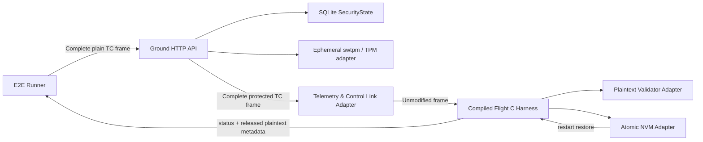

# TC 地面端到星载端端到端测试设计

本文是 [`CRYPTOGRAPHIC_TEST_DESIGN.md`](CRYPTOGRAPHIC_TEST_DESIGN.md) 的 TC 专项下位测试设计。所有 TC 测试必须先满足上位合同中的算法 KAT、独立差分、加固、证据和变更触发要求；发生冲突时以上位合同为准。

## 1. 目标与验收边界

本测试验证一条真实的 TC 处理链：测控向地面密码系统提交完整 TC 明帧，地面系统验证原帧、选择 SPI、派生密钥、分配 IV 并输出完整密帧，测控链路原样传输，编译后的星载 C 模块校验、解密、持久化状态，最后才向星务侧释放明文。

只有下列链路全部实际参与，才称为端到端测试：

```text
HTTP API -> 地面 CCSDS 应用服务 -> SQLite SecurityState/测试 TPM
         -> 完整密帧传输 -> 编译后的星载 C 模块
         -> 明文校验器 -> 原子 NVM 适配器 -> 明文或拒绝结果
```

主场景不得直接调用内部加密函数、直接修改数据库状态、跳过 FECF，也不得用测试代码重新实现一份星载解密算法来代替 C 模块。

当前共享测试向量仍保留，但它们属于快速的算法与字节级互操作测试，不等同于本设计中的进程级端到端测试。

## 2. 当前协议契约

普通 TC 使用 SM4-HCTR：

```text
TC Primary Header(5) | SPI(2) | IV Counter(4) | Ciphertext(N) | FECF(2)
```

Recovery TC 使用 SM4-GCM：

```text
TC Primary Header(5) | Recovery SPI(2) | IV Counter(4)
| Recovery Ciphertext(41) | Tag(16) | FECF(2)
```

职责固定如下：

| 模块 | 输入 | 输出或职责 |
| --- | --- | --- |
| 测控调用方 | 带合法帧长和 FECF 的完整 TC 明帧 | 调用 `POST /api/v1/tc:protect` |
| 地面密码系统普通 TC API | Base64 完整明帧 | Base64 完整 `Primary Header \| SPI \| IV \| Ciphertext \| FECF` 密帧 |
| 地面密码系统受控 Recovery 流程 | 主导头模板与换根事务 | 完整 Recovery GCM 密帧；Primary Header 与安全头均被认证 |
| 测控链路适配器 | 地面返回的完整密帧 | 原样传输并提供受控故障注入，不再组帧 |
| 星载密码模块 | 完整 TC 帧 | 状态码、普通明文；Recovery 消息不输出普通明文 |
| 星务适配器 | 解密明文 | 按测控团队提供的规则校验包格式和允许范围 |
| 星载 NVM 适配器 | 待提交状态 | 原子持久化；失败时不得释放明文或推进重放状态 |

普通 TC 的安全性依赖“HCTR 解密后严格校验，再持久化，最后释放”。HCTR 提供宽块扩散但不提供完整性认证，所以明文校验器不是可选组件。

重传合同固定为“再次保护、使用新 IV”：同一明帧每次调用 `tc:protect` 都分配新 Counter 并产生新密帧；密码系统不缓存密帧，也不实现 `Idempotency-Key`。测控链路重传同一逻辑帧时必须保持 TC 主导头中的帧序列号不变，星载 FARM/COP-1 或等价接收层负责阻止同一帧序列号重复交付。IV replay 只拒绝完全相同的旧密帧，不能替代帧序列号去重。

## 3. 测试架构



端到端测试采用一个深的 `TC E2E Harness` 模块隐藏环境启动、组帧、故障注入、C 进程通信、重启和报告生成。测试用例只表达业务动作和期望结果，不感知 SQL、密钥派生细节或 C 结构体布局。

建议接口：

```go
type Scenario struct {
    Name  string
    Steps []Step
}

type Report struct {
    Steps       []StepResult
    Assertions  []AssertionResult
    Measurements Measurements
}

func (h *Harness) Run(ctx context.Context, scenario Scenario) (Report, error)
```

Harness 内部只保留以下适配器：

- `GroundAdapter`：通过真实 HTTP 登录和 TC protect API 操作地面系统。
- `LinkAdapter`：只传输地面返回的完整密帧，并提供按位损坏、截断和错误长度等链路故障注入；不得重新组帧或重算正常业务帧的 FECF。
- `FlightAdapter`：启动并调用链接真实 `tc_security.c` 的 C harness 进程；后续上板时替换为串口或总线适配器。
- `FlightStateAdapter`：文件模拟的原子 NVM，支持提交失败注入、进程重启和状态快照。
- `FixtureAdapter`：只负责创建隔离租户、装载测试根密钥和清理环境，不参与业务断言。

不为未来协议增加通用插件层。当前唯一生产协议是 CCSDS；如果以后上板，只替换 `FlightAdapter`，场景和断言保持不变。

## 4. 隔离测试夹具

每次运行使用唯一租户和独立状态，例如 `tc-e2e-<run-id>`，不得复用开发环境当前租户或假定 IV 从 0 开始。

建议固定夹具如下：

| 项目 | 测试值 |
| --- | --- |
| 普通算法 | SM4-HCTR |
| Current | SPI `0x1001`，epoch 1，operational root v1 |
| Next | SPI `0x1002`，epoch 2，初始使用 operational root v1 |
| Recovery | SPI `0x7001`，SM4-GCM，recovery root v1，Tag 16 字节 |
| IV | 32 位单调计数器，由地面持久化分配 |
| 普通重放窗口 | 64 |
| 普通最大前跳 | 4096 |
| 最大 TC 帧 | 1024 字节 |
| Spacecraft ID | 测试固定值，地面组帧配置与星载配置必须一致 |

测试根密钥只允许通过编译标记或专用测试配置启用的 `FixtureAdapter` 注入临时环境。它必须在生产构建中不可达，不写普通日志，运行结束后删除 swtpm、数据库和星载 NVM 测试状态。

明文必须使用一组由测控团队确认的真实遥控包样例，并为每条规则提供“只错一个字段”的反例。在正式规则尚未交付前，可以使用明确标注为占位的严格规则，但占位规则不得作为发布验收依据。

## 5. 分层测试策略

### L1：共享向量与模块测试

目的：快速验证 Go 与 C 对同一根密钥、SPI、IV、派生上下文和帧字节得到一致结果。

- 每次提交运行。
- 使用当前 SM4-HCTR 与 SM4-GCM Recovery 共享向量，并单独校验 HCTR 整块和非整块标准向量。
- 覆盖 C 模块的 replay、FECF、持久化失败、Next promotion 和 Recovery authentication。
- 不声称覆盖 HTTP、数据库、TPM、并发 IV 分配或进程重启。

### L2：主机进程级端到端测试

目的：验证本设计第 1 节中的完整链路。

- 使用真实地面服务、临时 SQLite 数据库和独立 swtpm 状态目录。
- 使用编译后的 C harness 和文件 NVM 适配器。
- Pull Request 至少运行 P0；完整集合可按夜间任务运行。
- 输出 JUnit 和脱敏 JSON 报告。

### L3：硬件在环测试

目的：验证物理 TPM、目标编译器、星载板卡字节序、资源限制、实际 NVM 原子写和 120 ms 星务周期内的执行预算。

- 使用与 L2 相同的场景语义，只替换地面密钥适配器和 `FlightAdapter`。
- 作为版本发布门禁，不在普通开发提交中强制运行。

## 6. P0 端到端场景

### 6.1 普通 Current TC

1. 使用真实 API 加密一个合法 TC 数据域。
2. 断言返回安全数据的 SPI 为 `0x1001`，长度符合契约。
3. 链路适配器组完整帧并交给星载 C 模块。
4. 断言状态为 `OK`，释放明文逐字节等于输入。
5. 断言原子状态只提交一次，提交后 replay highest/bitmap 正确。
6. 再发送一条新指令，断言 IV 单调增加且两次 IV 不重复。

### 6.2 重新保护、重放与重启

1. 对完全相同的 TC 明帧再次调用 `tc:protect`，断言使用新 IV、完整密帧不同且原 TC 帧序列号不变。
2. 将第一次生成的完全相同密帧再次输入星载密码模块，期望 `REPLAY_REJECTED`。
3. 断言输出长度为 0、输出缓冲区不含上次明文、无新提交。
4. 重启星载 C harness 并从 NVM 恢复状态。
5. 再次重放第一密帧，仍期望 `REPLAY_REJECTED`。
6. 重启地面服务后生成新帧，断言 IV 不回退、不复用。
7. FARM/COP-1 集成测试证明第二次保护产生的新密帧不会因相同 TC 帧序列号被重复交付给星务；该断言属于星载 TC 接收层，不在密码模块内复制。

### 6.3 Next 自动一致化切换

1. 地面执行本地 Current -> Next 原子切换，使下一帧使用 `0x1002`。
2. 星载收到第一条合法 Next 帧，期望 `EPOCH_PROMOTED` 并释放明文。
3. 断言星载 Current 变为 `0x1002`/epoch 2，未来 Next 已派生，Next replay 状态已重置。
4. 再发送原 `0x1001` 帧，期望 `ASSOCIATION_NOT_FOUND`。
5. 重启星载后，断言新 Current 状态保持，合法的新帧可继续接收。

### 6.4 Recovery GCM 两阶段换根

1. 地面生成合法 Root Prepare Recovery 帧。
2. 星载期望 `ROOT_PREPARED`，持久化 pending operational root，但普通明文输出长度为 0。
3. 重发同一事务的有效重试，期望 `ROOT_ALREADY_PREPARED`，状态不重复推进。
4. 重启星载，确认 pending root 可恢复。
5. 地面切到用新 root 派生的 Next，发送第一条普通 TC。
6. 星载期望 `EPOCH_PROMOTED`，新 root 成为 Current root，pending root 被清除，明文正常释放。

### 6.5 持久化失败时不释放明文

1. 对一条全新合法帧注入下一次 NVM commit 失败。
2. 期望 `PERSISTENCE_FAILED`，输出长度为 0，输出缓冲区清零。
3. 断言内存和持久化 replay 状态均未推进。
4. 取消故障后重发同一帧，期望成功；这证明失败不会造成不可恢复失步。

### 6.6 HCTR 篡改必须被明文规则拦截

1. 修改普通 HCTR 密文中的一位，并重新计算正确 FECF。
2. 期望 FECF 通过，但明文校验失败并返回 `PLAINTEXT_REJECTED`。
3. 断言不释放明文、不提交 replay 状态。

这条用例必须使用测控团队提供的正式明文校验规则。HCTR 会把篡改扩散为整段不可控变化，但不能代替认证；该用例验证的是关闭式拒绝边界，不能只用“前两个字节固定”作为最终验收。

## 7. P0 拒绝矩阵

| 场景 | 期望状态 | 状态提交 | 明文释放 |
| --- | --- | --- | --- |
| 主导头声明长度与实际长度不一致 | `FRAME_LENGTH_INVALID` | 否 | 否 |
| 帧截断或超过 1024 字节 | `FRAME_LENGTH_INVALID` | 否 | 否 |
| FECF 损坏 | `FECF_INVALID` | 否 | 否 |
| 未配置 SPI | `ASSOCIATION_NOT_FOUND` | 否 | 否 |
| 重放已接收 IV | `REPLAY_REJECTED` | 否 | 否 |
| 普通 IV 前跳 4097 | `IV_FORWARD_JUMP_REJECTED` | 否 | 否 |
| 输出缓冲区过小 | `OUTPUT_TOO_SMALL` | 否 | 否 |
| 解密后包格式非法 | `PLAINTEXT_REJECTED` | 否 | 否 |
| NVM 原子提交失败 | `PERSISTENCE_FAILED` | 否 | 否 |
| Recovery Tag 篡改且 FECF 重新计算 | `AUTHENTICATION_FAILED` | 否 | 否 |
| Recovery 新版本、Next SPI 或 epoch 不符合事务约束 | `ROOT_PREPARE_REJECTED` | 否 | 否 |

所有失败用例还必须统一断言：输出长度为 0、输出缓冲区无残留明文、日志中没有根密钥/派生密钥/完整敏感明文。

## 8. P1 并发、边界和资源场景

- 32 或 64 个并发地面 protect 请求：所有成功响应的 IV 唯一，数据库中的 next IV 正确推进。
- 地面进程在 IV 分配前、分配后响应前分别终止：允许跳号，不允许重号或回退。
- 客户端不得自动重试一次已成功返回的 protect 请求；链路重传重新提交原明帧并保持其 TC 帧序列号。
- IV 接近 `uint32` 上限：达到耗尽边界后 fail closed，不环回。仅夹具初始化阶段可设置边界状态，业务断言仍必须走公开 API。
- 最小数据域、最大合法数据域和大一字节的数据域。
- Current、Next、Recovery 三条 replay 状态互不污染。
- 在一个 context 的校验回调中嵌套调用另一个 context，验证无可变全局状态；同一 context 并发由星务串行化，不作为库内锁语义。
- Recovery 密文、Tag、SPI、IV 和事务字段逐项单点篡改。
- C harness 使用 AddressSanitizer/UndefinedBehaviorSanitizer 运行全场景。
- 连续长稳测试记录内存峰值、每帧耗时和状态写次数。

## 9. 可观测性与报告

每个步骤至少记录：

- 场景名、运行 ID、步骤号和时间戳；
- 完整帧长度、帧 SHA-256、SPI 和 IV；
- 星载状态码、释放明文的长度与 SHA-256；
- commit 次数和 commit kind；
- 脱敏后的 Current SPI/epoch、pending 是否存在、replay highest/bitmap；
- 地面 protect 延迟、链路组帧延迟、星载 receive 总耗时及持久化耗时。

报告不得记录根密钥、派生密钥、TPM 授权值、登录凭据和完整敏感指令。测试失败时保存帧可以使用 Base64，但需要测试数据明确为非敏感样例。

性能验收暂不硬编码一个臆测值。总星务周期为 120 ms，项目应先给星载“校验 + 解密 + 原子提交”分配明确预算。Harness 支持 `TC_E2E_FLIGHT_BUDGET_US`；未配置时只报告分位数，配置后把 p99 和最大值纳入门禁。

## 10. 执行与门禁

一次 L2 执行的顺序固定为：

1. 创建唯一运行目录、租户、数据库和 swtpm 状态。
2. 通过测试夹具装载同源 operational/recovery roots 和固定安全关联。
3. 启动地面服务并等待 health、readiness 和 CCSDS association 为 READY。
4. 用 `-std=c11 -Wall -Wextra -Wpedantic -Werror` 编译 C harness；CI 调试任务额外启用 ASan/UBSan。
5. 顺序运行 P0；并发和长稳测试单独运行，避免干扰确定性场景。
6. 执行地面和星载重启用例。
7. 生成 JUnit、JSON 摘要和失败工件。
8. 清除数据库、swtpm、星载 NVM 和临时凭据。

PR 门禁要求：所有 P0 通过、无 sanitizer 错误、无密钥泄漏、失败路径均满足“不提交、不释放”。发布门禁还要求 L3 在物理 TPM 和目标星载板卡通过。

## 11. 已闭环的架构入口与硬件验收余项

### 11.1 星地同源测试密钥装载

`ccsds-provision` 只接受与编译变体匹配的严格 Mission Security Profile：默认 TC-only 只导入 Current/Next/Recovery Root；`-tags downlink` 变体额外导入独立的 8 槽下行 KEKSet。两者均生成星载初始 NVM 镜像、Recovery Root Prepare 完整帧和哈希证据。运行时仍不存在明文密钥导出接口。

### 11.2 地面 epoch 切换的生产编排入口

地面状态闭环固定为 `PREPARED -> SWITCHING -> ACTIVE`：Recovery 帧生成后持久化 PREPARED，原子提升进入 SWITCHING，首个 Next-SPI 完整密帧生成后进入 ACTIVE。该证据只代表地面发送侧，不冒充星上接收确认，也不生成额外链路指令。

### 11.3 Recovery 帧生成入口

普通测控 API 仍只接收带有效 FECF 的完整明文 TC 帧。Root Prepare 由离线 Mission Security Profile 强类型生成，Harness 消费同一个 `root-prepare.tc` 制品，不允许测控调用方传入 root、SPI、IV 或事务字段。

### 11.4 正式明文校验规则

密码系统无法判断一条业务指令是否危险，但星载端必须在 HCTR 解密后识别“结构上合法的遥控包”。必选校验合同、星务适配 seam、规则表输入和反例矩阵统一定义在 [`TC_PLAINTEXT_VALIDATION_DESIGN.md`](TC_PLAINTEXT_VALIDATION_DESIGN.md)，本测试设计不复制另一套字段规则。

端到端测试必须链接星务生产校验实现，并至少覆盖固定 TC 主导头、唯一未分段 Space Packet、长度精确一致、`VCID -> APID -> 指令码` 白名单、参数范围、保留位和填充。测试桩中的 `CA FE` 魔数只能用于底层 C 模块机制测试，不能进入 L2/L3 或发布验收。任务级规则表及其正反样例未冻结前，HCTR 篡改用例不得标记为安全验收完成。

### 11.5 真实板载适配器

通用 C 模块已提供固定长度双槽 NVM codec，覆盖字节序、CRC32C/inverse、最高有效 generation 选择、掉电半写回退、位翻转和回滚 floor。发布前仍必须在目标 BSP 验收物理擦写、读回、可信 generation floor、时间预算和输出缓冲区管理。

## 12. 完成定义

满足以下条件后，可认为地面到星载 TC 加解密已完成生产前端到端验证：

- P0 场景全部通过，Current、Next 自动切换和 Recovery 两阶段换根形成闭环；
- 任意校验、认证、重放或持久化失败均不会释放明文或推进状态；
- 地面并发与重启不会造成 IV 重用；
- 星载重启不会遗忘已接受帧或 pending root；
- HCTR 篡改能被正式遥控包规则拒绝；
- SM4-HCTR 普通链路和 SM4-GCM Recovery 链路均使用真实生产代码；
- 物理 TPM 与目标星载板卡的硬件在环测试满足已分配的执行时间和资源预算。
