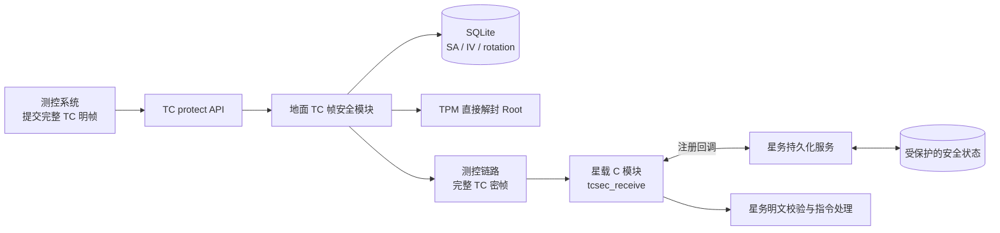
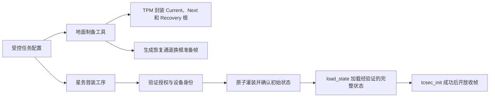
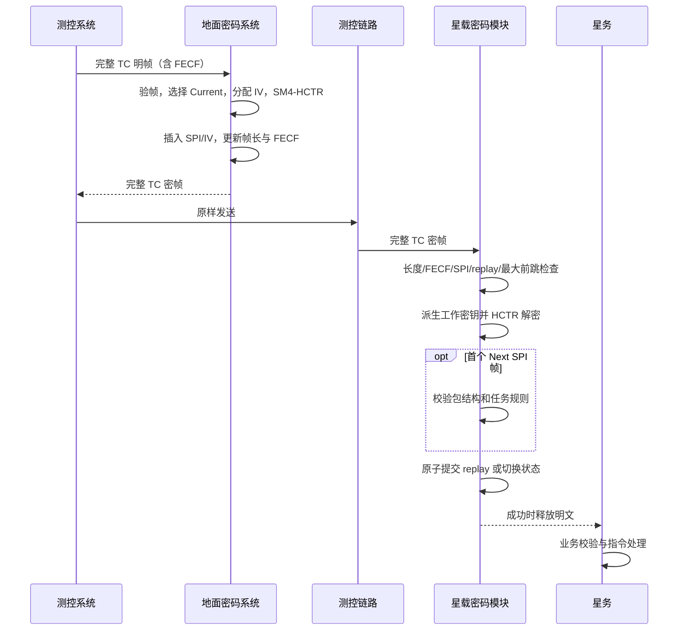

# TC 地面—星载架构与流程

## 架构



星载模块不感知租户、TPM、数据库、HTTP、审批、人员权限、下行密钥或地面密钥生命周期。它只感知 TC 帧结构、Current/Next/Recovery、派生上下文、重放状态、FECF、Next 明文校验和原子持久化结果。

明文规则来自测控团队冻结的遥控包 ICD，由星务提供任务规则并在构建时链接到密码模块。必选规则与职责以 [TC_PLAINTEXT_VALIDATION_DESIGN.md](TC_PLAINTEXT_VALIDATION_DESIGN.md) 为准。

## 配置、装星与轮换

星地使用同一份受控任务配置。地面 `ccsds-provision` 将 Current、Next 和 Recovery 根密钥封装到 TPM，输出完整的恢复通道换根准备帧及哈希证据。地面制备证据版本为 2，记录任务配置摘要和恢复帧哈希。

### 星载首装与运行恢复

首装在受控的装星工序中完成。星务的首装工具确认装星授权和目标设备身份，验证配置来源与完整性，并通过受保护的通道交付每星根密钥。配置绑定任务、设备及版本。编译产物可携带公开的格式版本、公开验证材料和任务参数。生产根密钥由受控工序灌装。

首装事务写入完整的初始状态并读回验证，其中包含 Current 和 Recovery 根密钥、SPI、初始安全代次、空重放窗口及任务配置摘要。Next 根通过已认证的换根准备事务交付。星务需要在可信持久状态中记录首装是否完成。首装过程中断时，由受控工序根据已提交记录完成或回收事务。已服役设备的状态缺失、损坏或回退时停止收帧，进入授权恢复流程。



首装载体、信任锚和工装由星务接口设计确定。验收覆盖错误设备、签名或配置损坏、首装重复执行、灌装中断，以及服役后状态回退。装星记录只保留设备标识、配置摘要和结果。

地面轮换状态为 `PREPARED → SWITCHING → ACTIVE`。星上收到首个合法 Next SPI 密文后自动提交 Pending Root，不新增测控链路管理指令。普通接收槽只有 Current/Next/Recovery，不存在 Previous 或 Grace。

## 普通 TC 加解密



## 星载最小公开接口

```c
tcsec_status_t tcsec_init(tcsec_context_t *context,
                          const tcsec_callbacks_t *callbacks);

tcsec_status_t tcsec_receive(tcsec_context_t *context,
                             const uint8_t *frame,
                             size_t frame_length,
                             uint8_t *plaintext,
                             size_t plaintext_capacity,
                             tcsec_result_t *result);

tcsec_status_t tcsec_reset(tcsec_context_t *context);

tcsec_status_t tcsec_get_runtime_status(const tcsec_context_t *context,
                                        tcsec_runtime_status_t *status);

```

每个独立接收状态机使用一个 `tcsec_context_t`。模块无可变全局状态，不同 context 可并发；同一 context 必须由星务串行调用，回调不得重入同一 context。`tcsec_init` 注册星务提供的回调。`tcsec_reset` 沿用已注册的 `load_state` 重载完整持久化快照，失败时暂停收帧，成功后恢复。

### 星务接口与掉电一致性

星务入口收敛为 init、reset、receive 和运行状态查询。上下文采用 512 字节
不透明存储对象，私有成员不进入交付头文件。交付采用公开 .h 与目标 .a，
正式任务规则由模块开发侧编译进库。

星务存储回调负责三个独立区域和受保护的原子防回退提交锚。提交时保留旧记录，
写完并验证三份新记录后发布锚。恢复时从锚指定的记录中取得完整多数并修复，
不能从不同版本拼接字段，不能退回旧多数。密码模块只在确认安全提交后交付明文，
星务通过业务事务号与执行记录处理安全提交和业务执行之间的掉电窗口。
详细约定见星务接口手册第 3 节和附录 B。
