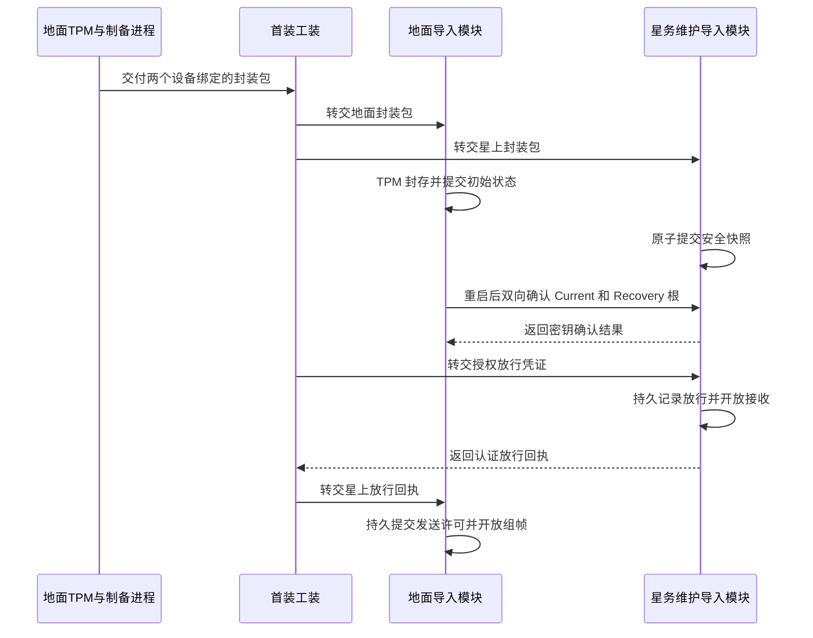

# TC 根密钥首装设计

状态：软件参考实现与目标平台集成要求。现行遥控帧、运行态回调及接口见[星地架构](TC_GROUND_FLIGHT_ARCHITECTURE.md)和[星务接口手册](FLIGHT_INTERFACE_MANUAL.md)。

## 1. 首装对象与职责

地面主机的物理 TPM 2.0 是地面硬件信任锚。授权制备进程通过 TPM `GetRandom` 取得根密钥材料，在受控内存中组包并清理临时数据。星地使用同一把 16 字节 Current 业务根和同一把独立的 16 字节 Recovery 根。地面生产封装包同时制备 Next 根，星上通过运行期 Recovery 换根流程接收它。首装时星上没有待生效根，运行模块按现行规则派生工作密钥。

| 角色 | 职责和权限 |
| --- | --- |
| 密码模块设计者 | 设计和验证密码操作、接口及异常处理。开发环境使用专用测试向量。生产签名、设备维护和密钥管理权限由独立角色持有。 |
| 地面测试人员 | 经测试授权通过有线维护口发起联试，读取测试结果。实星联试根由受控设备制备，测试人员使用密码操作接口。 |
| 业务使用者 | 通过授权接口使用密码服务，查询允许公开的版本、关联及运行状态。 |
| 首装审批人与操作员 | 分别审批、执行指定设备的首装。人机界面提供任务、设备、版本、事务、结果和审计号。 |
| 地面主机 TPM | 为授权制备进程提供随机材料，封存地面根。正式签名和地面导入私钥使用独立 TPM 对象，须在目标主机注册并验证其授权策略。 |
| 地面授权制备进程 | 验证绑定任务与设备的一次性授权，向本机 TPM 申请随机材料，为星地组包并请求签名，输出密文封装件和审计记录。 |
| 首装工装 | 核验台账和在线设备身份，转交封装包，协调验收与续办。工装只获得密文包和状态回执。 |
| 地面导入模块、星务维护导入模块 | 验证封装包、解封并提交本地设备状态。地面通过 TPM 封存根。星务通过 BSP 实现受保护存储和可信提交锚。 |

生产密钥明文仅在授权设备及其受控进程内处理。生产账号应限制源码调试、任意代码执行、内存转储、日志配置和存储读取。导入程序和星务固件由独立角色审批签名。设备须验证运行版本，生产导入凭据的使用权限须绑定到经授权的软件或等效的隔离机制。仅限制界面显示无法约束具有进程或设备调试权限的人员。

| 控制 | 地面主机落实 | 星务落实 |
| --- | --- | --- |
| 设备身份 | 从机密设备台账和 TPM 持钥证明校验主机身份与导入公钥。封装包绑定本机公钥的 SHA-256 指纹。 | 以受保护的设备凭据核对在线板卡及其导入公钥。设备序列号只用于展示和定位。 |
| 软件签名和密钥授权 | 生产制备服务使用独立账户。部署审批验证签名和版本。目标机验证启动及运行软件的完整性，并将 TPM 签名、导入和封存对象的使用权限绑定到批准状态。 | 安全启动验证维护程序和运行镜像签名及允许版本。生产导入凭据只允许授权程序使用。 |
| 权限隔离 | 开发者使用开发环境，审批与操作职责分开。控制生产账号登录、TPM 设备访问和进程控制权限。 | 有线维护会话验证工装身份和操作授权，生命周期门控测试、导入、业务入口。 |
| 调试限制 | 生产账号禁止附加调试器、读取制备进程内存、生成转储或替换已审批程序。验证 TPM 通路暴露范围。 | 关测时关闭测试诊断、撤销测试凭据，正式导入前由 BSP 验证调试锁定和持久化状态。 |

## 2. 地面测试、关测与生命周期

星务维护软件提供三项操作，分别用于安装封装的测试根、查询测试状态和关闭测试。地面通过实际 TC 链路发送测试帧，星上利用正常收帧路径验证认证、解密、重放和状态恢复。测试根、设备导入凭据、信任配置、SPI 和计数状态使用独立的测试命名空间。每套实星联试根由受控设备随机生成，绑定板卡及联试任务，使用设备绑定的封装件安装。测试人员查看测试项和结果，维护接口不提供原始密钥读取、任意内存读写或代码装载。正式根在关测完成后才允许制备交付。

| 生命周期状态 | 允许的维护动作及业务条件 |
| --- | --- |
| `FACTORY_TEST` 地面测试 | 在受控有线维护口验证测试授权后允许导入测试包、查询与关闭测试。开放本次联试所需的测试帧路径。生产导入关闭。 |
| `TEST_CLOSING` 正在关测 | 原子写入可信状态后关闭测试接口、测试收帧和调试访问，结束在途会话。受控清理程序删除测试根、派生材料、测试计数及所有持久副本，吊销旧测试授权，或销毁测试存储的专用封装密钥并验证密文已无法恢复。两类导入均关闭，工装只查询清理结果。 |
| `READY_FOR_COMMISSIONING` 待正式首装 | 断电重启复核清理结果和测试入口关闭证据。设备生成认证关测回执，绑定设备身份、防回退状态及测试事务。只有经验证的关测回执才能启动生产首装。 |
| `COMMISSIONING` / `INSTALLED_LOCKED` 正式导入与待放行 | 仅开放受控正式导入和验收操作。测试入口关闭，正式业务关闭。 |
| `OPERATIONAL` 正式运行 | 关闭测试、首装导入及相应调试权限。开放正式 TC，密钥更新使用已认证的 Recovery 流程。 |

生命周期记录独立于可擦除的测试区及运行态 NVM，从 `TEST_CLOSING` 起不可回退至测试状态。关测中掉电时继续清理，生产导入须等验证完成，擦除、恢复旧备份或重启均不会重开测试入口。生命周期记录不可验证时，两类导入和业务保持关闭。关测在星上关闭实际入口，地面也撤销测试工装和测试账户的访问权限并清理本地测试材料。星地联试、正式导入及在轨业务各自核验相应的授权用途。

## 3. 设备注册与交付物

地面主机和星载板卡各持有设备专属导入私钥。优先由 TPM 或板级安全器件生成并保管。台账校验设备身份、导入公钥的归属和设备持钥证明，并绑定任务与星载 `spacecraft_id`。`spacecraft_id` 是 TC 协议编号，硬件身份来自受信设备凭据。星务通过受控有线维护口接入，工装在传送前验证实际在线的目标设备。

| 交付物 | 内容与校验 |
| --- | --- |
| 任务清单 | 包含任务标识、星地设备标识、`spacecraft_id`、根版本、初始 SPI、安全代次、Nonce 前缀及清单格式版本。使用确定的规范编码计算摘要。运维界面按权限展示其中的字段。 |
| 地面密钥封装包 | 使用地面设备的导入公钥封装 Current、Recovery 和 Next 根。与地面任务清单和导入授权一并验证。 |
| 星上密钥封装包 | 使用星载板卡的导入公钥封装 Current 与 Recovery 根。包的签名覆盖事务号、任务清单摘要、目标设备和导入公钥标识、根用途与版本、包版本及密文。 |
| 首装验收回执 | 由授权设备或受信维护会话认证产生，绑定本端设备、事务、清单摘要、提交状态和验收结果。审计只记录必要标识及结果。 |

两个封装包遵循同一套签名绑定规则。主机参考实现采用 [RFC 9180 HPKE Base 模式](https://www.rfc-editor.org/rfc/rfc9180.html#appendix-A.3)，套件为 `DHKEM(P-256, HKDF-SHA256)`、`HKDF-SHA256`、`AES-128-GCM`。用目标设备的公钥封装，设备持有的导入私钥用于解封。制备方使用独立的 ECDSA P-256/SHA-256 签名密钥，签名编码为 ASN.1 DER。公钥封装提供接收端保密性，制备方签名提供来源认证和内容完整性。

参考实现将常量 `TC-ROOT-ENVELOPE-V1`、一个 `00` 字节、单字节用途码和四个 32 字节字段拼接为绑定字节串。用途码 1、2、3 分别表示测试根、地面生产根和星上生产根。四字段依次是任务清单摘要、设备身份标识、P-256 未压缩导入公钥的 SHA-256 摘要、事务号。绑定字节串同时用作 HPKE `info` 和 AAD。签名摘要为 `SHA256("TC-ROOT-ENVELOPE-SIGN-V1" || 00 || 绑定字节串 || enc || ciphertext)`。根按 Current、Recovery、Next 顺序拼接，只有地面生产包包含 Next，每根 16 字节。版本和用途通过清单绑定和固定字段顺序校验。接收端从可信授权构造绑定字段，验证生命周期、身份、授权和签名后调用导入凭据。测试和生产使用各自固定的可信签名公钥。该基线须经正式任务密码要求和目标设备验证后冻结，维护链路的传输编码由地面与 BSP 联合确定。

## 4. 首装与放行

1. **登记并审批。** 工装校验目标地面主机及板卡身份，核对设备可信状态及认证关测回执。审批绑定任务、设备、清单摘要、根版本和唯一首装事务号。需要重发时沿用同一事务及根集合，由授权制备进程从 TPM 保护的记录恢复对应材料。
2. **本地安装，业务保持关闭。** 两端先写受保护的首装事务记录，再验证和解封各自的包。地面先在 SQLite 提交 TPM 封存对象、关联参数和事务绑定，再推进一次性 TPM NV 暂存锚。重启后核对已提交记录和锚，初始发送计数在后续认证放行时发布。星务完整写入受保护快照，读回校验三份候选记录，再推进可信提交锚。初始安全状态包含空重放窗口、零验证预算、无 Pending 状态及相同的任务清单摘要。密钥明文和中间缓冲区在各处理路径结束时清理。
3. **断电后再核验。** 地面按正常启动路径加载本地记录。星务启动后在维护模式下用 `tcsec_init` 及 `load_state` 核验已提交快照，业务入口保持关闭。两端只使用重启后实际加载的 Current 和 Recovery 根完成双向密钥确认。分别派生专用确认密钥，确认消息绑定随机挑战、双方身份、事务号、任务清单摘要、根用途和确认方向。确认使用独立的用途域，避免推进生产计数、重放窗口和验证预算。操作员查看每种根的确认结果，确认报文由设备处理。[NIST 密钥确认](https://csrc.nist.gov/glossary/term/key_confirmation)
4. **先放行星上，再放行地面。** 两端提交证据和密钥确认均有效后，由授权方发布绑定本事务的放行凭证。星上持久记录放行后开放收帧并返回认证回执。地面收到匹配回执，持久提交发送许可后开放正式组帧。回执丢失时查询同一事务的已提交结果。工装无需读取根密钥，也无需注册密码模块的运行回调。

## 5. 首装判定与掉电恢复

设备出厂登记提供可验证的 `未首装` 证明。首装记录独立于运行快照，并由可信设备状态或可信台账提供防回退依据。读取和续办须核对事务、清单摘要和可信锚。每端在断电重启后从已提交状态继续，工装只协调流程并查询结果。

| 持久状态或中断点 | 恢复动作 |
| --- | --- |
| 已确认 `未首装` 且已进入 `READY_FOR_COMMISSIONING` | 使用有效授权开始新事务。空或不可读的 NVM 进入核查流程。 |
| `首装中`，本地提交未完成 | 保持业务关闭。只允许经授权续办同一事务。依据可信锚处理未提交副本，重新完成本地写入。 |
| `已安装待放行`，确认中断 | 保持业务关闭。重启后从已提交快照重新发起新挑战。保持根、代次、初始计数及预算原样。 |
| 星上已放行，地面尚未收到回执 | 地面继续关闭发送。重取星上的认证回执并完成地面放行。 |
| `已放行`，快照完整且未回退 | 按运行期规则恢复。对同一首装事务的重复请求仅返回状态或原有回执。 |
| `已放行`，快照丢失、回退或设备更换 | 停收或停发，发起独立授权的恢复流程。无法可信恢复计数、重放或短标签验证预算时，必须建立新的密码状态，并确保旧工作密钥及计数空间不会被重新启用。 |
| 记录缺失、损坏、冲突或来源无法验证 | 停止业务和灌装。核查独立设备台账，按可信的设备生命周期状态处置。 |

## 6. 在轨密钥保护

地面以 TPM 封装形式持久保管根密钥。星务从受保护 NVM 加载根与安全状态，经回调交给星载密码模块。工作密钥由授权软件在受控内存中派生、使用和清理。人员通过业务或运维接口获得状态、版本和操作结果。测试与首装入口已按生命周期关闭。运行期根更新通过独立 Recovery 密钥认证和加密后交付，由星务原子保存。板上正式私钥和根材料的使用须由安全启动、调试限制和存储访问控制共同约束。

## 7. 实施分工与验收

本仓库的 `internal/commissioning` 提供软件参考实现，覆盖阶段迁移、权限判定、允许阶段的授权导入、HPKE 封装、签名校验和短期明文清理。原生 TPM 提供 `FillRandom`，调用方可作为受控制备的随机来源。平台必须实现记录鉴别、反回退、验证授权和证据、读写串行化以及提交确认。参考实现的主机测试使用测试凭据和内存记录。地面命令接线、TPM 签名和导入对象授权、星务维护协议、安全启动、调试锁定、实物掉电及关测回执还需目标平台集成验证。

地面命令已接入非秘密清单、设备绑定的地面封装、签名安装授权及 TPM 导入对象。三份封存根和关联参数进入本地暂存记录，并由一次性 TPM NV 锚绑定。待集成项包括设备台账登记、关测回执签发和验证、密钥确认、认证放行和运行关联发布。星务维护导入、受保护存储提交及真实掉电也须在目标 BSP 验收。

### 地面导入文档与签名

版本 3 任务清单只含地面接口手册所列字段，清单摘要为 Go `encoding/json.Marshal` 规范输出的 SHA-256。字段按手册次序写入，顶层为 `format_version, mission_id, tenant_id, spacecraft_id, tc`，`tc` 内依次为 `current_spi, security_epoch, current_root_version, next_root_version, nonce_prefix_hex, recovery_spi, recovery_root_version, recovery_nonce_prefix_hex`。两个十六进制前缀先转小写，规范输出无多余空白。

| YAML 文档及版本 | 字段 |
| --- | --- |
| 本地登记 2 | `format_version`、`node_id`、`tenant_id`、`device_id_hex`、`recipient_key_id_hex`、`import_handle`、`import_object_name_hex`、`storage_object_name_hex`、`stage_anchor_index`、`stage_anchor_name_hex`、`envelope_issuer_p256_hex`、`install_authority_ed25519_hex`。设备 ID 和接收公钥指纹各 32 字节，TPM Name 各 34 字节，锚索引为 TPM NV 句柄，签名验证公钥分别为 65 字节未压缩 P-256 点及 32 字节 Ed25519 公钥。 |
| 地面封装包 1 | `format_version`、`enc_hex`、`ciphertext_hex`、`signature_der_hex`。三个二进制字段分别为 65 字节封装公钥、64 字节认证密文、ECDSA DER 签名。 |
| 安装授权 2 | `format_version`、`transaction_id_hex`、`closure_receipt_sha256`、`expires_unix`、`signature_hex`。事务号和关测回执摘要各 32 字节，有效期为 UTC Unix 秒，签名为 64 字节 Ed25519。 |

安装审批方在核验关测回执及操作授权后签发安装授权。签名原文按顺序拼接 ASCII `TC-GROUND-INSTALL-V2`、一个 `00` 字节、第 3 节定义的地面封装绑定字节串、`SHA256(enc || ciphertext || DER 签名)`、关测回执的 SHA-256、34 字节未写入态 TPM NV Name、8 字节大端截止时间。签名和截止时间通过才允许导入。暂存去重绑定对相同原文去掉末尾截止时间后计算 SHA-256。操作员可在同一受保护事务内续办，收到暂存成功后须完成冷启动确认和认证放行才能发送。

### 地面一次性暂存锚

登记方在批准的 TPM/PCR 基线上定义一个 32 字节 SHA-256 普通 NV 索引，使用空读授权值。索引属性固定为 `PLATFORMCREATE | POLICY_DELETE | POLICYWRITE | WRITEALL | AUTHREAD | NO_DA`。写策略按 `PolicyPCR`、`PolicyCommandCode(TPM2_NV_Write)`、`PolicyNvWritten(false)` 顺序计算。定义时登记未写入态的 Name。写后 TPM 的 `WRITTEN` 位置位，应用核对规范化 Name，并通过绑定登记存储主密钥的带盐会话认证读回。策略控制写入次数及长度。删除保护阻止以重建同一索引回退首装状态。登记程序须将索引分配及恢复纳入设备台账。[TCG TPM 2.0 规范](https://www.trustedcomputinggroup.org/resources/documents/tpm-library-specification)

锚保存 `SHA256("TC-GROUND-STAGED-V1" || 00 || 事务号 || 暂存去重绑定 || SHA256(暂存记录字节))`。SQLite 事务先落盘。若 TPM 尚未写入，续办时重新验证授权和封装、解封候选根并逐项比对首装根和关联参数，再写锚。若 TPM 已写入，必须有与锚完全一致的暂存记录，直接复核原承诺。TPM 写入回执丢失时复核认证读回。缺失、分叉或回退时保持停发，转入受控核查。该锚绑定首装暂存，运行态和放行还需各自的可信提交依据。

| 验收项 | 最低预期 |
| --- | --- |
| 设备、用途和版本绑定 | 错板、换公钥、包互换、篡改、过期授权、重复事务及跨事务混用均经过测试。重复完成的事务没有重置状态的副作用。 |
| 人员与明文隔离 | 设计者和首装操作员的真实账号验证无权读取生产明文、附加调试器、导出内存或自行替换导入程序。检查文件、控制台、界面、日志和诊断产物。 |
| 测试隔离与不可逆关测 | 测试包无法通过生产授权，关测前生产包被拒绝。关测途中掉电持久关测状态，重启继续。关测后测试凭据、导入、业务帧及调试入口均不可用。验证恢复旧备份、重复关测、残留副本和并行测试会话。 |
| 真实掉电 | 覆盖星上副本写入、提交锚更新、地面 TPM 封存与数据库提交、星上放行及地面确认各窗口。逐项检查旧状态、新状态和不可确认状态的处置。 |
| 星地一致性 | Current 或 Recovery 错根均阻止放行。正确根通过重启后的双向确认。确认旧报文无法用于新挑战。两端放行后验证真实地面加密和星上认证解密。 |
| 首装与丢失可区分 | 物理擦除运行区、回退备份或换板时，旧授权无法将服役设备恢复为初始计数。独立台账及可信状态可用于确认处置依据。 |

实现和验证按[项目密码测试设计](CRYPTOGRAPHIC_TEST_DESIGN.md#11-变更触发矩阵)执行。角色划分参考 [NIST 密钥管理组织最佳实践](https://csrc.nist.gov/pubs/sp/800/57/pt2/r1/final)。
